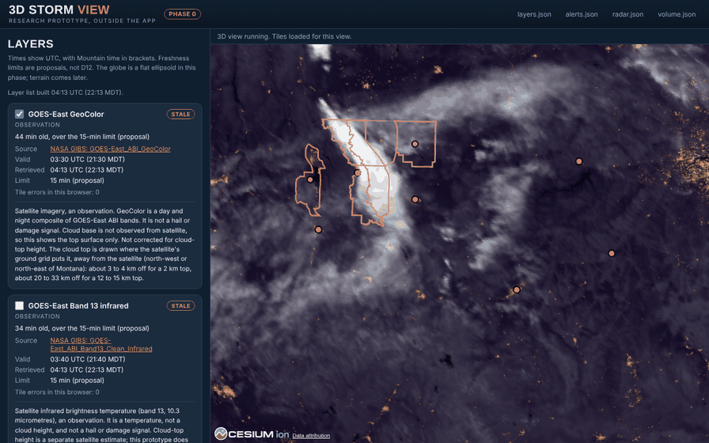
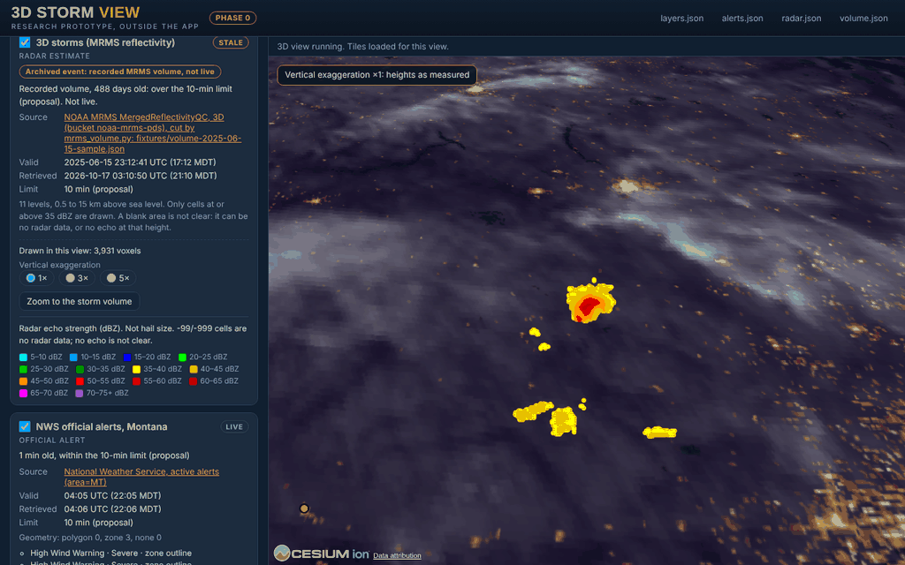

# 3D storm view (globe) — research scaffold

Status 2026-10-17 · branch `codex/montana-weather-pilot`, with `main` merged in at 195d68c · **research only; nothing ships.** The product is now the Montana Hail Watch website (D27). Merging this branch to `main` publishes the site (AGENTS.md:56), and nothing here touches `website/`. The branch carries open pull request #2, an earlier Montana pilot, so `research/globe/` can move to a fresh branch from `main` if you prefer. Sections 1–7 are this plan and replace the desktop-era version. Sections 8 onward hold the evidence; each fact there names its file in [validation-evidence](validation-evidence/). A file with a `review` key is reviewed and its review wins over its facts; the other files are marked unreviewed. Carson decides: §2 lists each choice with its default. docs/DECISIONS.md D30 records this research; the proposed entries GP-1 to GP-11 (§9b) wait for Carson. Decision 2026-10-17: Carson chose route (a), the staged route (§6).

## 1. Bottom line

1. **What was asked.** "A version of Google Earth with holographic imagery for clouds and storms." "Holographic" stays his word for the goal; no screen uses it. The UI name is decision D-G6.
2. **What it is, in the website's terms.** Pictures and layers written into the site by the 10-minute build (`.github/workflows/website.yml:15`; `website/build.py`): clouds as a satellite picture (an observation) and an estimated cloud-top height (a satellite estimate, top only); storms as MRMS reflectivity (a radar estimate). Python builds every value and word; the browser draws and takes input (AGENTS.md rule 4).
3. **The hard limit.** The browser may fetch only site files (`tests/test_site.py:459-471`; `website/static/map/map.js:9`). Streamed worldwide imagery, the Google Earth look, needs that rule changed (D-G15; design D calls it D-G1). Without it, a Montana-box globe can show a basemap raster (150,000 B budget), 3DEP terrain (105,000 B as uint16 on a 0.05° grid, computed: 150 × 350 × 2 B), the GOES Band 13 picture, cloud-top heights and MRMS volumes. A hand-built Montana orthoimage would be 0.47 MP at 1 km a pixel and 4,727 MP at 10 m (computed: 518 × 912 km, [design-d.json](validation-evidence/design-d.json) s4); neither gives the street detail the ask implies.
4. **Two routes.** (a) Staged, chosen 2026-10-17 (recommended by the synthesis): storm layers on the Map page first (P1–P6: text values, a Band 13 picture, cloud-top classes, an echo-top raster, MESH only if its units are verified, a two-hour loop), then a link-only three.js globe (PG) after P1–P4 pass and Carson approves a library (OW-1). (b) Direct: design D's globe page now. The table below gives first-visit bytes, build bytes, JavaScript, what each delivers of the ask, and what must change.
5. **Settled facts.** The inputs are free and reachable from the Actions runner: 41 of 42 website runs succeeded ([judge2-engineering.json](validation-evidence/judge2-engineering.json), facts_rechecked). Measured: the live build writes 3,926,457 B in 91 files and downloads 45,673,824 B in 198 requests ([main-architecture.json](validation-evidence/main-architecture.json)). The GOES file banner is an open licence question (OW-11). Not settled: the meanings of MRMS -99 and -999 (the NSSL table returned HTTP 503, [mrms.json](validation-evidence/mrms.json)), MESH units (likely mm), and the ACHA height datum.
6. **What the prototype proved in a real browser.** Headless Chromium 141 on SwiftShader, a CPU renderer and not a GPU: 206 offline unit tests pass (two live-only skips) and 7 browser tests pass, after the fix-ups (§11); the canvas is 99.4–99.5% non-black at 900 × 720; a GOES toggle changes 87–88% of canvas pixels; at 390 px there is no sideways scroll; a blocked library shows "3D view could not load" and the layer panel still works ([prototype-globe.json](validation-evidence/prototype-globe.json); [prototype-integration.json](validation-evidence/prototype-integration.json)). Not proved: frame rates, real phones, WebGL2 on iOS or Android, or the vendored three.js route. The prototype loads CesiumJS from a CDN, which AGENTS.md rule 4 does not allow on the site. Under the 15-minute GOES proposal its GOES layers were stale at every check, 28–50 min behind.
7. **Gates from the roadmap.** Next 1 closes when two scheduled runs in a row publish (`docs/ROADMAP.md:36-40`). Measured gaps between scheduled starts on `main` were 151.5, 141.6 and 264.5 min: four starts (19:42, 22:14, 00:35 and 05:00 UTC) span 9.3 h (computed: 557.6 min), median gap 151.5 min. Measured from the Actions API; a 05:13Z `gh run list` in [design-synthesis-website.json](validation-evidence/design-synthesis-website.json) gives the same gaps, and the supervisor re-checked at 05:50 UTC. An earlier two-gap median of 146.5 min is in [judge2-engineering.json](validation-evidence/judge2-engineering.json) K1. Next 4 says to predeclare metrics before any new feed is added (`docs/ROADMAP.md:47-49`). Next 2 is the feedback week; freezing Map and Now until it closes is the synthesis's proposal (OW-8), not roadmap text. Next 8 (text version), Next 9 (JavaScript) and Next 11 (MESH) meet P1, the browser caps and P3.
8. **Names and rules.** Any name needs the D26 trademark check before print and must avoid HailTrace (`docs/DECISIONS.md:310-312`). Rule 5 says invented data is labelled DEMO; the site labels it SAMPLE (`website/templates/base.html:16-18`), which is decision OW-12. No provider or library is judged on quality (AGENTS.md rule 9).
9. **Scores by lens, 0 to 10, not combined** ([design-synthesis-website.json](validation-evidence/design-synthesis-website.json)). Rules: D 7, C 6. Engineering: C 8, D 6. Product: C 5.4, D 4.5. Owner ask: D 7, C 3, because C has no globe.
10. **Carson decides, in this order.** (1) Is a 3D view still wanted after D28, the last recorded map instruction ("a working interactable map of montana that looks like this", `docs/DECISIONS.md:359-361`)? (2) OW-18, the schedule. (3) OW-1, the library and globe page. (4) OW-8, the freeze. (5) OW-10 and OW-11, counsel on NOAA publishing and the GOES banner. (6) OW-12, the label. (7) OW-14, radar staleness. (8) OW-20, whether storm views may reach homeowners, adjusters or insurers.

### Routes side by side: route (a) chosen 2026-10-17

| | (a) Staged (synthesis) | (b) Direct (design D now) |
|---|---|---|
| What is built | P1–P6 on the Map page; PG, a link-only globe, only after P1–P4 pass | `globe.html`, a fifth page: Band 13 drape (ph. 1), terrain and cloud tops (ph. 2), 11-level volumes (ph. 3), a loop (ph. 4) |
| First visit, wire | about 0.85 MB (computed: 282,836 Map + 420,000 frames + 150,000 Band 13 B); about 0.95 MB on design C's own budget ([judge2-engineering.json](validation-evidence/judge2-engineering.json) K6) | about 0.69 MB without the Earth texture (computed: 685,194 B), about 1.1 MB with it (+400,000 B); design D's raw total is 2.8 MB ([design-d.json](validation-evidence/design-d.json) s3) |
| Built per run | +570,000 B (computed: 420,000 + 150,000); site about 4.5 MB against 3.93 MB today ([design-synthesis-website.json](validation-evidence/design-synthesis-website.json)) | about 7.9 MB per build (computed; [design-d.json](validation-evidence/design-d.json) s3) |
| Downloaded per run | +10.6–14.7 MB (computed: 4.2 GOES, [goes-aws.json](validation-evidence/goes-aws.json), plus 6.4–10.5 MRMS 11 levels, [pipeline-options.json](validation-evidence/pipeline-options.json)) | about 60.5–64.6 MB per build (computed: 45.7 today + 6.4–10.5 MRMS + 4.5 ACHA2KMC + 3.9 Band 13); design D's own total, 56.6–60.7 MB, leaves out Band 13 |
| Browser JavaScript | `layers.js` at most 300 lines and 16,000 B; `map.js` (2,155 lines, 114,696 B) does not grow ([main-architecture.json](validation-evidence/main-architecture.json)) | `globe.js` at most 600 lines and 40,000 B (design D) or 400 and 24,000 B (synthesis); `volume.js` 250 lines, loaded on demand |
| Library | none; Leaflet 1.9.4 is already vendored at 147,552 B | three.js 0.186.1, MIT: 2,120,885 B raw, 417,073 B gzip (computed, Python gzip -9: [design-synthesis-website.json](validation-evidence/design-synthesis-website.json)) |
| What it delivers of the ask | Flat pictures with words: a satellite picture, an echo-top raster and a two-hour loop; no globe, tilt, true-height clouds or 3D volumes | A 3D view of the Montana box with terrain, a Band 13 drape, lifted cloud tops, volumes and a loop; no streamed street detail |
| What must be relaxed | No browser rule changes for P1–P6 (P1 adds one documented browser-only script, row S1 in §9b, for the owner's ruling). New kinds and freshness limits by DECISIONS entry (GP-1, GP-2); counsel on NOAA publishing and the GOES banner (OW-10, OW-11) before P2 | Library approval (OW-1); JavaScript duties and caps (ROADMAP Next 9); Earth texture licence (OW-15); a loop store (OW-22); the schedule gate (OW-18) |

### Terms used

- **P1–P6, PG**: the synthesis's steps. P1 text values; P2 Band 13 picture; P3 MESH footprint; P4 echo-top raster; P5 cloud-top classes; P6 two-hour loop. PG is the link-only globe. **ph.** is design D's phase.
- **ACHA, ACHAC, ACHA2KMC**: NOAA's GOES cloud-top height products, at 10 km (ACHAC) and 2 km (ACHA2KMC).
- **DQF**: the quality flag in a satellite product. ACHAC heights are valid only where DQF is 0.
- **MRMS, MergedReflectivityQC, MESH**: NOAA's radar mosaic; its 3D reflectivity field in dBZ (radar echo strength); MESH, a hail-size estimate whose units are unverified.
- **dBZ thresholds**: 20, 35 and 50 dBZ are echo thresholds, not probabilities and not hail sizes.
- **GOES Band 13**: an infrared channel in kelvin (brightness temperature). An observation, not a height.
- **OW, O, D-G**: owner-decision ids from the synthesis (OW), design D (O) and this plan (D-G).
- **Kinds**: AGENTS.md rule 5 names forecast, radar estimate, point report, official alert and inspection. Observation and satellite estimate are proposed kinds (GP-1); base map is not evidence.
- **computed**: the figure is arithmetic on the numbers in the cell or the cited file; the formula is written in the cell or named in the cited file.

## 2. Decisions Carson needs to make

IDs: D-G1 to D-G7 are the original plan's decisions; D-G8 (sequencing) and D-G9 (roof imagery) were added in the plan critiques; D-G10 to D-G26 are new. The synthesis's OW ids and design D's O ids sit beside them. Design D and the judge files call the site-files rule "D-G1"; here that rule is D-G15, because D-G1 is the library decision in the original plan and in the synthesis (OW-1). The proposed DECISIONS entries GP-1 to GP-11 are not owner decisions and are not listed. A default applies only if Carson does not answer.

| ID | OW · O | Decision | Options and their costs | Recommended by the synthesis | Default if no answer |
|---|---|---|---|---|---|
| D-G1 | OW-1 · O-2 | A vendored WebGL library and a link-only globe page (PG) | (a) None: Map only. (b) three.js 0.186.1, MIT: 2,120,885 B raw, 417,073 B gzip; `globe.js` at most 400 lines and 24,000 B (synthesis) or 600 and 40,000 B (design D). (c) MapLibre GL JS 5.0.0 csp, 1,201,908 B raw: tiles, no volumes. Rule 4 allows vendored code; new JavaScript duties need Carson's ruling (ROADMAP Next 9) | Decided 2026-10-17: not now (route a); revisit at the P4 gate | No library copied; the Map stays the only map |
| D-G2 | OW-2 | Where heavy processing runs | (a) The 10-minute Actions build: about 0.4 min added per run for 33 MRMS levels (sandbox), $0 on a public repository ([hosting-options.json](validation-evidence/hosting-options.json)). (b) A second scheduled job the build copies from: 3–5 min more latency and a second publisher. (c) A small server: $3.50–6.49 a month | The 10-minute build; a build-only store for a loop only (OW-22); a server only if OW-10 is refused | (a) |
| D-G3 | OW-3 · O-8 | Scope | (a) Montana frame box 43.0–50.5 N, 118.5–101.0 W (`website/gridded.py:38`); view box 44.35–49.01 N, 116.06–104.03 W (`build.py:216`); 14 towns. (b) Contiguous US later: the MRMS CONUS grid of 7,000 × 3,500 cells does not fit one 3D texture (§9; [rendering-options.json](validation-evidence/rendering-options.json)) | Montana box now; contiguous US later (ROADMAP Next 14) | Montana box |
| D-G4 | OW-4 | Budget | (a) $0: NOAA, NASA GIBS (CC0 data), USGS, NWS, Natural Earth and Census; no ion account, no paid token. (b) Paid: Google Photorealistic 3D Tiles (Enterprise tier, no caching: excluded), Cesium ion terrain (not hostable), commercial imagery ([google-terms.json](validation-evidence/google-terms.json)) | $0 | $0 |
| D-G5 | OW-5 · O-3 | Placement | (a) A layers group on the Map page behind a default-off build flag (GP-10); no new page. (b) A fifth page linked from Map and About; no nav item until the 288 px check. (c) A fifth top-level nav item, which breaks the four-item bar (DESIGN.md:62) | Decided: (a) layers group on the Map page behind a default-off flag | (a), flag off |
| D-G6 | OW-6 · O-4 | Name | "Storm layers" (synthesis); "3D view" (design D; only if PG is approved); "Storm globe" (suggests tracking or a hail measure). "Google Earth" is not used in copy. D26 check before any print | Working name: Storm layers (decided by default) | "Storm layers" |
| D-G7 | OW-7 · O-5 | Floors: phone width and WebGL2 | (a) 288 px (`tools/smoke_pages.py:23`) or 320 px (DESIGN.md:29-30). (b) WebGL2: iOS Safari 15 and later and Android Chrome; iOS 12–14.8 disabled by default; global usage 97.13% ([judge2-engineering.json](validation-evidence/judge2-engineering.json) K14) | 288 px; PG on iOS 15 or later and Android Chrome (no device run) | 288 px; text shown where WebGL2 is absent |
| D-G8 | OW-8 | Sequencing (from the plan critiques) | (a) P0 after Next 1 (ROADMAP.md:36-40). (b) Map and Now unchanged until the feedback week closes (Next 2, ROADMAP.md:41-44). (c) New feeds only after predeclared metrics (Next 4, ROADMAP.md:47-49; P0 "Not started", line 95) | P0 after Next 1; Map and Now frozen until the feedback week closes; new feeds after Next 4 | No new layer reaches main; flag off |
| D-G9 | OW-9 | Roof imagery, before and after (a separate product, $0) | (a) Not built; no phase depends on it. (b) Licensed aerial imagery with capture dates: a paid source, outside the $0 budget | Not decided here | Not built |
| D-G10 | OW-10 · O-7 | Publishing terms for NOAA-derived products on Actions and Pages (site-wide; the live build already does this) | Quoted: "You may only access and use GitHub Actions to develop and test your application(s)"; the CDN clause is cut off in the excerpt ([hosting-options.json](validation-evidence/hosting-options.json) gh-terms-1, -3). Counsel clears: no change. Not cleared: product files move to object storage (R2: 10 GB free, no egress charge; not re-fetched) | Counsel reads the clauses before P2 | No new NOAA-derived product on Pages until read (P0 stop) |
| D-G11 | OW-11 | The GOES file banner, "Access is restricted to approved users only", against the NODD statement that the data is open ([goes-aws.json](validation-evidence/goes-aws.json)) | (a) Counsel reads before P2. (b) If refused: drop GOES; the Band 13 and cloud-top layers go; MRMS and alerts stay | Counsel before P2; drop GOES if refused | No GOES layer until read |
| D-G12 | OW-12 | Label for invented data: DEMO (AGENTS.md:76) or SAMPLE (`base.html:16-18`) | (a) Amend rule 5 to name SAMPLE. (b) Rename the strings to DEMO (`base.html`; `gridded.py:100-109`). Either way invented layers stay off the live build | Amend rule 5 to name SAMPLE, or rename the strings (GP-7) | SAMPLE on every page, legend and export |
| D-G13 | OW-13 | MRMS gap words: "No radar coverage" for every negative value (`map.js:33-35`; `gridded.py:191-198`), or "No radar data" for -99 and -999 | (a) "No radar data" for -99, -999 and all negatives until a coverage code is verified; this changes the live Map's words. (b) Keep "No radar coverage" for all negatives (unverified, [mrms.json](validation-evidence/mrms.json)) | "No radar data" for -99, -999 and all negatives | New layers say "No radar data"; the live Map's words stay until decided |
| D-G14 | OW-14 · O-9 | Radar staleness: 15 or 30 minutes | 15: DESIGN.md:154 and DECISIONS.md:341. 30: `gridded.py:53`, `sources.py:115`, DESIGN.md:333. Costs a docs change (GP-9) and no build change | 30 minutes | 30 minutes (the code as it runs) |
| D-G15 | OW-15 · O-6 | Earth texture and streamed imagery tiles (streamed tiles are design D's "D-G1") | (a) Basemap raster only: Natural Earth and Census, 150,000 B budget. (b) NASA Blue Marble, 2048 × 1024 JPEG, 400,000 B budget, unmeasured: the NASA page says imagery is "not in the public domain" and also that NASA content is generally not subject to copyright. (c) Streamed tiles (GIBS, USGS): a rule change in `tests/test_site.py:459-471`, a named host list, a privacy line (viewer IP and tile coordinates go to the host), GIBS lag of 19–45 min | (a); no streamed tiles | (a) |
| D-G16 | OW-16 | Cloud tops before parallax correction | (a) Hold. (b) An uncorrected layer with parallax.json's wording verbatim, off by default: 3–4 km off for a 2 km top, 20–33 km for 12–15 km tops ([parallax.json](validation-evidence/parallax.json)). (c) Corrected: the ACHA2KMC crop is unmeasured; ACHAC 10 km is 0.32 MB per step | Hold; if shown, the verbatim wording and off by default | Hold |
| D-G17 | OW-17 | Viewer clock in browser code (design D duty 10; design C N5) | (a) New layers use Python-written words and the page-age check only. (b) Allow per-layer stale classes from the viewer's clock. The existing "now" label (`map.js:907-909`, `1152-1154`) needs a ruling either way | Python words for new layers; rule on the existing label | (a) |
| D-G18 | OW-18 | Schedule and failure notices | Measured gaps between scheduled starts on main: 151.5, 141.6, 264.5 min; median 151.5 (computed). (a) Fix the schedule (the cause is not diagnosed). (b) Re-time the 25-minute page check. (c) Decide whether the 10-minute cadence is required. At a 150-minute gap the banner shows about 83% of the time (computed: (150-25)/150). Failure mail goes to the workflow's creator (gh-notify-1) | Fix the schedule or re-time the check before any new freshness claim | No new freshness claim until P0 passes |
| D-G19 | OW-19 | First-visit budget, in wire bytes | Design D: 3.0 MB pass and 4.0 MB stop, in raw bytes ([design-d.json](validation-evidence/design-d.json) s7). Synthesis: 1.5 MB pass and 2.5 MB stop, in wire bytes. Wire today (computed): the Map at about 0.28 MB; route (a) 0.85 MB; route (b) 0.69–1.1 MB (computed) | 1.5 MB pass; 2.5 MB stop (wire) | 1.5 MB and 2.5 MB, wire |
| D-G20 | OW-20 | Storm or height views reaching homeowners, adjusters or insurers | (a) No: internal views with the disclaimer. (b) Yes: a legal wording review, source and time on every picture, and the honesty rules re-run (judge2-product P-8, [judge2-product.json](validation-evidence/judge2-product.json)) | No until ruled | No |
| D-G21 | OW-21 | Approve `evaluation-predeclared.json` as the metric file for new feeds | Approve: 16 predeclared metrics; comprehension results under n = 20 are report-only ([evaluation-predeclared.json](validation-evidence/evaluation-predeclared.json)). Decline: no new MRMS level, MESH or GOES feed reaches main (GP-8) | Yes; report-only below n = 20 | Not approved: no new feed reaches main |
| D-G22 | OW-22 · O-10 | Two-hour loop | (a) None: latest frame only. (b) Frames carried in the build from the live site: 12 MRMS frames at about 10.0 MB per build and about 43 GB a month of Pages reads at 4,320 builds (computed: 12 × 0.84 MB; [design-d.json](validation-evidence/design-d.json) s7). (c) A build-only external store (R2, not re-fetched) needs OW-10 and OW-2. A 60-frame loop at 2-minute steps is 50.2 MB per build and about 217 GB a month (computed), above the 100 GB soft limit ([hosting-options.json](validation-evidence/hosting-options.json)) | None until OW-10 and OW-2 close | (a): latest frame only |
| D-G23 | OW-23 · O-15 | Hail-size words before MESH units are verified | MESH units are likely mm; codes -1 and -3 are unconfirmed ([mrms.json](validation-evidence/mrms.json)). (a) Off until verified. (b) "Estimated hail", with its interval and resolution, once verified | Off until verified | Off |
| D-G24 | O-11 | MRMS levels and thresholds: 50 and 35 dBZ first, or add 20 dBZ | 20 dBZ over 33 levels: 835,879 B peak frame ([pipeline-options.json](validation-evidence/pipeline-options.json)) and 10.3 MB as JSON; 35 dBZ 1.67 MB and 50 dBZ 0.23 MB as JSON ([prototype-mrms.json](validation-evidence/prototype-mrms.json)) | 35 and 50 dBZ first (the PG3 gate) | 35 and 50 dBZ |
| D-G25 | O-12 | Cloud product: ACHA2KMC 2 km or ACHAC 10 km | ACHA2KMC: about 4.5 MB per step, crop unmeasured. ACHAC: 0.31–0.32 MB per step; heights are valid only at DQF 0 (41% of review-box cells, [rendering-options.json](validation-evidence/rendering-options.json)). Footprints 24.4 × 10.9 km at 10 km and 4.9 × 2.2 km at 2 km ([prototype-goes.json](validation-evidence/prototype-goes.json)) | ACHA2KMC, gated on the DQF-0 count (design D) | Not decided; P2 does not depend on it |
| D-G26 | O-13 · O-14 | GOES source: GOES-West primary or GOES-East optional; GOES-East longitude -75.0 (grid) or -75.2 (file) | GOES-East optional doubles the GOES bytes (design D O-13). The longitude gap is 0.14 km of shift at 12 km tops (computed); the 33 km legend bound could read 34 km ([prototype-goes.json](validation-evidence/prototype-goes.json)) | GOES-West primary (design D's proposal; the synthesis states none) | GOES-West; W2 confirms the longitude |

## 3. Target picture — what the finished view shows

Sources and byte budgets are in §8 and §10. Kinds follow AGENTS rule 5 with the proposed GP-1 kinds: observation and satellite estimate (proposed), radar estimate, official alert, base map. P1–P6 and PG are the synthesis's phases; "ph." is design D's phase. Legend text marked (draft) is proposed and not yet approved.

| Layer | Kind | Source | Built by | Per build · per visit | State words | Legend |
|---|---|---|---|---|---|---|
| Base map | base map (not evidence) | Natural Earth 10 m and US Census outlines ([rights-matrix.json](validation-evidence/rights-matrix.json)) | `tools/build_basemap.py` (committed builder) | 384,594 B vector file, measured, already on the Map; PG raster at most 150,000 B | static; source date unverified | "Base map" |
| Terrain (PG2) | base map: ground height, not roof height | USGS 3DEP, public domain, credit requested ([terrain.json](validation-evidence/terrain.json)) | A committed builder under `tools/` (not written yet; a hand-made file is not provenance, [judge2-rules.json](validation-evidence/judge2-rules.json)) | 105,000 B as uint16 on a 0.05° grid (computed); budget 150,000 B | static; source date unverified | "Ground height (USGS 3DEP), not roof height" (draft) |
| Band 13 picture (P2; ph. 1) | observation (brightness temperature) | GOES-West or GOES-East ABI band 13 on AWS ([goes-aws.json](validation-evidence/goes-aws.json)) | Build step: 8-bit crop of the frame box | 29,901 B crop, measured ([pipeline-options.json](validation-evidence/pipeline-options.json)); budget 150,000 B; one picture per visit | loaded; problem; stale after 1,200 s; unavailable after 3,600 s (GP-2 proposal) | "Satellite infrared brightness temperature, K. An observation. Not a height and not a hail signal." ([design-d.json](validation-evidence/design-d.json) s5) |
| Cloud-top height (P5; ph. 2) | satellite estimate, top only | ACHAC 10 km, 0.31–0.32 MB per step, or ACHA2KMC 2 km, about 4.5 MB per step | Build step: DQF filter, native cells, height packing | ACHAC crop 1,984 B, measured; budget 200,000 B (ph. 2) | As Band 13; grey means no valid height | "Cloud top height, km (datum to confirm before use). Satellite estimate (ACHA retrieval). Cloud top only; cloud base is not observed." ([design-d.json](validation-evidence/design-d.json) s5) |
| Echo-top raster (P4) | radar estimate | MRMS MergedReflectivityQC, 11 levels with below-ground levels masked ([mrms.json](validation-evidence/mrms.json)) | Build step, with a 7-frame window (new persistence code, `build.py:472-478`) | 7 frames at most 60,000 B: 420,000 B per build (budget); at most 0.42 MB per visit | "No radar data" for -99 and -999; "Outside map area"; stale after 1,800 s (`gridded.py:53`); no frames after 10,800 s (`gridded.py:54`) | "Echo top, radar estimate: highest of 11 sampled heights at or above 35 dBZ, metres above sea level. Blank is not clear." (draft) |
| MRMS volumes (PG3; ph. 3) | radar estimate, 3D | MRMS, 11 levels, native cells at 20, 35 and 50 dBZ | Build step; `volume.js` loads on demand | At most 1,000,000 B per frame (budget; 835,879 B peak at 33 levels, measured) | As echo top; below-ground levels not drawn and counted | "Radar echo strength (dBZ), NOAA radar estimate (MRMS). Not observed hail or damage. Heights above sea level; levels below ground are not drawn." ([design-d.json](validation-evidence/design-d.json) s5) |
| MESH hail footprint (P3) | radar estimate (hail-size estimate) | MRMS MESH_00.50 ([mrms.json](validation-evidence/mrms.json)) | Build step | 35,226 B gzip per 2-minute step; derived size unmeasured; off until units are verified | off | "Estimated hail (not observed hail size; not damage)" (GP-1 proposal) |
| Official alerts | official alert | NWS polygons and zones; no AI text (AGENTS.md rule 6) | The existing alert step in `build.py`; the last verified list is kept on failure | Inside map.json: 47,940 B, measured ([main-architecture.json](validation-evidence/main-architecture.json)) | verified list; verified and empty; refresh failed (last list and time kept); could not check; town: "Alerts not checked" (DESIGN.md:155-158) | Event name and outline as the site has them; a zone match with no outline is a marker with text, never "no alert" (synthesis) |
| 14 towns | not evidence | `website/towns.json` | Existing build step | Inside map.json on every build | Missing values show a dash and "not available" (DESIGN.md:159-160) | Town names |
| Time and loop (P6; PG4) | per layer's own valid time | Each layer's frames | The build carries earlier frames (new code; `build.py:472-478` loads only state.json today) | 12 frames at most 0.9 MB per visit (synthesis P6; [design-c.json](validation-evidence/design-c.json) P4); 12 MRMS frames about 10.0 MB per visit (computed; design D) | Each frame shows valid and retrieved time; gaps shown, never interpolated | Times in Montana time; UTC stored (AGENTS.md:94-95) |
| Earth texture (only if OW-15) | base map | NASA Blue Marble ([gibs.json](validation-evidence/gibs.json)) | Committed builder | 400,000 B budget, unmeasured | static | "Base map" |

## 4. Evidence rules applied to the 3D view

- **Kinds stay apart.** Observation (Band 13 picture), satellite estimate (cloud-top height), radar estimate (echo top, volumes, MESH), official alert (NWS) and base map (no evidence kind). No layer merges kinds, and each shows its source, valid time, retrieved time and state (D12, DECISIONS.md:86-88). The two satellite kinds need a DECISIONS entry (GP-1); `sources.py` CONTRACTS has no kind field today (`sources.py:45-138`).
- **Estimates are called estimates.** Cloud-top height is "estimated" and "top only", never "measured"; cloud base is not observed. The plan's earlier "measured cloud-top height" is withdrawn (plan critique, technical, item 4; scratchpad, not in the repo).
- **Labels name the measurement.** "Echo top, radar estimate"; "Cloud top, satellite estimate"; "Satellite picture, observation" (synthesis graft G13).
- **No echo is not clear, as wording.** The phrase is not on the site or in DESIGN.md (grep, 2026-10-17). The site's existing rule is "Missing is not dry" (DESIGN.md:275-276). main-architecture.json point 7 names DESIGN.md:275-276 for "No echo is not clear"; that text is "Missing is not dry". The proposed "Blank is not clear" (GP-4) covers radar and cloud layers.
- **MRMS codes.** -99 and -999 read "no radar data (meanings unverified)" ([mrms.json](validation-evidence/mrms.json)). The data has no coverage-mask product (none of 243 prefixes; §8, correction 3; [mrms.json](validation-evidence/mrms.json)), so "No radar coverage" is not drawn from a code until one is verified (OW-13). The live Map words negative values "No radar coverage" (`map.js:33-35`); a second phrase, "No radar data on this map", is at `map.js:36` (§15).
- **Heights.** MRMS levels are heights above sea level, 500–19,000 m ([mrms.json](validation-evidence/mrms.json)). Under Billings (952 m, [terrain.json](validation-evidence/terrain.json)) the 0.5 and 0.75 km levels are below ground and 1.0 km is 48 m above (§9). Below-ground columns are counted apart and never read as "no echo". The Montana-wide share is unverified; P0 counts it at 1,000 random points.
- **Parallax, verbatim.** Uncorrected (phase 1 legend): "Not corrected for cloud-top height. The cloud top is drawn where the satellite's ground grid puts it, away from the satellite (north-west or north-east of Montana): about 3 to 4 km off for a 2 km top, about 20 to 33 km off for a 12 to 15 km top." Corrected (phase 2): "Corrected for cloud-top height. The height is a satellite estimate; an error of 1 km in it moves the cloud by about 2 km." ([parallax.json](validation-evidence/parallax.json); unreviewed.) Say "tens of km" only for tops of about 12 km and higher. The GOES-East longitude gap (-75.0 grid, -75.2 file) moves the shift by 0.14 km (computed), so the "33 km" bound may read 34 km ([prototype-goes.json](validation-evidence/prototype-goes.json)).
- **No interpolation.** None between frames, levels or cells. A missing slot is a gap with its age ([rendering-options.json](validation-evidence/rendering-options.json); synthesis P6).
- **No severity ramps.** Opacity encodes echo class only, never severity. Every hazard colour carries its word (AGENTS.md:92-93; [design-d.json](validation-evidence/design-d.json) s5).
- **Gap words and states.** Site words: "No radar coverage", "No model data", "Outside map area" (`map.js:33-39`); "This is not an all-clear." on failure states (`map.html:52-59`); "Data unavailable" only at `map.js:2093`. States are loaded, problem and stale (DESIGN.md:153-162). A failed refresh keeps the last words with "could not refresh" and never shows an all-clear.
- **Disclaimer.** Every new page and legend carries: "Weather information only. It does not confirm roof damage and it is not a decision to work or to stop work: check the sky and the site." (`website/templates/base.html:45`; DESIGN.md:167-168). The Map page has no disclaimer today (grep: base.html is the only copy), so the Map gets one before any new layer ships.
- **Text List.** Every drawn value appears as text beside the picture (DESIGN.md:170-173; ROADMAP Next 8). P1 does this first.
- **Invented data.** Labelled SAMPLE on every page and export until OW-12 decides (GP-7). A proposed check (GP-7) would fail any build with sample text in `_site`, so sample frames never reach a live build.
- **Exports and saved pictures.** The site has no export. A screenshot carries no source or time unless the picture draws them in, so source, valid time and kind go into the canvas or legend ([judge2-product.json](validation-evidence/judge2-product.json) G10).
- **Pilot confound.** A change to the Map or Now during the feedback week confounds what Carson and a crew lead report (ROADMAP Next 2). New layers stay behind a default-off build flag (GP-10) until then.
- **Public use.** Storm and height views do not go to homeowners, adjusters or insurers until OW-20 is ruled. Volumes show echo strength, not hail size, and MESH stays off until its units are verified.

## 5. Workstreams and what they produced

Every file with a review key carries its reviewer's corrections; the last column records the main ones. W0 is prior work; the last two rows are the main-architecture map and the parallax geometry.

| W | Workstream | Status | Output | Result | Refuted or corrected |
|---|---|---|---|---|---|
| W0 | Prior work and repo search | Done; reviewed | [prior-work.json](validation-evidence/prior-work.json) | No repo source for GOES, MRMS or imagery freshness limits; D12 covers radar, alerts, SPC, forecast and footprint only | Rule 7 is AGENTS.md:80-84; the MRMS 503 is at hail-rain.md:105-106; the D2 quote is composite |
| W1 | NASA GIBS (GOES, Blue Marble, VIIRS) | Done; reviewed | [gibs.json](validation-evidence/gibs.json) | Served GOES and Band 13 frames decode; one sample each returns CORS *; NASA CC0 data | Declared levels TM6 and TM5; served TM7 and TM6. Typical lag 19–45 min; late frames 76–96 min |
| W2 | NOAA GOES on AWS (CMIPC, ACHAC, CODC) | Done; reviewed | [goes-aws.json](validation-evidence/goes-aws.json) | Band 13 3.9 MB per step; ACHAC 0.32 MB; heights valid only at DQF 0 | Two height products, ACHAC 10 km and ACHA2KMC 2 km (about 4.5 MB); "tens of km poleward" replaced; COD 16.0 is a cap |
| W3 | MRMS on AWS (33 levels, composite, MESH) | Partly: NSSL table unread (HTTP 503) | [mrms.json](validation-evidence/mrms.json) | 0.01° grid; 20.0 MB gzip per step for 33 levels; MESH 35,226 B | No coverage-mask product (none of 243 prefixes); GRIB units read "unknown"; 2025 LastModified is an upload time |
| W4 | NEXRAD, NWS radar services, IEM tiles | Done; reviewed; NCEP and Unidata terms not found | [radar-tiles.json](validation-evidence/radar-tiles.json) | Level II kept about one day; NWS CONUS record gaps up to 8.27 min | Legacy bucket ended 1 September 2025; IEM's public-domain line covers website materials only |
| W5 | Terrain (AWS Terrain Tiles, USGS 3DEP) | Done; reviewed | [terrain.json](validation-evidence/terrain.json) | Billings 951.6 m (3DEP) to 952.0 m (skadi); 3DEP public domain, credit requested | The 1,090 m airport figure matches only at the station point; NWS gives 1,111.9 m; skadi returns ACAO * on GET, not on HEAD |
| W6 | Base imagery (USGS, GIBS, Esri, EOX) | Done; reviewed; Esri anonymous use unresolved | [base-imagery.json](validation-evidence/base-imagery.json) | USGS real to LOD 16, about 1.63 m at Missoula (computed); Esri terms bar hosting; EOX 2018–2025 layers are non-commercial (CC BY-NC-SA) | USGS z17 and up return 404; an Esri z20 placeholder is served as 200; VIIRS empty at 6 of 6 points on 2026-10-17 |
| W7 | Globe libraries (CesiumJS, three.js, globe.gl, deck.gl, MapLibre) | Done; reviewed | [globe-libs.json](validation-evidence/globe-libs.json) | three.js 0.186.1 at 2,120,885 B raw (MIT); Cesium needs ion overrides | MapLibre measured at 6.14.0 (the globe projection came in 5.0.0); a default Viewer makes one ion request at load; VoxelPrimitive is experimental |
| W8 | WebGL in the shells and headless Chromium | Done; reviewed; sandbox only | [webgl-runtime.json](validation-evidence/webgl-runtime.json) | WebGL2 context in headless Chromium 141 on SwiftShader; no GPU or phone numbers | GTK and Qt need PyGObject or PyQt6, which are not in requirements.txt |
| W9 | App integration (desktop era) | Done; reviewed; superseded by D27 | [app-integration.json](validation-evidence/app-integration.json) | Routes and CSP mapped for the parked app; not used on the website | The "mrms.json absent" note was stale (the file exists); the scratch /globe page is 11,461 B on re-run |
| W10 | Google Earth and Maps Platform terms | Done; reviewed | [google-terms.json](validation-evidence/google-terms.json) | 3D Tiles: Enterprise pricing and no caching; excluded | Clauses 2.4, 3.2.3(a)(ii), (c)(i) and (d) were omitted; the SST cache clause covers other services only |
| W11 | Rendering techniques (desktop era) | Done; unreviewed | [rendering-options.json](validation-evidence/rendering-options.json) | Technique table; 27.4 MB per 33-level frame as uint8 (computed) | No review key; §9 records the -99 and -999 conflict with the site |
| W12 | Pipeline and cost (desktop-era options) | Done; unreviewed | [pipeline-options.json](validation-evidence/pipeline-options.json) | Options A to D; A adds about 0.4 min to the build (sandbox); budgets | Two decode peaks are cited, 364 MB (pipeline-options) and 409 MB (prototype-mrms); §10 keeps both |
| W13 | Designs A to D, judges, syntheses | Done; two judge rounds | [design-d.json](validation-evidence/design-d.json); [judge2-rules.json](validation-evidence/judge2-rules.json); [judge2-engineering.json](validation-evidence/judge2-engineering.json); [judge2-product.json](validation-evidence/judge2-product.json); [design-synthesis-website.json](validation-evidence/design-synthesis-website.json) | Round 2 scores in §1; designs A and B target the parked app | Design D's gzip estimate of 0.62 MB is 1.46 times high (417 KB measured); its first visit is about 1.1 MB on the wire, not 2.8 MB raw |
| W14 | Prototype (browser and data) | Done; 206 offline unit tests (two live-only skips) and 7 browser tests pass after the fix-ups | [prototype-globe.json](validation-evidence/prototype-globe.json); [prototype-integration.json](validation-evidence/prototype-integration.json); [prototype-mrms.json](validation-evidence/prototype-mrms.json); [prototype-goes.json](validation-evidence/prototype-goes.json) | Renders, toggles and passes the phone-width check in Chromium; CesiumJS from a CDN | Review flag F1, the dBZ colour steps in the browser, now comes from Python (`globe.js:293-297`); the CDN breaches rule 4 as shipped |
| W15 | Plan critiques (product, technical) | Done | plan-critique-product.json and plan-critique-technical.json (scratchpad; not in the repo) | 50 MiB cap is whole-repo; D12 has no GOES or MRMS limits; "Folium bundles Leaflet" is wrong | The first plan's §1–§7 claims are restated in §1–§7 here |
| W16 | Montana street-zoom sources | Done; reviewed | [montana-imagery-buildings.json](validation-evidence/montana-imagery-buildings.json) | Overture: 470 footprints (464 with centroids in a 1 km box), 280 with heights; TIGER city boundary | NAIP 2025 is 30 cm in the state page and 0.205 m on the ground (service units); USGS z17 and z18 return 404 |
| W17 | Labels over imagery | Done; reviewed | [labels-on-globe.json](validation-evidence/labels-on-globe.json) | Label sources and terms; OSM needs credit; tile policies bar bulk use | GIBS 15 m placeholders (13 of 18); CARTO key required from 2026-09-25 |
| W18 | Design references (owner's six screenshots) | Done; reviewed | [design-references.json](validation-evidence/design-references.json) | Zoom bands 5.4 to 16.0; Apple terms have no attribution clause | Zoom 01 corrected to 15.7 and 04 to 13.8; 06 is 2,572 m per point |
| W19 | Rights matrix | Done; unreviewed | [rights-matrix.json](validation-evidence/rights-matrix.json) | 26 rows of licence, host, attribution and cache terms; browser fetch is "no" in every row | Recorded: the NASA imagery conflict and the Esri and EOX limits |
| W20 | Predeclared evaluation | Done; frozen 2026-10-17; unreviewed | [evaluation-predeclared.json](validation-evidence/evaluation-predeclared.json); §12 | 16 metrics; held-out days in 2025 (hail 06-13, 06-20, 07-28; quiet 06-03, 08-02; night 07-21) | Seven open conflicts listed in §12 |
| W21 | Hosting and scheduler facts | Done; unreviewed; GitHub limits re-fetched 2026-10-17 | [hosting-options.json](validation-evidence/hosting-options.json) | Pages 1 GB and 100 GB soft a month; 5-minute schedule floor; R2 10 GB free (not re-fetched) | Scheduled starts measured 141–265 min apart, not 10 (judge2-engineering K1); R2 prices not re-fetched |
| — | Main-architecture map | Done; unreviewed (repo read at 349df2a) | [main-architecture.json](validation-evidence/main-architecture.json) | The site: 14 towns, four pages, 288–1,440 px tests; 179 CI tests | Doc drift: radar 15 or 30 min; map.js 2,100 or 2,155 lines; tzdata |
| — | Parallax geometry | Done; computed; unreviewed | [parallax.json](validation-evidence/parallax.json) | Shift 3.3–4.4 km at a 2 km top to 24.5–33.5 km at 15 km; no observed cloud matched | Replaces "tens of km poleward"; GOES-East longitude gap of 0.14 km |

## 6. Build phases

The synthesis's numbers (P0–P6, PG) are used here. design-c.json numbers its own phases differently (its P1 is the cloud layer and its P5 is the desktop-era globe). Design D's phases 0–5 are the direct route.

### Synthesis gates and phases (route a)

| Gate | Scope | Done when (numeric) | Stop | Tests and CI |
|---|---|---|---|---|
| P0 | Gates; no product code | Median gap between scheduled starts on main at most 20 min over 24 h, none over 30 min (proposal; measured 151.5); ROADMAP Next 1 closed; GP-1 to GP-11 written; OW-1 to OW-9 answered; counsel reads OW-10 and OW-11; OW-19 and OW-21 approved; below-ground share at 0.5 and 1.0 km from 1,000 random Montana points (computed); -99 and -999 checked against the NSSL table | Schedule fails after 7 days: no new freshness claim. Counsel does not clear OW-10: no new NOAA-derived product on Pages | A scheduled-run check script (new; reads `gh run list`) |
| P1 | Text first (Next 8): echo-top height and valid-column count at 14 towns in map.json and the List | 14 of 14 towns show a value or a named reason; no "dry" or "no hail" string; each value carries "radar estimate", metres above sea level and valid time | Any value without its valid-column count is removed | `test_site`: wording and List-parity tests |
| P2 | Band 13 picture (observation only) | Frame at most 150,000 B; legend as in §3; Chromium at 288, 390 and 1,440 px: scrollWidth equals innerWidth, zero off-site requests, a layer switch changes over 2% of picture pixels; upload within 1,200 s of scan end in 95% of builds over 7 days | A zero-tolerance check fails twice: remove the layer | Branch-only smoke (`website.yml:96-105`); widths (`tools/smoke_pages.py:23`); a crop test in the style of `test_gridded` |
| P3 | MESH hail footprint (Next 11). Built behind `--storm-layers` on 2026-10-19 (D37; branch `claude/hail-b4`, not merged); gates in [p3-verification.json](validation-evidence/p3-verification.json) | Units and codes -1 and -3 verified; predeclared metrics at zero mismatch; the Benchland 2025-06-15 case is an example, not ground truth ([evaluation-predeclared.json](validation-evidence/evaluation-predeclared.json)) | Units unverified at the gate: skip to P4 | Evaluation file (OW-21); no hail-size words until verified (GP-1) |
| P4 | Echo-top raster: highest level at or above 35 dBZ among 11 levels, below-ground levels masked; 7-frame window | voxel_dbz_mismatch 0 on 1,000 random cells per build; threshold_count_parity 0; no_data_rendered_as_echo_or_clear 0; missing_slot_shown_as_gap 1.000; alert parity 0 differences on 20 fixtures; frames at most 420,000 B; build time added at most 60 s | Any fidelity metric above 0 in two consecutive builds: hide the layer; P1 to P3 stay | Threshold parity against numpy; -99 and -999 never echo; alert fixtures in `test_site` |
| P5 | ACHA cloud-top classes with the estimate label; corrected (OW-16, default hold) or verbatim uncorrected | 0 height mismatches on 3 recorded scenes; geolocation p95 at most 0.5 source pixel, or the verbatim legend; 0 cells with DQF other than 0 drawn; a recorded top of 8 km or more renders above one of 3 km or less | Any height mismatch: Band 13 drape only | Height and DQF tests; quantisation at most 50 m; recorded-case test |
| P6 | Two-hour loop of 12 echo frames; the build reads prior frames from the live site | At most 0.9 MB per visit; frame_time_error 0 s; decision_time_leaks 0; no interpolated frame | Any leak, or above 1.5 MB: cap the loop at one hour | Carry-forward test (`--previous`, `build.py:472-478`); gap test |
| PG | Link-only three.js globe with the Montana box drape and the P2 and P4 layers; linked from Map only | OW-1 approved; P1 to P4 passed; lock entry for 417,073 B gzip; `globe.js` at most 400 lines and 24,000 B; first visit at most 1.5 MB on the wire; WebGL2 absent shows the banner and List; two phones (iOS Safari, Android Chrome) at 15 fps or more with volumes off; one laptop at 30 fps or more (the original plan's target; unverified); 14 of 14 towns in the List; banner past 1,500 s; zero off-site requests | Any item fails twice: remove the link; keep the Map page | Lock-file test with sha256; line and byte caps; `tools/smoke_globe.py` on branch pushes |

### Design D phases 0–5 (route b)

| Phase | Scope | Done when (numeric) | Stop | Tests and CI |
|---|---|---|---|---|
| 0 Decide | Answer D-G1 (OW-1) and O-2 to O-15 in writing; copy three.js and its LICENSE only after approval | All listed decisions answered; 0 bytes added to `_site` | Owner declines a globe: the Map stays the only map | None |
| 1 Page, flat drape | `globe.html`, `globe.js`, three.js, Earth texture (only if O-6), basemap raster, Band 13 frame, List, states, disclaimer, banner | (a) over 20% non-background pixels at 288, 390 and 1,440 px; (b) scrollWidth equals innerWidth at 288, 320, 375, 768 and 1,440 px; (c) zero non-site requests; (d) first visit at most 3.0 MB raw (restated in wire bytes, OW-19); (e) List parity 14 of 14; (f) WebGL2 blocked: List and words, no blank canvas; (g) banner past 1,500 s under a fake clock | (a) or (b) fails after two fixes, or first visit over 4.0 MB: keep only the Map link | `tests/test_globe.py`; `test_site` page-loads-only-site-files over every built file, not HTML alone; `tools/smoke_globe.py`; `tools/smoke_pages.py` widths |
| 2 Cloud height and terrain | ACHA2KMC height PNG with sidecar; terrain field; cloud lift in a vertex shader; corrected parallax legend | DQF-0 share in the box measured (gate per [rendering-options.json](validation-evidence/rendering-options.json) phase 2); height PNG at most 200,000 B per build; quantisation at most 50 m; browser value equals Python's value at 14 towns within 50 m; height frame at most 1,200 s old in 95% of builds over 7 days (proposal); a recorded top of 8 km or more renders above one of 3 km or less | DQF-0 share too small to show clouds: flat drape with the uncorrected wording | Quantisation and sidecar round-trip tests; smoke check of the lift |
| 3 MRMS volume | 11 levels; 20, 35 and 50 dBZ native cells as boxes; `volume.js` loaded on demand | Predeclared fidelity metrics at zero on the held-out days (hail 2025-06-13, 06-20, 07-28; quiet 06-03, 08-02; night 07-21); threshold_count_parity 0; no voxels from -99 or -999; frame at most 1,000,000 B (peak measured 835,879 B at 33 levels); decode at most 10 s per build (measured 7.3 s); comprehension at least 0.90 with n of at least 20 | Comprehension below 0.90: 50 dBZ only, or remove the layer | Threshold and no-data cases in `tests/test_globe.py`; `volume.js` cap test (250 lines, 15,000 B) |
| 4 Time loop | Earlier frames carried by the build | Reads from the live site at most 12 MB per build (computed 10.0 MB; about 43 GB a month), or an external store chosen (O-10); each frame shows valid and retrieved time; missing slots shown as gaps | No store decision: latest frame only | Carry-forward and gap tests |
| 5 Phones | Three real phones: iOS Safari and Android Chrome | Each phone records WebGL2 present, 15 fps or more with volumes off (proposal; design D's 30 fps needs phone numbers), and memory | Under 15 fps on a device class: volumes off for that class | Device log; not in CI |

### Tests and CI each phase needs

- `.github/workflows/website.yml`: add `tests.test_globe` to the unittest line (line 84); add `tools/smoke_globe.py` to the branch-only browser step (lines 96-105); pin Playwright, which is unpinned (lines 99-100). The path filter already covers `website/**` and `tools/**` (lines 19-26), so changes under `research/` do not build the site.
- `tests/test_site.py`: the off-site scan covers every built HTML, JS, CSS and JSON file. Today the regex sees only tags in HTML (line 464; [judge2-engineering.json](validation-evidence/judge2-engineering.json) K10). New static files join `VERSIONED` (`build.py:361-370`) and the hash test (`test_site.py:473-486`).
- Caps: a line and byte limit for each browser file, and a sha256 lock with a build-time check for vendored code (GP-3). The tests fail on any dBZ, threshold or unit-conversion literal in browser scripts.
- Every new CONTRACTS key needs a freshness limit, and a unit test fails on a missing key. No silent default (`weather.py:232` is not copied).

## 7. Risks, ranked

| # | Risk | Mitigation | Evidence |
|---|---|---|---|
| 1 | Site-files rule: the only route to street-level detail is streamed imagery, which sends viewers' IP addresses and tile coordinates to a host and needs a test change | Default off (D-G15); no phase needs it; basemap raster only | `tests/test_site.py:459-471`; [gibs.json](validation-evidence/gibs.json); [design-d.json](validation-evidence/design-d.json) s4 |
| 2 | Schedule: scheduled runs start about every 151 min (median), not every 10; a freshness claim is false most of the day, and the 25-minute banner shows about 83% of the time at a 150-minute gap (computed) | P0 gate; OW-18; no freshness claim until it passes | [judge2-engineering.json](validation-evidence/judge2-engineering.json) K1; `website.yml:15`; `base.html:57` |
| 3 | Publishing terms: the site already publishes NOAA-derived pictures through Actions and Pages; the CDN clause is cut off in the excerpt | Counsel before P2 (OW-10); object-storage fallback (R2, not re-fetched) | [hosting-options.json](validation-evidence/hosting-options.json) gh-terms-1, -3; [judge2-engineering.json](validation-evidence/judge2-engineering.json) K16 |
| 4 | Honesty: dramatic volumes read as damage or hail size; saved pictures lose their source; the Map has no disclaimer today | Disclaimer on every new page; labels drawn into the picture; comprehension gate (overreach at most 0.05; zero false all-clears) | [judge2-product.json](validation-evidence/judge2-product.json) honesty traps; `base.html:45` is the only copy |
| 5 | MRMS -99 and -999 meanings unverified; the NSSL table returned HTTP 503; the live Map words every negative value "No radar coverage" | New layers say "No radar data"; P0 checks the NSSL table (OW-13) | [mrms.json](validation-evidence/mrms.json) (review); `map.js:33-35`; `gridded.py:191-198` |
| 6 | Loop bandwidth: 12 frames are about 10 MB per visit; a 60-frame loop at 2-minute steps is about 217 GB a month against the 100 GB soft limit (computed at 4,320 builds) | No loop until OW-10, OW-2 and OW-22 close; P6 capped at one hour above 1.5 MB | [design-d.json](validation-evidence/design-d.json) s7; [hosting-options.json](validation-evidence/hosting-options.json) gh-pages-2 |
| 7 | WebGL2 on real phones is untested; iOS 12–14.8 disables it by default; only SwiftShader timings exist | Text List and banner as fallback; phone gate (design D phase 5); floors in D-G7 | [judge2-engineering.json](validation-evidence/judge2-engineering.json) K14; [prototype-globe.json](validation-evidence/prototype-globe.json) limits |
| 8 | GIBS lag: typical 19–45 min and late frames 76–96 min (an earlier 30–96 min summary is not the reviewed range). Under a 15-minute limit a GIBS layer reads stale most of the time | No GIBS layer in P1 to P6; if used, limits of 3,600 s and 10,800 s (GP-2 proposal) | [gibs.json](validation-evidence/gibs.json) (review) |
| 9 | JavaScript growth: `map.js` is 2,155 lines (ROADMAP says about 2,100); design D adds about 850 lines and 48% more bytes | Caps tested; a JavaScript duties table; Carson's ruling (ROADMAP Next 9) | [main-architecture.json](validation-evidence/main-architecture.json); [judge2-engineering.json](validation-evidence/judge2-engineering.json) K13; `docs/ROADMAP.md:61-66` |
| 10 | Pilot confound: a Map or Now change during the feedback week confounds what Carson and a crew lead report | Default-off flag (GP-10); freeze (OW-8) | `docs/ROADMAP.md:41-44` |
| 11 | Decode and memory: a 33-level decode took 20.6–23.0 s and 409 MB peak on the sandbox; the 11-level 1.0 MB budget is untested for its own settings; runner RAM is unmeasured | 11 levels; decode gate of 10 s; measure on the Actions runner before PG3 | [rendering-options.json](validation-evidence/rendering-options.json) §9; [prototype-mrms.json](validation-evidence/prototype-mrms.json); [judge2-engineering.json](validation-evidence/judge2-engineering.json) K9 |
| 12 | Download totals: design D's 56.6–60.7 MB leaves out the Band 13 file (3.9 MB per step), so the true total is 60.5–64.6 MB | Restate the total; budget the Pages reads again | [goes-aws.json](validation-evidence/goes-aws.json); [design-d.json](validation-evidence/design-d.json) s3 |
| 13 | Street-zoom sources: the old MSL GIS host retired 2026-07-31 (already past); the replacement answered 200 on 2026-10-17; NAIP 2025 is a provisional placeholder | Street zoom stays out of the globe; licence and resolution recorded before any use | [montana-imagery-buildings.json](validation-evidence/montana-imagery-buildings.json) (review) |
| 14 | Naming and trademark: "Storm globe" or "Google Earth" in copy implies tracking or a Google product; the name is unchecked | D26 check before print; "Storm layers" (OW-6) | `docs/DECISIONS.md:310-312`; [judge2-product.json](validation-evidence/judge2-product.json) naming |
| 15 | Repository size: research/ is 743,511 of the parked app's 1,281,532 B zipball (computed); the 50 MiB cap applies to the whole repository | Low while the app is parked; keep raw GRIB out of git; a size gate if the app returns | `desktop/updater.py:191, 258, 266-267`; plan critique, technical, item 1 (scratchpad) |

## 8. Verified sources

Each source below was checked either by a live request with its content decoded (bytes, grid, colour and value counts, not just HTTP status) or by a fetched page quoted verbatim, and an independent refuter then re-ran the checks and corrected the record. The checks ran on 2026-10-17 UTC, between 01:48 and 04:12.

Rules for every row: a `review` key in an evidence file overrides its `facts`; a file with no review key is cited as unreviewed. Kinds follow §4 (observation, satellite estimate, radar estimate, official alert); base maps are not evidence. The browser may fetch only site files ([main-architecture.json](validation-evidence/main-architecture.json); tests/test_site.py:459-471), so the browser column reads "No (R1)" everywhere except the site's own basemap file. Several hosts send CORS headers, so the test, not CORS, is the barrier. Changing R1 needs an owner decision (docs/DECISIONS.md), an AGENTS.md rule 4 change and a changed test ([rights-matrix.json](validation-evidence/rights-matrix.json)).

### Clouds

| Source | What it is (kind) | Cadence | Measured latency | Bytes per step or tile | Grid / resolution | Licence (short) | Hostable by the site? | Browser-fetchable today? | Evidence |
|---|---|---|---|---|---|---|---|---|---|
| GIBS GOES GeoColor, East and West (WMTS) | observation (RGB composite, derived) | 10 min | East 32–44 min (n = 4); West 29–45 min (n = 5); late frames 76–96 min | 33–141 KB per 256 px tile; Montana 2×2 box 0.42 MB (East) per step | 256 px tiles; 1 km at sub-point; served to level 7, declared 6 | NASA CC0 for mission data; acknowledgment requested | Yes, derived pictures | No (R1) | [gibs.json](validation-evidence/gibs.json) |
| GIBS GOES Band 13 clean IR, East and West | observation (brightness temperature) | 10 min | East 19–35 min (n = 5); West 20–29 min (n = 4) | Montana 2×2 box 0.29 MB (East) and 0.28 MB (West) per step | 2 km at nadir; served to level 6, declared 5 | as above | Yes, derived pictures | No (R1) | gibs.json |
| NOAA GOES-19/18 ABI ACHAC cloud-top height, 10 km (AWS) | satellite estimate; height of the top only | 5 min | GOES-19 median 115 s (104–125); GOES-18 98 s (89–117); S3 upload time | 0.31–0.32 MB per step | 300×500 at 10.02 km; height valid only where DQF = 0 (733 of 1,777 Montana cells, 41%) | NODD "open to the public"; file banner "Access is restricted to approved users only" (conflict) | Derived only; licence open | No (R1) | [goes-aws.json](validation-evidence/goes-aws.json) |
| ABI ACHA2KMC cloud-top height, 2 km (from 2023-03-24) | satellite estimate; height of the top only | 5 min | GOES-19 median 118 s (105–139) | about 4.5 MB per step | 1500×2500 at 2.0 km; heights also at DQF 1 and 2 | as ACHAC | Derived only; licence open | No (R1) | goes-aws.json |
| ABI CMIPC band 13, 2 km CONUS | observation (brightness temperature, K) | 5 min | GOES-19 median 30 s (26–46); GOES-18 33 s (24–49) | 3.9 MB (East) and 3.7 MB (West) per step | 1500×2500 at 2.004 km; scale 0.06145332 K, offset 89.62 K | as ACHAC | Derived only | No (R1) | goes-aws.json |
| ABI CODC cloud optical depth, 2 km | satellite estimate (retrieval; capped at 16.0) | 5 min | GOES-19 median 149 s (137–172); GOES-18 117 s (95–133) | 3.26 MB (East) and 4.6–4.7 MB (West) per step | 1500×2500 at 2.004 km; valid 0–160 | as ACHAC; 97.8% of Montana valid cells carry DQF 133 (degraded) | Not decided | No (R1) | goes-aws.json |

Per 5-minute step, GOES-19 ACHAC plus band 13 plus CODC is 7.48 MB (median, computed from the listings); with ACHA2KMC in place of ACHAC it is about 11.6 MB. GOES-16 has no 2026 data. GIBS GOES tiles for June 2025 return 404, and the first Band 13 tile probed as served is noon on 2026-07-18, so GIBS cannot check the 2025 hail cases ([goes-aws.json](validation-evidence/goes-aws.json); [gibs.json](validation-evidence/gibs.json)).

### Storms

| Source | What it is (kind) | Cadence | Measured latency | Bytes per step or tile | Grid / resolution | Licence (short) | Hostable by the site? | Browser-fetchable today? | Evidence |
|---|---|---|---|---|---|---|---|---|---|
| MRMS MergedReflectivityQC, 33 levels (0.5–19 km above sea level) | radar estimate (3D); -99 and -999 are "no radar data (meanings unverified)"; the 0.5 km level is below Billings ground of 952 m (computed) | 2 min | 35–99 s at 02:04:39; 29–120 s over 2026-10-16 | 20.0 MB gz per step for 33 levels; daily mean 19.8–24.9 MB; per level 0.06–1.10 MB | 7000×3500 at 0.01°; about 1.1 km N–S by 0.76 km E–W at 47 N | NODD: open; attribution requested; no endorsement implied | Derived frames yes (PrecipRate is already hosted); raw no | No (R1) | [mrms.json](validation-evidence/mrms.json); [terrain.json](validation-evidence/terrain.json) |
| MRMS MESH_00.50 (maximum expected size of hail) | radar estimate (hail-size estimate); units and codes -1 and -3 unverified | 2 min | not measured separately | 35,226 B gz (53,176 B raw) | same 7000×3500 grid | as above | Derived yes once units are settled; raw no | No (R1) | mrms.json |
| NEXRAD Level II volumes (Unidata archive on AWS, plus chunks) | radar estimate (raw volume, not a product) | median gap 7.0–8.9 min per site | archive 415–524 s after start (medians); chunks 2–3 s (upload time) | 2.2–6.1 MB per volume; 55 or 67 chunk objects per volume | polar radials, 720 per cut on cuts 0–5; VCP 35 (12 cuts at KBLX, 14 at KMSX) | NODD sentence on the registry; Unidata bucket licence not found | No raw: 0.36–1.24 GB per site per day (computed: 163–204 volumes × 2.2–6.1 MB) | No (R1) | [radar-tiles.json](validation-evidence/radar-tiles.json) |
| NWS radar services (WMS layer 1 "Image"; REST radar_base_reflectivity) | radar estimate (national base reflectivity) | service says "Every 5 minutes"; observed CONUS gaps 5.95–8.27 min | record-to-frame offset 51–68 s | Montana crop PNG 3,289 B; 0 of 240,000 px opaque at 03:18 UTC | 1 km (REST layer 0) | public domain covers "Web pages" only; experimental products for research use | Derived PNG possible; service terms unverified | No (R1) | radar-tiles.json |
| NCEP GeoServer conus_bref_qcd | radar estimate (QC'd CONUS composite); Montana pixels in 9 of 60 frames | about 2 min (median step 1.98–2.02 min) | not measured | GetCapabilities 7,953 B; GetMap bytes not recorded | CONUS composite; grid not recorded | no terms found | Unverified | No (R1) | radar-tiles.json |
| IEM tile cache: N0Q radar and GOES IR tiles | radar estimate (N0Q copy; source after 2022 not named); GOES tiles are observations | max-age 300 s; minute-ago layers m05m to m55m | not measured | Billings N0Q tile 2,130 B (149 px opaque at 03:18 UTC) | 256 px web-mercator tiles; orders 0–23 | "public domain" for website materials; footer "All rights reserved"; tile terms not stated | Unverified | No (R1) | radar-tiles.json |

Not decoded: the MRMS composite (1,346,410 B gz) and AtLowestAltitude (8,574,762 B), both at 02:04:39 ([mrms.json](validation-evidence/mrms.json)). At 03:18 UTC IEM had 149 px opaque over Billings and NWS had 0; the KBLX volume at 03:04 had 1,485 Montana gates at 10 dBZ or more, 19.8% with RHO of 0.9 or more. A QC explanation is plausible, not proven ([radar-tiles.json](validation-evidence/radar-tiles.json)). No echo is not clear.

### Earth

| Source | What it is (kind) | Cadence | Measured latency | Bytes per step or tile | Grid / resolution | Licence (short) | Hostable by the site? | Browser-fetchable today? | Evidence |
|---|---|---|---|---|---|---|---|---|---|
| AWS Terrain Tiles (joerd: Terrarium PNG, GeoTIFF, skadi HGT) | base map: ground elevation (bare earth; not roof height) | static; objects dated 2016–2017 | n/a | Terrarium z10 46,196 B; GeoTIFF z10 168,989 B; skadi 1° tile 9.44 MB gz (25.9 MB raw); about 700 z10 tiles for Montana, about 32 MB (computed) | Terrarium 256 px, z9–z15 (z16 404); skadi 3601×3601 per degree; Billings 952 m | joerd: 3DEP public domain, credit requested; other inputs per credit list | Yes for 3DEP inputs; Montana z10 about 32 MB | No (R1) | [terrain.json](validation-evidence/terrain.json); [rights-matrix.json](validation-evidence/rights-matrix.json) |
| USGS 3DEP (National Map ImageServer) | base map: ground elevation (metres inferred) | published as of 2026-09-28 | n/a | not measured (identify JSON only) | not stated; Billings 951.596 m | public domain; credit requested | Yes; bytes not measured | No (R1) | terrain.json |
| USGS National Map imagery (USGSImageryOnly; NAIP-based) | base imagery (aerial; not evidence) | service; not dated | n/a | Billings level-12 tile 28,363 B (JPEG) | 256 px; real to level 16 (service maxScale = LOD 16); 1.63 m on the ground at Missoula at level 16 (computed: 2.389 m × cos 47°) | FAQ: "free and in the public domain"; some images copyrighted | Licence yes; retired on main (D28) | No (R1); not used | [base-imagery.json](validation-evidence/base-imagery.json) |
| GIBS Blue Marble (BlueMarble_NextGeneration) | base imagery (not dated) | no time dimension | n/a | not measured | 256 px to level 8; level 9 HTTP 400 | NASA default CC0; sponsor terms unverified | Licence yes | No (R1) | [gibs.json](validation-evidence/gibs.json) |
| GIBS VIIRS true colour (SNPP; NOAA-20) | observation (daily; used as base imagery) | daily (P1D) | NASA: many products are available within 3–5 hours of observation | 12,607 B (level-9 JPEG); 15,027 B (level 4, Montana) | 256 px to level 9; level 10 HTTP 400 | NASA default CC0; NOAA-20 sponsor terms unverified | Licence yes; newest day can be an empty 1,665 B tile | No (R1) | [gibs.json](validation-evidence/gibs.json); [base-imagery.json](validation-evidence/base-imagery.json) |
| Natural Earth 10 m and US Census outlines (basemap.json, in use) | base map: outlines and names (not evidence) | static (Natural Earth v5.1.2; Census 2017 files) | n/a | basemap.json 384,594 B (85.5% of its 450,000 B budget) | vector; built by the committed builder tools/build_basemap.py | Natural Earth public domain; Census by 17 U.S.C. 105 | Yes, already hosted | Yes, as a site file | [rights-matrix.json](validation-evidence/rights-matrix.json); [main-architecture.json](validation-evidence/main-architecture.json) |
| Esri World_Imagery | base imagery (commercial) | service; max-age 86400 s | n/a | Billings level-12 tile 20,413 B; level 20 at Billings is a placeholder served as HTTP 200 | 256 px; real to level 19 at Billings | E204 3.2(b) attribution; 3.2(c) "may not otherwise scrape, download, or store Data"; Public Plan personal use only | No (E204 3.2(c); exportTilesAllowed false) | No (R1); anonymous host answers, use policy unstated | [base-imagery.json](validation-evidence/base-imagery.json) |
| EOX EOxCloudless (Sentinel-2 composite) | base imagery (composite) | by layer year (2016; 2018–2025) | n/a | not measured | not recorded | 2016 layer CC BY 4.0; 2018–2025 CC BY-NC-SA 4.0; commercial use needs an EOX licence (no price) | 2016 layer with attribution only; 2018–2025 no | No (R1) | [base-imagery.json](validation-evidence/base-imagery.json) |
| Google Map Tiles, Photorealistic 3D Tiles, Google Earth imagery | base imagery and 3D tiles (not evidence) | root tileset valid "at least three hours" (google-terms) or "up to three hours" (globe-libs, via rights-matrix) | n/a | not measured | 3D tiles, not decoded | pre-fetch and cache ban; Earth: no commercial or promotional use; Maps ToS 3.2.3(e) bars use "with or near a non-Google Map" | No; paid ($6.00 per 1,000 events after 1,000 free, as displayed 2026-10-17) | No (R1); needs a key | [google-terms.json](validation-evidence/google-terms.json) |

### Labels

| Source | What it is (kind) | Cadence | Measured latency | Bytes per step or tile | Grid / resolution | Licence (short) | Hostable by the site? | Browser-fetchable today? | Evidence |
|---|---|---|---|---|---|---|---|---|---|
| USGS ImageryTopo (roads and names over imagery) | base map labels over imagery | service; not dated | n/a | 23–38 KB per 256 px JPEG | 256 px; real to level 16 | public domain, except three US Topo cases; ImageryTopo road licence not stated | Licence yes; retired on main | No (R1) | [labels-on-globe.json](validation-evidence/labels-on-globe.json) |
| GIBS reference layers: Reference_Labels, Reference_Features, Coastlines | base map labels and boundaries (titled "OSM") | not stated | n/a | 13 of 18 successful 15 m responses are a 921 B opaque black placeholder; level-9 empty tiles 334 B; label tiles 1,841–5,292 B | 15 m layers to level 13; level-9 layers to level 9; 3 of 21 HTTP 500 | NASA acknowledgment; the OSM titles bring the ODbL credit | Unverified (ODbL credit; share-alike review) | No (R1) | [labels-on-globe.json](validation-evidence/labels-on-globe.json); [gibs.json](validation-evidence/gibs.json) |
| OpenStreetMap: tile policy; OSM data via Overpass and Nominatim | base map data (ODbL) | Nominatim at most 1 request per second | n/a | Missoula boundary polygon lookup 74,342 B; Overpass gave resets | vector | ODbL: credit OSM; tile policy bars bulk download, prefetch and offline use | Data yes, with credit; tiles no (policy) | No (R1) | [labels-on-globe.json](validation-evidence/labels-on-globe.json); [montana-imagery-buildings.json](validation-evidence/montana-imagery-buildings.json) |
| CARTO light_only_labels (raster) | base map labels (raster) | not measured | not measured (proxy 502) | not obtained | 256 px | key required since 2026-09-25; 1,000,000 commercial tile requests a month (s12.d); attribution (s13.a) | No (key and terms) | No (R1) | [labels-on-globe.json](validation-evidence/labels-on-globe.json) |
| OpenFreeMap vector tiles (MapLibre style "liberty"); Protomaps planet PMTiles | base map vectors (not evidence) | OpenFreeMap build 20261011 still current; Protomaps planet dated 2026-10-16 | n/a | OpenFreeMap Missoula level-8 tile 73,972 B; Protomaps planet 138,922,827,597 B | MVT; max zoom 14 (OpenFreeMap), 15 (Protomaps); place points fall outside their tiles (139 of 154 at z5) | OpenFreeMap: attribution; offline at most 3,000 tiles or 50 MB; automated collection barred. Protomaps: ODbL produced work | No: TOS bars automated collection; an extract needs a share-alike review; no CORS on the planet file | No (R1) | [labels-on-globe.json](validation-evidence/labels-on-globe.json) |
| Apple MapKit JS (candidate) | base map (proprietary) | n/a | n/a | n/a | n/a | free 250,000 map views and 25,000 service calls a day per Developer Program membership; no 3D, globe or satellite mode found | No: Terms s1.3(vi) bars copying or extracting | No (R1) | [labels-on-globe.json](validation-evidence/labels-on-globe.json); [design-references.json](validation-evidence/design-references.json) |

CesiumJS's MVTDataProvider is experimental, geometry only, with no name or label handling; Cesium labels are viewport-aligned ([labels-on-globe.json](validation-evidence/labels-on-globe.json)).

### Corrections the refuters made

1. **Two cloud-top products, not one.** ACHAC (10 km) and ACHA2KMC (2 km) both exist; the first report named only the 10 km. The 2 km product carries heights at DQF 1 and 2, the 10 km only at DQF 0. Per step: 0.32 MB against about 4.5 MB ([goes-aws.json](validation-evidence/goes-aws.json)).
2. **GIBS declared levels are lower than served, and latency is 19–96 min.** Layer limits say GeoColor level 6 and Band 13 level 5; the server serves 7 and 6 over Montana. Typical lag is 19–45 min after the label; late frames (404, then 200) arrive 76–96 min after it. The NASA page says the time parameter is not supported; a live request with TIME returns frames ([gibs.json](validation-evidence/gibs.json)). The served layers are `*_v0_NRT`; gibs.json quotes that class at 3.5 h, far longer than the measured lag.
3. **MRMS has no coverage-mask product.** None of 243 prefixes is named Coverage or Mask. -999 in each 3D file is the only coverage signal, and its meaning is unverified; README §4's "own no-coverage mask" is not supported ([mrms.json](validation-evidence/mrms.json)).
4. **MRMS levels, size and sample maxima.** Levels are heights above sea level (500–19,000 m). Whole days run 19.8–24.9 MB gz per 2-minute step (594–746 MB/h); the earlier 21.3 MB and 640 MB/h came from a 2-hour window. The 2025-06-15 peaks (72.5 dBZ at 22:24:41; 73.5 dBZ at 22:30:42 in an offset sample) come from sampled steps; a day peak needs all 720 ([mrms.json](validation-evidence/mrms.json)). GRIB units read "unknown", so dBZ and mm are inferred.
5. **Public-domain wording covers less than it looks.** NWS's sentence covers "The information on National Weather Service (NWS) Web pages"; experimental products are for research use. IEM's covers "The materials found on this website", with "All rights reserved" in the footer and tile services unnamed. The NODD sentence covers the NOAA registry, not the Unidata buckets or NCEP GeoServer, for which no terms were found ([radar-tiles.json](validation-evidence/radar-tiles.json)).
6. **NWS cadence is not 5 minutes in practice.** The service says "Every 5 minutes"; observed CONUS record gaps reached 8.27 min (03:19:49 to 03:28:05), and a 12.7 min gap was seen unless an unpolled record existed ([radar-tiles.json](validation-evidence/radar-tiles.json)).
7. **Level II retention is about one day.** Expiry headers (00:00 UTC the next day) fit a one-day rule (retention 24–48 h); the "about 2 days" estimate is refuted ([radar-tiles.json](validation-evidence/radar-tiles.json)).
8. **Terrain: Billings 952 m holds; the 1,090 m airport figure does not.** Billings ground reads 951.9–953.4 m across Terrarium levels 9–15 (pixel-centre convention), 951.596 m in 3DEP and 952.00 m in skadi. The brief's airport figure of about 1,090 m matches the DEM only at the station point (1,085–1,092 m); NWS KBIL gives 1,111.9 m. "skadi sends no CORS header" is refuted: a GET gets ACAO *, a HEAD does not ([terrain.json](validation-evidence/terrain.json)).
9. **MSL imagery: host retired, resolution not settled.** The old MSL GIS host was retired on 2026-07-31; gisservice.mt.gov answered 200 on 2026-10-17. NAIP 2025 is a provisional placeholder in the service text; the state page says 30 cm; the service's pixelSizeX 0.3 is in Web Mercator units, which is 0.205 m on the ground at 47 N (computed) ([montana-imagery-buildings.json](validation-evidence/montana-imagery-buildings.json)).
10. **USGS stops at level 16.** tileInfo lists levels to 23, but the service maxScale is the level-16 scale and levels 17–23 return 404 ([base-imagery.json](validation-evidence/base-imagery.json)).
11. **Footprint counts and licences.** Overture has 464 of 470 centroids inside the 1 km box (not 462). Microsoft's README says CDLA Permissive 2.0 while Overture lists the same footprints under ODbL; Microsoft's files are GeoJSON Lines, not CSV ([montana-imagery-buildings.json](validation-evidence/montana-imagery-buildings.json)).
12. **Parallax and GIBS.** README §4's "tens of km poleward" is replaced: the shift is away from the satellite, north-west for GOES-East and north-east for GOES-West, and reaches tens of km only for tops about 12 km and higher ([parallax.json](validation-evidence/parallax.json)). "GIBS imagery is not parallax corrected" is unverified: gibs.json finds zero shift on 5 Band 13 frames, and no page read mentions parallax.
13. **Freshness citations.** README §3 cites D12 for GOES 15 min and MRMS 10 min. D12 lists radar 15, alerts 10, SPC 60 and forecast 12 h; the GOES and MRMS limits are proposals ([prior-work.json](validation-evidence/prior-work.json)).

### Still unverified

- **MRMS -99 and -999.** Both read "no radar data (meanings unverified)". The NSSL code table returned HTTP 503 on every try. The shares fit -999 as no coverage and -99 as no echo, which is not proof; whether -999 follows the Montana radars' beam geometry is untested ([mrms.json](validation-evidence/mrms.json)). MESH units are likely mm; codes -1 and -3 are not confirmed.
- **True 2025-06-15 day peak at 3 km.** Needs all 720 steps; the samples are not a day maximum ([mrms.json](validation-evidence/mrms.json)).
- **GIBS parallax, GeoColor and 2025 cases.** Five Band 13 frames show zero shift; cloud-height effects are untested. GeoColor (RGB) is not pixel-matched, and the source of the 02:15Z frame is unknown. June 2025 GOES tiles return 404 ([gibs.json](validation-evidence/gibs.json)).
- **ACHA datum.** Sea level or ground is open; each 1 km of ground elevation adds 1.6–2.2 km of shift ([parallax.json](validation-evidence/parallax.json)). The CF standard-name text in prototype-goes.json reads the variable as geopotential height referenced to the geoid; no product document was read to confirm the datum.
- **Warm high tops.** Valid Montana height cells have a median band 13 temperature of 269.6 K at a median 11.2 km top (r = -0.62). Unexplained; needs a recorded high-top case ([goes-aws.json](validation-evidence/goes-aws.json)). The COD cap at 16.0 and a 0.012 K range gap are also unexplained.
- **GOES licence.** The NODD sentence says "open to the public"; the file banner says "Access is restricted to approved users only". Legal scope not read ([goes-aws.json](validation-evidence/goes-aws.json)).
- **Cesium ion, World Terrain.** The ToS and Appendix A state no commercial-use rule. The display "during the Term" clause and the sublicensing bar are read as paraphrase; a legal reading is needed ([terrain.json](validation-evidence/terrain.json)).
- **Google.** Whether Maps ToS 3.2.3(e) reaches 3D Tiles shown beside other layers is an inference; root-tileset billing is not on the pricing page ([google-terms.json](validation-evidence/google-terms.json)).
- **Esri anonymous use.** services.arcgisonline.com answers without a token; no Esri page says whether that use is permitted; footnote 10 on session tokens is unresolved ([base-imagery.json](validation-evidence/base-imagery.json)).
- **Other base layers.** NASA GIBS licence ("generally are not subject to copyright" and "not in the public domain" both appear; no licence page). USGS non-US tiles at levels 6–8 (source and licence undocumented). EOX 2018–2025 commercial price not published. Copernicus notice reach to EOX layers single-sourced ([base-imagery.json](validation-evidence/base-imagery.json)).
- **Missoula sources.** NAIP 2025 native resolution and the USDA 2025 specification; Microsoft-versus-Overture licence; City of Missoula ArcGIS (proxy 502, not reached); County NearMap 2026 (viewer only, no licence text) ([montana-imagery-buildings.json](validation-evidence/montana-imagery-buildings.json)). OSM counts: Overpass reset 4 of 4 times and the mirror returned HTTP 500, so no count was reproduced.
- **Labels.** CARTO live status (proxy 502, not retried); MapKit JS 3D or globe support, membership and non-browser use; OpenFreeMap's "no limits" on the homepage against its automated-collection ban; label depth test, where the shader and the JSDoc disagree ([labels-on-globe.json](validation-evidence/labels-on-globe.json)).
- **Radar.** NCEP GeoServer and Unidata bucket terms (none found); IEM against NWS over Montana (QC explanation plausible, not proven); NEXRAD chunk suffixes S, I, E and the _MDM objects, whose purpose is unverified ([radar-tiles.json](validation-evidence/radar-tiles.json)).
- **Terrain.** Which 3DEP raster answered at Billings and KBIL (the 6.7 m KBIL gap is unexplained); normal-tile encoding (inference); MapLibre tileSize 256 not browser-tested ([terrain.json](validation-evidence/terrain.json)).
- **Design.** The Apple Legal page behind the wordmark was not read; the MapKit zoom convention (256 or 512 pt) was not checked ([design-references.json](validation-evidence/design-references.json)).

### Parallax

Geometry only; no observed cloud was matched. [parallax.json](validation-evidence/parallax.json) has no review key, so it is unreviewed; its own self-checks (9 of 9) and 12 unit tests pass. Shift of an uncorrected cloud top across the four Montana sites and both satellites (computed: lowest and highest total_km in the file's table):

| Cloud-top height | Shift (km) |
|---|---|
| 2 km | 3.3–4.4 |
| 5 km | 8.1–11.1 |
| 8 km | 13.0–17.8 |
| 12 km | 19.6–26.7 |
| 15 km | 24.5–33.5 |

The shift points away from the satellite: north-west for GOES-East (bearings 312–321°), north-east for GOES-West (30–40°). At the nearer satellite a 2 km ABI pixel covers about 4.1–4.7 km along the tilt and 2.1–2.2 km across it. GOES-West is nearer for Missoula, Billings and Glasgow; GOES-East for Miles City (margin 0.28°).

Legend wording, verbatim from the file. Uncorrected, Phase 1:

> "Not corrected for cloud-top height. The cloud top is drawn where the satellite's ground grid puts it, away from the satellite (north-west or north-east of Montana): about 3 to 4 km off for a 2 km top, about 20 to 33 km off for a 12 to 15 km top."

Corrected, Phase 2:

> "Corrected for cloud-top height. The height is a satellite estimate; an error of 1 km in it moves the cloud by about 2 km."

GOES-East longitude: the GOES-19 file attributes give a subpoint of -75.2° ([goes-aws.json](validation-evidence/goes-aws.json)); the P3 note in the supervisor log reports the geolocation grid origin at -75.0° (prototype-goes.json, not read here). The model uses -75.2. The 0.2° gap is about 0.14 km of shift (computed: 0.344 km × 0.2 / 0.5). A 0.5° satellite longitude error moves the 12 km shift by at most 0.344 km, and each 1 km of height moves it 1.63–2.24 km at 12 km ([parallax.json](validation-evidence/parallax.json)). Open: the longitudes (assumed -75.2 and -137.0 until W2 confirms them), the perspective point height, 56 µrad sampling, the ACHA datum, and whether any feed is already corrected.

## 9. How to draw clouds and storms

### 9a. Rendering techniques

**Scope.** This section is about the website ([main-architecture.json](validation-evidence/main-architecture.json)), not the parked app, so the §1–7 limits (50 MB cap, pywebview, network-off self-test) do not apply. The binding limits are the 15-minute build job, the 10-minute cron and a live build of 3,926,457 B (measured; main-architecture.json, pages_and_limits). The browser may fetch only site files, so every technique below is built by Python into the site folder and only drawn in the browser (main-architecture.json, plan point 19; AGENTS.md rule 4).

**Units and boxes.** KB and MB are decimal. The plan box is the prototype's Montana-and-border box, lon -116.8 to -103.3 and lat 43.6 to 49.75: 1,350 × 615 MRMS cells per level at 0.01°, 33 levels, 27,398,250 cells per volume (computed: 1,350 × 615 × 33; [prototype-mrms.json](validation-evidence/prototype-mrms.json)). The site's frame box is lat 43.0 to 50.5 and lon -118.5 to -101.0 ([main-architecture.json](validation-evidence/main-architecture.json), gridded.crop). That is 750 × 1,750 = 1,312,500 cells per level (computed), 1.58 times the plan box. Counts and bytes in the other rows scale with area on the site box and are not measured there.

**Loops.** Per-2-hour figures use 2-minute MRMS steps (60 frames). The site rebuilds every 10 minutes and keeps no past frame ([main-architecture.json](validation-evidence/main-architecture.json), rebuild_model), so at the build cadence a 2-hour loop has 12 frames (computed). A loop needs persistence first (§6, phase 4).

**Measurement.** GPU classes are reasoned from counts and sizes. No GPU was timed; every WebGL number is SwiftShader in headless Chromium ([webgl-runtime.json](validation-evidence/webgl-runtime.json); [rendering-options.json](validation-evidence/rendering-options.json)). Against the §2 D-G7 floor (integrated GPU, 2018 or later), the High rows are untested, not ruled in or out.

**Table 1. Inputs, computation, bytes and GPU class.** Phase numbers follow §6.

| ID | Technique | Data needed | Computed where | Bytes per frame, plan box (formula) | GPU / memory class (reason) | Phase |
|---|---|---|---|---|---|---|
| a | Draped satellite image (GOES GeoColor or Band 13) | GIBS WMTS GOES-East and GOES-West GeoColor and Band 13, 10-minute frames, or a Python PNG from ABI band 13 (2 km, 5-minute) ([rendering-options.json](validation-evidence/rendering-options.json)) | Build: frame, valid time, freshness; fetch or make the picture; write it to the site. Browser: draw one picture. | GIBS 2 × 2 tile box: 0.28–0.42 MB per layer per 10-minute frame, measured (rendering-options.json). A single site-built PNG of that area is not measured. C13 PNG at 0.02°: 128.8 KB per 5-minute frame ([prototype-goes.json](validation-evidence/prototype-goes.json), unreviewed); 1.5 MB per hour (computed: 128.8 KB × 12). | Low: 4 tiles of 256 px RGBA = 1.05 MB GPU per layer (computed: 4 × 256 × 256 × 4 B); no 3D texture. | 1 (default); 4 (loop) |
| b | Cloud deck lifted by cloud-top height | ACHA cloud-top height (HT) and its quality flag (DQF). 10 km ACHAC: 0.32 MB per 5-minute file. 2 km ACHA2KMC: 4.4–4.5 MB per step, not opened by the prototypes ([rendering-options.json](validation-evidence/rendering-options.json)). Imagery as a. | Build: DQF filter, native-cell extraction, per-cell displacement from the parallax geometry ([parallax.json](validation-evidence/parallax.json)), height packing. Browser: vertex shader lifts each cell and samples the picture at the apparent point. | 2 B × native cells (uint16 height), plus 1 B × cells if DQF is shipped (computed). Plan box, 10 km: 2,647 cells = 5.3 KB (prototype-goes.json, unreviewed). Plan box, 2 km: 66,108 cells = 132 KB (computed from the 2 km native count; assumes ACHA2KMC uses the same grid, unverified). Review box: 10 km 3.6 KB per frame, 43 KB per hour; 2 km 88.7 KB per frame, 1.06 MB per hour (computed; rendering-options.json). Static shift table once: 14 KB or 355 KB (computed: 2 × float32 per cell). | Low at 10 km: 1,777 vertices and 3,554 triangles (review box, computed). Medium at 2 km: 44,363 vertices and 88,726 triangles, plus a texture fetch per vertex (computed). | 2 |
| c | Volumetric ray-marching in a 3D texture | MRMS MergedReflectivityQC, 33 levels (heightAboveSea 500–19,000 m), 2-minute steps ([mrms.json](validation-evidence/mrms.json)). One gzipped whole-CONUS file per level-step, no byte range; 20.0 MB for all 33 levels at one step (mrms.json; main-architecture.json). | Build: decode, crop, class-code (20, 35, 50 dBZ; separate no-data code), pack one 3D array. Browser: upload the texture, march rays, map class codes to colour from a fixed table. No threshold or interpolation logic in the browser. | 1,350 × 615 × 33 × 1 B = 27.40 MB uint8 (computed); 54.80 MB at uint16. Per hour (30 frames) 822 MB; per 2 h (60 frames) 1,644 MB (computed). Site box: 43.3 MB per frame (computed). gzip of the array not measured. | High: 27.4 M texels, 27 MB at R8 (computed). It fits one 3D texture because 1,350, 615 and 33 are each at most MAX_3D_TEXTURE_SIZE 2048 (SwiftShader value; real GPU limits unmeasured; [webgl-runtime.json](validation-evidence/webgl-runtime.json)); the site box (1,750 × 750 × 33) also fits. The CONUS grid, 7,000 × 3,500, does not. Fetch load: 21.4 M samples per frame at a 900 × 720 canvas, 1.28 G per second at 60 fps (computed). | 3 (experiment only) |
| d | Sparse voxels or boxes (what the prototype draws) | The same 33-level step as c. An output list of [i, j, k, dbz] for cells at or above a threshold (mrms_volume.py v0.1; [prototype-mrms.json](validation-evidence/prototype-mrms.json)). | Build: inclusive threshold, crop, index, height-true positions. Browser: instanced boxes or points (drawing only). | Measured JSON: about 16.7 B per voxel plus about 9.6 KB fixed (quiet frame; prototype-mrms.json). Event peak, upper bounds: 10.33 MB at 20 dBZ (619,321 voxels), 1.67 MB at 35 (99,854), 0.23 MB at 50 (13,482). Quiet frame: 9.6 KB. Packed binary at 5 B per voxel (computed, not built): 3.10, 0.50 and 0.07 MB. Site box: scales with voxel count, not measured. | 20 dBZ high: 619,321 instances, about 8.1 MB of arrays at 13 B per voxel (computed). 35 dBZ medium: 1.3 MB. 50 dBZ low: 0.18 MB. Cesium rewrites the vertex buffer when points are added or removed, so per-frame rewrites are costly (PointPrimitiveCollection documentation, via rendering-options.json). | 3 (50 and 35 dBZ first; 20 dBZ only if the budget allows) |
| e | Isosurfaces at 20, 35 and 50 dBZ | The same voxel field. A mesher inside the publish job, not chosen or checked here (unverified). | Build: all meshing. Browser: loads the mesh. | Proxy only (computed): exposed faces × 2 triangles × 72 B = 51.7 MB at 20 dBZ (359,134 faces), 11.5 MB at 35 (80,145), 2.16 MB at 50 (14,996). Per hour 1,551, 346 and 65 MB. That is 5.0, 6.9 and 9.3 times the voxel JSON (rendering-options.json). An indexed glTF would be smaller; not measured. | High at 20 dBZ (718,268-triangle proxy); medium at 35 (160,290); low at 50 (29,992). Counts are proxies; no mesher was run. | 3 (after d) |
| f | Stacked translucent slabs, one per level | 33 per-level pictures per frame (PNG or raw). | Build: render each level. Browser: stack textured quads. | Raw 8-bit: 830,250 B per level × 33 = 27.40 MB per frame (computed; equal to c). 822 MB per hour and 1,644 MB per 2 h (computed). PNG per slab not measured. | High on memory and fill: RGBA8 slabs take 109.6 MB of GPU against 27.4 MB as R8 (computed); 33 full-box quads mean 21.4 M fragment writes per frame at 900 × 720 (computed). | Not for the main volume; at most a level inspector (§6, phase 3). |
| g | 2D fallback drape | Desktop draft: NWS base reflectivity WMS (D7). Website draft: the site's own MRMS PrecipRate frames (main-architecture.json, plan point 9). | Build: picture, valid time, freshness. Browser: draw one picture. | Blank Montana export: 866 B (prototype-globe.json, unreviewed; URL not recorded, so not re-run). Echo-bearing export not measured (unverified). | Low: one RGBA texture of 1,280 × 583 = 2.98 MB GPU (computed). | 1 (fallback) |

**Build cost on the site.** One 33-level MRMS step is a 20.0 MB download (20,013,085 B; [mrms.json](validation-evidence/mrms.json)), against 3.6 MB of MRMS in today's whole live build (3,639,199 B; [main-architecture.json](validation-evidence/main-architecture.json), measured). One 33-level frame runs 20.6 to 23.0 s with 409 MB peak memory on the sandbox (runs R3, R4, R8 to R10; [prototype-mrms.json](validation-evidence/prototype-mrms.json)). A 60-step loop in one build is 1.2 GB of downloads and about 21 to 23 minutes of runtime (computed), above the 15-minute build job.

**Shared rule.** The desktop-era plan had the browser fetch GIBS tiles (technique a, "computed where"). On the site that becomes a build-time fetch instead (main-architecture.json, plan point 19).

**Table 2. What each technique honestly shows, its legend draft, failure modes and phone fit.** Legend drafts quote the evidence files. "This is not an all-clear." is added wherever a gap can occur.

| ID | Shows (evidence kind) | Legend text (draft) | Failure modes | Phone fit |
|---|---|---|---|---|
| a | Observation: satellite picture of the cloud tops. GeoColor is a colour composite, not a height or a radar estimate. No cloud base. | "Satellite image (GOES, observation). Not corrected for cloud-top height. The cloud top is drawn where the satellite's ground grid puts it, away from the satellite (north-west or north-east of Montana): about 3 to 4 km off for a 2 km top, about 20 to 33 km off for a 12 to 15 km top. Cloud base is not observed. Valid and retrieved times shown." ([parallax.json](validation-evidence/parallax.json)) | Parallax, uncorrected (§4). Table ranges: 3.25 to 4.43 km at 2 km; 19.55 to 33.46 km at 12 to 15 km ([parallax.json](validation-evidence/parallax.json), table). The GOES-East grid origin of -75.0 (not the -75.2 assumed there) moves the 15 km upper bound to about 34 km ([prototype-goes.json](validation-evidence/prototype-goes.json)); confirm before the legend ships. Late frames 76 to 96 min after label; a 404 can later return 200; an off-grid time returns the previous frame ([rendering-options.json](validation-evidence/rendering-options.json)). Show a gap, never the previous frame; a blank tile is Unavailable, not sky. The 15-minute GOES limit is a proposal; prototype GOES layers were 28 to 50 min behind across checks ([prototype-globe.json](validation-evidence/prototype-globe.json)), so limits must follow measured latency. | Fits on bytes. WebGL on phones unverified: no phone run, and the WKWebView WebGL2 evidence is engine-level only ([webgl-runtime.json](validation-evidence/webgl-runtime.json)). |
| b | Satellite estimate of the cloud-top height only. The CF standard name in [prototype-goes.json](validation-evidence/prototype-goes.json) reads the height as geopotential, referenced to the geoid, not the ground; the datum is not confirmed against a product document (§8). | "Corrected for cloud-top height. The height is a satellite estimate; an error of 1 km in it moves the cloud by about 2 km. Cloud base is not observed. Grey = no valid height." ([parallax.json](validation-evidence/parallax.json)) | Sampling the picture at the ground point, not the apparent point Q(G,h), shows the wrong cloud (parallax.json, method). Resampling 10 km pixels adds false detail; draw native footprints: 24.4 × 10.9 km at 10 km, 4.9 × 2.2 km at 2 km (prototype-goes.json, unreviewed). Valid heights are sparse: 41.2% of review-box 10 km cells (733 of 1,777, 01:41) and 48.0% of plan-box cells (1,270 of 2,647, 03:28, unreviewed) ([rendering-options.json](validation-evidence/rendering-options.json)). Unexplained: median height 11.2 km with median band-13 brightness 269.6 K (warm for high tops), r = -0.62 (rendering-options.json, citing goes-aws.json). A recorded high-top case is needed before Phase 2 acceptance. | 10 km fits on bytes. 2 km is heavier and untested on phones. |
| c | Radar estimate of echo strength per height level. Heights are above sea level; nothing between levels is measured. | "Radar echo strength (dBZ), MRMS 3D mosaic. Heights are above sea level, not above ground. Grey = no radar data (meanings unverified). No echo is not clear. Estimate from radar, not observed hail or damage. This is not an all-clear." ([mrms.json](validation-evidence/mrms.json)) | Trilinear sampling across levels 0.25 to 1 km apart creates values never measured: sample the nearest level only (interpolation is false precision and forbidden). Levels below ground: Billings sits at 952 m (terrain.json, via [rendering-options.json](validation-evidence/rendering-options.json)), so the 0.5 and 0.75 km levels are below ground and 1.0 km is 48 m above; clip to terrain; Montana-wide share unverified. Beam overshoot far from the four radars leaves low levels empty: label as no radar data (§4; D24). A partial frame (03:08:36 run lacked 16 to 19 km; [prototype-mrms.json](validation-evidence/prototype-mrms.json)) must show a gap, not zeros. -99 and -999 are both "no radar data (meanings unverified)" ([mrms.json](validation-evidence/mrms.json)). Conflict: the site treats MRMS negatives as "no coverage" (main-architecture.json, nodata) and has the hatch word "No radar coverage" (map.js:33-39); mrms.json advises against that label until the codes are verified. Cells are 1.11 km north-south by 0.76 km east-west at 47 N, not square ([mrms.json](validation-evidence/mrms.json)). | Does not fit on current numbers: 27.4 MB per frame, about 7 times the 3.93 MB whole current build; 1.28 G samples per second at 60 fps (computed). |
| d | Radar estimate per cell per level. Each box is one cell at one height. The JSON has no per-cell no-data mask. | "Radar echo strength at or above 35 dBZ (MRMS, estimate; not hail, not damage). Boxes sit at their height above sea level. Grey = no radar data (meanings unverified). This is not an all-clear." ([rendering-options.json](validation-evidence/rendering-options.json)) | No mask: a missing box reads as clear air unless a mask layer is added (prototype-mrms.json, limitations). Sub-terrain boxes must be clipped. The 20 dBZ peak frame (10.3 MB) has no per-frame budget yet (§10, pending). A missing level is a gap, never a copy of the previous frame. Build time: 20.6 to 23.0 s per 33-level frame on the sandbox, so a 60-frame loop is about 21 to 23 minutes in one build (computed), above the 15-minute job. | 50 dBZ fits on bytes (0.23 MB peak frame). 20 dBZ does not. |
| e | Radar estimate of a threshold surface. Positions are estimates between cells. | "Outline of radar echo at 35 dBZ (MRMS, estimate). Surface positions are estimated between grid cells. Not a probability shell." ([rendering-options.json](validation-evidence/rendering-options.json)) | Marching-cubes edge interpolation places surfaces between measurements (false precision; the mesher is unverified). No-data boundaries draw false edges if read as no echo. Box-edge faces cut surfaces (2,806 faces at 20 dBZ, computed). Sub-terrain surfaces. | Heavy: 2.2 to 11.5 MB per frame at 50 and 35 dBZ (proxy); 51.7 MB at 20 dBZ. Not a phone budget at 20 dBZ. |
| f | Radar estimate, one picture per height level. Discrete layers, not a volume. | "Each layer is one radar height level above sea level, not a continuous volume. Layers below ground are hidden." ([rendering-options.json](validation-evidence/rendering-options.json)) | Implied vertical continuity (false precision). Sub-terrain slabs appear inside the terrain. Uneven spacing: level steps of 0.25, 0.5 and 1 km ([mrms.json](validation-evidence/mrms.json)). Translucent stacking muddies dBZ colours; opacity must never encode severity (rendering-options.json, legend rules). | Does not fit: 27.4 MB per frame and 109.6 MB of GPU as RGBA8 (computed). |
| g | Radar estimate, 2D, one tilt, no height. Desktop draft: NWS base reflectivity. Website draft: MRMS PrecipRate ([main-architecture.json](validation-evidence/main-architecture.json), plan point 9). | Website draft: "Precipitation rate, MRMS (radar estimate). No height. No radar data. This is not an all-clear." Desktop draft: "NWS base reflectivity, 2D radar estimate. No height. Blank is not clear." ([rendering-options.json](validation-evidence/rendering-options.json)) | A blank box read as clear. Desktop draft only: the CONUS footprint covering Montana was 43 to 56 s older than the app's newest footprint ([prototype-globe.json](validation-evidence/prototype-globe.json)). Single tilt, not a volume. | Fits on bytes (blank export 866 B). |

**Shared rules.** No interpolation between frames or levels: it is false precision and forbidden unless disclosed ([rendering-options.json](validation-evidence/rendering-options.json)). Every legend carries "Weather information only. It does not confirm roof damage" (main-architecture.json, plan point 15). Each layer keeps its evidence kind and freshness, as in §4. Phone fit uses the site's 288 to 1,440 px test widths ([main-architecture.json](validation-evidence/main-architecture.json), design.phone_sizes); real phones were not tested (same file, unverified).

### Library capabilities

**Table 3. Library facts, as measured in the sandbox.** Sources: [globe-libs.json](validation-evidence/globe-libs.json) unless noted.

| Library (version) | Vendored bytes | Licence | WebGL | Time-dynamic imagery | 3D textures or volumes | Terrain without an account | Tiled base maps | Python wrapper |
|---|---|---|---|---|---|---|---|---|
| CesiumJS 1.146.0 | Cesium.js 6,080,574 B; Workers 1,034,391 B; Assets 4,379,545 B; 11.5 MB total (computed) | Apache-2.0 | WebGL2 by default, WebGL1 fallback; voxels need WebGL2 (1.134); billboards and labels need WebGL2 or ANGLE instanced arrays (1.140) | WMTS time dimension and clock (documented; not re-fetched) | VoxelPrimitive (experimental, WebGL2); Texture3D from 1.138 | Ellipsoid only, no height data; a height source is not checked here | Imagery providers (WMTS, URL templates) | cesiumpy 0.3.3 (2016; Apache-2.0) |
| MapLibre GL JS 6.14.0 | mjs 1,078,892 B + worker 508,314 B = 1.59 MB (computed); ESM only | BSD-3-Clause | WebGL2 required; throws without it | No time API; setTiles takes a list of tile URLs | None; no volume or 3D-texture API | raster-dem (terrarium) supported; key rules for DEM sources unverified | Vector and raster tiles; globe projection from 5.0.0 (January 2025) | maplibre 0.3.6 (MIT; no globe) |
| three.js 0.186.1 | module 662,772 B + core 1,458,113 B = 2.12 MB (computed) | MIT | WebGL 2 only since r163 | None (user code) | Data3DTexture (core); VolumeRenderShader1 (addon, not core) | None (user code) | None (user code) | pythreejs 2.4.2 (2023; BSD-3-Clause) |
| globe.gl 2.46.2 | UMD min 1,885,160 B (embeds three r185) | MIT | Via three (WebGL 2) | Tile URL function (globeTileEngineUrl); no time API | None | None (bump map only, no elevation) | globeTileEngineUrl | None on PyPI |
| deck.gl 9.4.0 + pydeck 0.9.3 | dist.min.js 2,073,497 B (gzip -9 574,961 B) | MIT (deck.gl); Apache-2.0 (pydeck) | WebGL2 device; GlobeView experimental | TileLayer, experimental on the globe | setTexture3DData in bundle; no VolumeLayer | TerrainLayer in bundle; source not checked | TileLayer | pydeck: globe only via map_projection 'globe' with MapLibre |

- MapLibre: the plan's version 5 is not what was measured. Version 6.14.0 is the npm latest (sha512 checked); the globe projection shipped in 5.0.0 (January 2025) ([globe-libs.json](validation-evidence/globe-libs.json)).
- Bytes are uncompressed files as served. Compressed sizes exist for Cesium.js (Brotli 1,382,737 B from cdnjs; gzip -9 1,773,186 B), deck.gl (gzip -9 574,961 B) and three.js (gzip -9 417,073 B, [design-synthesis-website.json](validation-evidence/design-synthesis-website.json)) ([globe-libs.json](validation-evidence/globe-libs.json)).
- Not in the table: Google Photorealistic 3D Tiles is a streamed service with an API key, Enterprise-tier pricing and no-caching terms. It is out of scope under D-G4 (§2; globe-libs.json).
- Cesium's Viewer defaults call Cesium ion unless overridden. The Cesium probe made requests only to cdnjs and the USGS basemap ([webgl-runtime.json](validation-evidence/webgl-runtime.json)); a default Viewer made one ion request at load (globe-libs.json).
- Facts only; no ranking. Fit against the site rules (vendored, hand-written JavaScript only, phones first) is not scored here.

### What the prototype showed

1. Voxel counts at the event peak, 2025-06-15 23:12:41 UTC, 33 levels (a sample peak, not a day maximum): at least 20 dBZ, 619,321 voxels (10,327,224 B); at least 35 dBZ, 99,854 (1,666,106 B); at least 50 dBZ, 13,482 (232,822 B). Quiet frame 2026-10-17 03:04:41 UTC: 0 voxels, 9,642 B. A 4-level cross-check matches mrms.json ([prototype-mrms.json](validation-evidence/prototype-mrms.json)).
2. Draw results: 1,265 synthetic and 3,931 sample voxels (35 dBZ, 11 levels) drawn as one point collection. At 1×, the build took 4 to 12 ms and the first frame came 95 to 122 ms after build start (SwiftShader, not GPU). The 33-level 20 dBZ volume was not drawn ([prototype-globe.json](validation-evidence/prototype-globe.json)).
3. Flat blobs: at 1× exaggeration the cells read as flat blobs from the top-down default. The zoom control tilts the camera 45 degrees, and the 1×, 3× and 5× factor is labelled on screen ([prototype-globe.json](validation-evidence/prototype-globe.json); [globe-volume.png](validation-evidence/globe-volume.png)).
4. Cesium ion credit: the credit still showed on the screenshot although no ion token was used. The attribution rule for non-ion CesiumJS is not settled. (Supervisor review of the screenshot; no evidence file records it.)
5. Freshness and phones: under the 15-minute GOES proposal both GOES layers were stale at every check (28 to 50 min behind). Tiles loaded in 26.6 to 40.6 s on SwiftShader at 1280 × 800. At 390 px width the page had no sideways scroll, and a blocked CDN left the layer panel working ([prototype-globe.json](validation-evidence/prototype-globe.json)).

### Existing viewers

Four examples were found. None draws GOES in 3D, and none is a browser-based radar volume viewer ([rendering-options.json](validation-evidence/rendering-options.json), negative_searches).

| Viewer | Draws | Data source | Status | URL |
|---|---|---|---|---|
| Blue Raster: NEXRAD voxel rendering in ArcGIS Pro (article dated 2 July 2025) | 3D voxel volumes of NEXRAD reflectivity, layered over a 2D composite | NEXRAD reflectivity; the article gives no dBZ thresholds or colour scale | Desktop GIS, not a web viewer; the article links a 3D public scene viewer, not opened | https://blueraster.com/stories/3d-visualization-of-tornadic-mesocyclones-using-voxel-rendering/ |
| Nexrad Spatial VR (Unreal Engine 5.7, Windows, OpenXR) | Ray-marched voxel fields over a 3D USGS map | Raw NEXRAD binaries (Level II), parsed into voxel fields; the page describes a 3D USGS map with elevation data | "Name your own price"; licence name not on the page; a derivative of the open-source OpenStorm Radar project | https://nexrad-spatial.itch.io/nexrad-spatial-vr |
| Sundaram et al., Purdue (research system; date not on the pages read) | GPU texture-based volume renderer with user transfer functions for colour and opacity | Near real-time 3D NEXRAD Level II on TeraGrid; the view is delivered by remote rendering over VNC | Research paper, read as page images; public availability not checked | https://www.rcac.purdue.edu/about/publications/Realtime_3D_Vis_NEXTRAD.pdf |
| Windy 3D globe (contrast; not a 3D radar viewer) | Flat map layers placed on a globe | Forum moderator: "Except very special data, Radar nor Satellite data are not available in three-dimension" | Forum statement; deletion notice; date not visible | https://community.windy.com/topic/21761/3d-view-needs-radar-satellite-enabled |

CesiumJS (1.138 in the viewer survey; the measured library is 1.146.0) is a library, not a viewer: its volume rendering uses WebGL2 3D textures, and no GOES or radar example was found on it ([rendering-options.json](validation-evidence/rendering-options.json), viewer_survey_note).

### 9b. Architecture: where the 3D view lives

The product is the Montana Hail Watch website (D26–D29): static pages that `website/build.py` writes every 10 minutes and GitHub Pages serves ([main-architecture.json](validation-evidence/main-architecture.json)). A globe must be one more page of that build, drawn by vendored code in the browser, with Python building every number. Nothing here is built, committed or deployed; the owner decides (§14). "Holographic" is his word for the goal; the UI name is open (OW-6).

### Routes and scores

| Lens (judge file) | C2: flat overlays on Map (design C) | Globe page (design D) | Design A | Design B |
|---|---|---|---|---|
| Site rules ([judge2-rules.json](validation-evidence/judge2-rules.json)) | 6 | 7 | 2 | 3 |
| Engineering cost ([judge2-engineering.json](validation-evidence/judge2-engineering.json)) | 8 | 6 | 3 | 2 |
| Product value and fit, weighted ([judge2-product.json](validation-evidence/judge2-product.json)) | 5.4 | 4.5 | 2.8 | 2.2 |
| Owner's literal ask, sub-score O ([judge2-product.json](validation-evidence/judge2-product.json)) | 3 | 7 | 7 | 6 |

Scores are out of 10 per lens and are not added. They rate fit with the site's rules, cost and the owner's ask, not the quality of any provider, library or model (AGENTS.md rule 9). Designs A and B target the parked desktop app and are scored only for what transfers ([design-synthesis-website.json](validation-evidence/design-synthesis-website.json)).

### Recommended hybrid, and the direct route

The synthesis recommends the hybrid. P1–P6 are design C's C2 on the Map page, in order: text, a Band 13 picture, MESH only with verified units, an echo-top raster, then a two-hour loop. A link-only three.js globe (PG) follows only after P1–P4 pass and OW-1 approves the library and JS caps. There is no nav item, and the Now and Storm reports cards stay as they are ([design-synthesis-website.json](validation-evidence/design-synthesis-website.json), recommendation). The direct route is design D now; its costs are below.

### Phases of the hybrid

| Phase | Scope | Done when (numeric gate) | Stop rule |
|---|---|---|---|
| P0 | Gates | Median gap between scheduled starts ≤ 20 min over 24 h, none over 30 min (proposal; measured gaps 141.6–264.5 min, median 151.5 (§1); [judge2-engineering.json](validation-evidence/judge2-engineering.json) K1 had 146.5 over two gaps); OW-1 to OW-9 answered; counsel reads OW-10 and OW-11; below-ground share at 0.5 and 1.0 km from 1,000 random Montana points | Schedule gate fails after 7 days: no new freshness claim |
| P1 | Text first: echo-top height and valid-column count at 14 towns | 14 of 14 towns show a value or a named reason; no "dry" or "no hail" string (test) | A value without its valid-column count is removed |
| P2 | Band 13 picture, observation only | Frame ≤ 150,000 B; at 288, 390 and 1440 px no sideways scroll and zero off-site requests; a layer switch changes > 2% of pixels; upload within 1,200 s of scan end in 95% of builds over 7 days | Zero-tolerance check fails twice: layer removed |
| P3 | MESH hail footprint (Next 11) | Units and codes −1 and −3 verified; predeclared metrics at zero mismatch | Units unverified at the gate: skip to P4 |
| P4 | Echo-top raster: highest level ≥ 35 dBZ among 11 levels above the mask; 7-frame window | Voxel mismatch 0 on 1,000 random cells per build; threshold-count difference 0; frame ≤ 420,000 B; build time +≤ 60 s | Any fidelity metric above 0 in two builds: hide layer |
| P5 | ACHA cloud-top classes with the estimate label; corrected or uncorrected (OW-16) | 0 height mismatches on 3 recorded scenes; DQF other than 0 never drawn; a recorded 8 km top renders above a 3 km top | Any height mismatch: Band 13 drape only |
| P6 | Two-hour loop of 12 echo frames, carried from the live site | ≤ 0.9 MB per visit; frame-time error 0 s; no interpolated frame | Any leak, or over 1.5 MB: cap at one hour |
| PG | Link-only globe: Montana drape, P2 and P4 layers; linked from Map only | OW-1 approved; P1–P4 passed; globe.js ≤ 400 lines and 24,000 B; first visit ≤ 1.5 MB on the wire; two real phones at ≥ 15 fps with volumes off (proposal; unmeasured) | Any item fails twice: remove the link, keep Map |

Source: [design-synthesis-website.json](validation-evidence/design-synthesis-website.json) phases. Wire bytes are in "Build additions" below.

### Design D in detail

- Page: `website/templates/globe.html`, rendered by `build.py` from a globe-data step (proposed `website/globe.py`, writing `data/globe.json`, as `map_data` does at build.py:219–246). It is its own document, as map.html is: base.html's 600 s meta refresh (base.html:6) would reset WebGL ([design-d.json](validation-evidence/design-d.json) s1).
- Placement: links from Map and About in phase 1, and a fifth nav item only after the 288 px check. base.html:25–30 has four pages; DESIGN.md:89–97 rejected a full-width map on phones.
- Imagery: a Montana-box basemap raster from basemap.json (budget 150,000 B; not yet built). An Earth texture only if OW-15 clears NASA's terms (budget 400,000 B). No streamed tiles unless OW-15 ([design-d.json](validation-evidence/design-d.json) s3–s4).
- Terrain (phase 2): a 0.05° height field, 150 × 350 cells, 105,000 B as uint16 (computed) from USGS 3DEP, public domain with credit requested ([terrain.json](validation-evidence/terrain.json)).
- Clouds and radar: a Band 13 drape from both GOES crops, 31,885 B per step (measured, [pipeline-options.json](validation-evidence/pipeline-options.json)); an ACHA2KMC height PNG with a sidecar (budget 200,000 B) lifted in a vertex shader (phase 2). MRMS at phase 3: 11 levels at 20, 35 and 50 dBZ as native cells, budget 1,000,000 B per frame. The measured 835,879 B peak is a 33-level, 20 dBZ keyframe, not this configuration ([judge2-engineering.json](validation-evidence/judge2-engineering.json) K9).
- Text: every drawn value is also in an HTML List written by Python for 14 towns. States are loaded, problem and stale; the banner shows past 1,500 s (base.html:57); the disclaimer is verbatim (DESIGN.md:167–168).
- Phone: the prototype had no sideways scroll at 390 px (bodyScrollWidth 390 = innerWidth 390), on SwiftShader and not on a phone ([prototype-globe.json](validation-evidence/prototype-globe.json)).

### Libraries

| Library (licence) | Raw bytes | Gzip | Limits found | Status |
|---|---|---|---|---|
| three.js 0.186.1 (MIT) | 2,120,885 (module 662,772 + core 1,458,113); no minified build | 417,073 (Python gzip -9, [design-synthesis-website.json](validation-evidence/design-synthesis-website.json); GNU gzip -9 measured 417,103 in [judge2-engineering.json](validation-evidence/judge2-engineering.json) K5) | WebGL2 only since r163; Data3DTexture built in; no tiles, labels or DEM | Recommended for PG ([design-d.json](validation-evidence/design-d.json)) |
| MapLibre GL JS 6.14.0 (BSD-3-Clause) | 1,078,892 (one file, [design-c.json](validation-evidence/design-c.json)); 1,587,206 (module plus worker, [globe-libs.json](validation-evidence/globe-libs.json)) | 285,648 (design-c) | No volume API; WebGL2 required; eligible 2026-10-25 under the 14-day rule ([design-b.json](validation-evidence/design-b.json)) | Fallback only if OW-15 tiles are approved; the two byte totals cover different file sets (unverified which applies) |
| CesiumJS 1.146.0 (Apache-2.0) | Cesium.js 6,080,574; Workers 1,034,391; Assets 4,379,545 ([globe-libs.json](validation-evidence/globe-libs.json)) | 1,773,186 (Cesium.js only) | Viewer calls ion unless overridden; bundled default token "for evaluation purposes only"; World Terrain needs ion and cannot be hosted (ion ToS 2.2.2) | Not recommended: the CDN form breaks AGENTS.md:71–72; vendored it is 11.5 MB raw |

Not chosen: globe.gl 2.46.2 (UMD 1,885,160 B; embeds three r185; no volumes) and deck.gl 9.4.0 (2,073,497 B; no VolumeLayer) ([globe-libs.json](validation-evidence/globe-libs.json); [design-c.json](validation-evidence/design-c.json)).

### Costs of each route

- Direct (design D now): OW-1 must be approved now, and the schedule gate fails today (P0). First visit is about 0.69 MB on the wire without Earth and 1.09 MB with it (computed); design D's 2.8 MB is raw bytes, and its 14 s figure assumes 1.6 Mbit/s, which is not measured ([design-d.json](validation-evidence/design-d.json) s3; judge2-engineering K6).
- Direct: the 417,073 B library is copied in every build, with no minified build (K5), and adds about 850 JS lines (K13). The loop costs about 10 MB per visit (11.1 MB with the page), and about 9,000 loop visits a month fit the 100 GB soft limit (K7). The only prototype loads CesiumJS from cdnjs (K17); iOS WebGL2 comes from caniuse, not a device (K14).
- Direct: lifted clouds and volumes make the 3–33 km parallax error ([parallax.json](validation-evidence/parallax.json)) read as position and severity ([judge2-product.json](validation-evidence/judge2-product.json)); OW-16 and OW-20 gate this.
- Hybrid: no globe for at least four phases; the owner-ask score is 3 of 10 (judge2-product). C2 adds no library: Leaflet 1.9.4 is vendored at 147,552 B raw ([main-architecture.json](validation-evidence/main-architecture.json)).
- Hybrid: each new feed needs a DECISIONS entry (GP-1, GP-8) and OW-21 first. The loop needs persistence, since build.py:472–478 reads state.json only and returns nothing on error (K8); its visits cost at most 0.9 MB ([design-c.json](validation-evidence/design-c.json) P4).

### Build additions per build (bytes)

| Route | Written per build | Downloaded per build | First visit (wire) | Per visit |
|---|---|---|---|---|
| Today (main) | 3,926,457 B in 91 files (measured) | 45,673,824 B in 198 requests (measured) | about 0.28 MB (computed) | none |
| C2 (P1–P6) | +570,000 B: echo raster ≤ 420,000 (7 × 60,000), Band 13 ≤ 150,000; MESH unmeasured; site about 4.5 MB | +6.4–10.5 MB MRMS 11 levels plus 4.2 MB ACHAC and Band 13: 56.3–60.4 MB (computed) | 0.85 MB (computed; K6 gives 0.95 MB with design C's 0.66 MB budget) | P6 ≤ 0.9 MB |
| PG (globe) | +3.95 MB: three.js 2.12, Earth 0.40, basemap 0.15, terrain 0.15, MRMS 0.84, ACHA 0.2, GOES crops 0.03, globe.json 0.02, JS 0.04; total about 7.9 MB (computed) | 60.5–64.6 MB (computed; design D's 56.6–60.7 omits the 3.9 MB Band 13 object) | 0.69 MB without Earth; 1.09 MB with it (computed) | about 10 MB (12 × 0.84 MB, computed) |

Sources: [pipeline-options.json](validation-evidence/pipeline-options.json) (MRMS, GOES crops); [goes-aws.json](validation-evidence/goes-aws.json) (full Band 13 object 3,909,220 B per step). The build job binds at 15 minutes and the cron at 10 (website.yml:15, 38); the measured main-branch median is 70 s (K2). First visits per month at the 100 GB soft limit: about 92,000–118,000 (computed: 100 GB ÷ 1.09 MB and ÷ 0.85 MB; [hosting-options.json](validation-evidence/hosting-options.json)).

### JavaScript duties: complete list

Browser code draws, takes input and handles browser-only events. Never in JavaScript: freshness or state words, frame times, dBZ or threshold logic, legend text, parallax wording, alert matching, zone geometry, below-ground masks, tile templates, sort order ([design-synthesis-website.json](validation-evidence/design-synthesis-website.json) js_duties; AGENTS.md:66–72).

| ID | Duty | Why it must run in the browser | Route |
|---|---|---|---|
| E1–E2 | Playback timer, paused when hidden (map.js:1400, 1497); pointer scrub and timeline keys (map.js:1457, 1494) | Timers, visibility, pointer and key events | on main |
| E3–E4 | Layer menu, Escape, outside tap (map.js:1562–1600); town sheet and List with focus trap (map.js:1802–2112) | Focus and DOM state | on main |
| E5 | Geolocation; the location stays in the browser (map.js:13, 1726–1795) | Browser location API; privacy | on main |
| E6 | Same-origin fetch of site files with plain failure text (map.js:116–119) | Only the browser fetches; site-files rule | on main |
| E7 | Page-age check past 25 min (base.html:47–62; map.js:21, 168) | Viewer clock; rule 4 names this check | on main |
| E8 | "now" label within 10 min of the viewer's clock (map.js:907–909, 1152–1154) | Not on rule 4's list; OW-17 rules on it | on main |
| S1 | Insert Python-rendered storm text into the Map's List and town sheets when they open (storm.js: measured 37 lines and 1,741 B; proposed cap 40 lines / 2,000 B) | The List and town sheets are built by map.js in the browser, so the copy is placed there; the words stay Python's | P1, behind --storm-layers (not on main) |
| N1–N2 | Layer switch and opacity from Python's class table; frame index from timeline input, never interpolated | Browser input; the table stays in Python | C2 |
| N3–N4 | "could not load" text on a picture error; failed refresh keeps Python's words plus "could not refresh" (design-b G-JS5) | Image and fetch error events | C2 |
| N5–N6 | aria-pressed and accessible names; map.json version gate ("needs a newer build") | DOM state; compares version numbers, not times (OW-1) | C2 |
| G1–G2 | WebGL2 probe, banner and List without it; library load error shows the same banner | Browser capability and load events | PG |
| G3 | Fetch globe.json and site images only, with timeouts | Browser network; site-files rule | PG |
| G4–G5 | Build sphere, textures and cloud drape; swap textures and toggle layers | GPU objects and state from input | PG |
| G6 | Orbit, zoom limits, reset (mouse and touch) | Gestures | PG |
| G7 | Project town points to the screen; hide overlapping labels | Needs the live camera | PG |
| G8 | Keyboard focus order (aria-pressed on toggles) | Browser focus | PG |
| G9–G12 | Page-age check as E7; hash state for layer and view (map.js:221–246 precedent); no automatic rotation under reduced motion; stop rendering while hidden | Shared clock; URL; matchMedia; visibility and battery | PG |
| V1 | Upload Python's 3D texture and run the volume shader (only with volumes on) | GPU work; volume.js loads on demand | PG3 |
| dropped | Design D duty 10: stale and problem classes from valid times against the viewer's clock | Python writes the words instead (judge2-rules OD-2) | removed |

This is the first new duty since the staged route (a) began on 2026-10-17, and it needs Carson's ruling (ROADMAP Next 9).

Caps, for the owner to pick (OW-1; P-12):

| File | Synthesis cap (proposed) | Design D cap (proposed) | Basis |
|---|---|---|---|
| map.js (exists) | no growth: 2,155 lines, 114,696 B | not applicable | [measured](validation-evidence/main-architecture.json) |
| layers.js (C2, new) | 300 lines, 16,000 B | not applicable | 53.2 B per line (computed) |
| globe.js (PG) | 400 lines, 24,000 B | 600 lines, 40,000 B (about 32,000 B at 53.2 B per line) | design D s2; computed |
| volume.js (PG3) | 250 lines, 15,000 B | 250 lines, 15,000 B | design D s2 |

ROADMAP Next 9 asks for less JavaScript; moving about 330 lines of map.js to the build is Carson's call (ROADMAP.md:61–66; main-architecture item 18).

### Site-files rule and its exception

- Browser code fetches site files only (test_site.py:459–471; map.js:9). The regex at test_site.py:464 checks HTML tags only; the new scan must cover every built HTML, JS, CSS and JSON file (judge2-engineering K10).
- No exception is proposed for C2 or PG. The only exception is streamed imagery (OW-15). It would need a DECISIONS entry naming each host, a test that allows only that list, and a privacy line, because the viewer's address and tile coordinates reach the host ([design-synthesis-website.json](validation-evidence/design-synthesis-website.json) browser_fetch_rule; [design-d.json](validation-evidence/design-d.json) s4).
- ID clash: plan §2 uses D-G1 for the library question; design D uses D-G1 for hosts. This section uses OW-1 and OW-15.

### Alerts, below-ground levels, no-data cells, legends

- Null-geometry alerts (design A's cases A–F, [design-a.json](validation-evidence/design-a.json)): a polygon draws its outline (A); no polygon and all zones loaded gives the union of zone outlines (B); some zones loaded gives a partial outline, "1 of 3 zones", with the rest shown as can't-tell (C); a zone match with no outline gives a marker at the zone centre, labelled approximate (D); no zone codes gives no feature and a "Can't tell" card (E); a place-level result of None gives "Can't tell yet" with its reason (F). A missing outline never means no alert (AGENTS.md:77–79). Parity: 20 fixtures against the site's matcher (synthesis grafts). Today no-outline alerts are listed with a note (sources.py:46–53). Reported: all 19 active Montana alerts had null geometry at D10 time (DECISIONS.md:75–76, desktop era; not re-checked).
- Below-ground levels: MRMS levels are heights above sea level, 0.5–19 km ([mrms.json](validation-evidence/mrms.json), reviewed). Billings ground at 952 m puts the 0.5 and 0.75 km levels underground ([terrain.json](validation-evidence/terrain.json)). The share of Montana with underground lowest levels is unmeasured; the supervisor's "most of Montana" is unverified and the P0 gate measures it. Underground levels are not drawn and are counted; a column whose only ≥ 35 dBZ levels are underground is counted apart, never written as "no echo" (judge2-rules defect). ACHA heights read as geopotential height referenced to the geoid (CF text in prototype-goes.json; unreviewed; datum unverified); ground height comes from the terrain field, and each 1 km of ground adds 1.6–2.2 km of shift ([parallax.json](validation-evidence/parallax.json)).
- No-data cells: MRMS −99 and −999 both read "no radar data", meanings unverified (the NSSL table returned HTTP 503; [mrms.json](validation-evidence/mrms.json)). Level shares fit −999 as no coverage and −99 as no echo (computed inference, not proof). The flat map hatches every negative value as "No radar coverage" (gridded.py:191–198; map.js:34). Until verified, one words table reads "No radar data" (OW-13). Class rasters use nearest-neighbour sampling, with no interpolation and no reuse of the flat map's 1 px smoothing (gridded.py:91–92). Opacity encodes echo class only, never severity.
- Legends (every colour class carries a word): "Satellite infrared brightness temperature, K. An observation. Not a height and not a hail signal." (Band 13); "Cloud top height, km (datum to confirm before use). Satellite estimate (ACHA retrieval). Cloud top only; cloud base is not observed." (phase 2); "Radar echo strength (dBZ). NOAA radar estimate (MRMS), not observed hail or damage. Heights above sea level; levels below the ground are not drawn." (phase 3); the parallax wording verbatim from [parallax.json](validation-evidence/parallax.json) ([design-d.json](validation-evidence/design-d.json) s5).

### Freshness for `website/sources.py` CONTRACTS (proposed)

| Key | Measured latency | fresh / unavailable seconds | Basis |
|---|---|---|---|
| mrms (radar, 11 levels) | 2-min steps; 29–120 s over 2026-10-16; 35–99 s at 02:04:39 ([mrms.json](validation-evidence/mrms.json)); the 10-min build adds 0–10 min | 1800 / 10800 (existing: gridded.py:53–54; sources.py:115) | MRMS file time |
| goes_c13 (Band 13, AWS) | Upload median 30 s after scan end, GOES-19 (26–46 s); GOES-18 33 s ([goes-aws.json](validation-evidence/goes-aws.json)) | 1200 / 3600 (proposal, GP-2) | 5-min scans |
| goes_acha (ACHA, AWS) | ACHAC median 115 s (104–125); ACHA2KMC 118 s (105–139); CODC 149 s (137–172) ([goes-aws.json](validation-evidence/goes-aws.json)) | 1200 / 3600 (proposal, GP-2) | 5-min scans |
| gibs_goes (only if used) | GeoColor 29–45 min typical; Band 13 19–35 min; late frames 76–96 min ([gibs.json](validation-evidence/gibs.json), reviewed) | 3600 / 10800 (proposal, GP-2) | not used by C2 or PG |
| stations (existing) | Hourly observations; D29 limit 75 min | 4500 (sources.py:34) | not new |
| page banner | Build time against the viewer's clock | 1500 (base.html:57) | not new |
| alerts; terrain | Fetched each build; static terrain | each build (sources.py:50); version stamp | not new |

Two figures in the brief do not match the evidence. "AWS GOES about 2–3 min" fits the ACHA and CODC medians (1.9–2.5 min), not Band 13 (about 0.5 min). "GIBS about 40 min typical" fits GeoColor only; Band 13 is 19–35 min. Every freshness claim stays conditional on P0 (schedule median 151.5 min over gaps of 141.6–264.5 min; a 25-minute banner then shows about 83% of the time, computed as (150 − 25) / 150).

### DECISIONS entries to write (GP-1 to GP-11)

Wording from the synthesis; each entry is written only after its owner decision (§14).

| ID | Title | Proposed wording (one or two sentences) | Waits on |
|---|---|---|---|
| GP-1 | Satellite kinds and labels | `satellite_image` (observation) and `satellite_estimate` (cloud-top height, top only) join the kinds, never "measured"; MRMS stays a radar estimate; MESH stays off until units are verified. | OD-4, OW-23 |
| GP-2 | Freshness per product | Each CONTRACTS entry gets fresh and unavailable seconds from its source valid time; a test fails on a missing key (no 3600 s default, weather.py:232). | OW-18 |
| GP-3 | Vendored browser code | Third-party code and fonts sit in website/static/vendor/ at an exact version, with LICENSE and vendor.lock.json (name, version, licence, source, date, sha256); the build fails on a mismatch; Leaflet 1.9.4 is the first entry. | OW-1 |
| GP-4 | Browser duties and caps | Browser JavaScript is limited to the duties above and their caps; "Blank is not clear" joins "Missing is not dry" (DESIGN.md:275–276) for radar and cloud layers. | OW-1, OW-17 |
| GP-5 | Publishing terms | Counsel reads the Actions and Pages terms before any new NOAA-derived product is published; if refused, product files move to object storage. | OW-10 |
| GP-6 | Correction: Folium does not bundle Leaflet (recorded in D30; not a new entry) | The claim at DECISIONS.md:196 is corrected: Folium loads Leaflet from jsDelivr with no integrity attribute (folium.py:27); the site serves its own Leaflet 1.9.4. | none; already recorded in D30 |
| GP-7 | Invented data labelled, never live | Invented layers carry the SAMPLE label on every page, legend and export (base.html:16–18); a live build fails if sample text reaches _site. | OW-12 |
| GP-8 | Evaluation gate for new feeds | No new MRMS level, MESH or GOES feed reaches main until OW-21 approves evaluation-predeclared.json; fidelity passes only at zero mismatches; comprehension passes at 0.90 with n ≥ 20, otherwise report-only. | OW-21 |
| GP-9 | Radar stale past 30 minutes | Radar is stale when the newest MRMS file is over 30 minutes old (gridded.py:53); DESIGN.md:154 and DECISIONS.md:341 are corrected from 15 minutes. | OW-14 |
| GP-10 | Storm layers off by default | Statewide products over the frame box (gridded.py:38) ship behind `--storm-layers`, default off; no place-derived file leaves the build. | OW-5, OW-12 |
| GP-11 | Product contract and refusals | Each product sidecar carries schema, last_run_utc, source_valid_utc, next_expected_utc, max age and sha256; a product step never raises; a malformed product is refused and the last verified frame stays with its age. | none |

GP numbers are proposals from this plan; D numbers are decisions recorded in docs/DECISIONS.md.

Doc drift to fix with these: DESIGN.md:154 says 15 minutes and DESIGN.md:333 says 30 (both verified); DESIGN.md:29 says 320 px and DESIGN.md:39 lists 288 px (verified); map.js is 2,155 lines, and the synthesis says ROADMAP.md:61–62 gives about 2,100 while main-architecture says ROADMAP.md:26; AGENTS.md:44 installs tzdata and website.yml:80 does not; DECISIONS.md:388 says about 40 MB per build against 45.7 MB measured. The technical critique cites the Folium claim at DECISIONS.md:188; the line is 196 (verified).

### Tests and CI

- Now: 179 unit tests in 11.2 s (website.yml:84; measured, [main-architecture.json](validation-evidence/main-architecture.json)). The 240 alert scenarios do not run in the website workflow.
- Browser checks run on branch pushes only (website.yml:96–105), and Playwright is installed unpinned (website.yml:99–100). The site's browser checks did not run for this research; the prototype's browser tests ran in headless Chromium 141 in the sandbox (§11).
- To add: tests/test_globe.py (crop index, threshold parity, no-data never echo, underground drop, height round trip, no interpolation, budgets; [design-d.json](validation-evidence/design-d.json) s6); a scan of every built HTML, JS, CSS and JSON file for off-site URLs; a sources.CONTRACTS key test; a vendor sha256 test; VERSIONED entries for new static files (build.py:361–370); tools/smoke_globe.py (request log, WebGL2 check, widths 288–1440 px, 20% non-background pixels, 2% change on a layer switch, blocked-library fallback).
- website.yml: add tests.test_globe to line 84, smoke_globe to lines 96–105, and pin Playwright (99–100). Test that identical deploys keep their ETags (K4; unverified, one sample).

### Dissent: what the losing designs do better, and when to prefer them

- Rules judge: design D scores highest on site rules (7 against C's 6). If OW-1 were approved now, design D phase 1 (0.69 MB on the wire, computed) would meet the literal ask sooner. The synthesis declines: the schedule gate fails today, the loop costs about 10 MB per visit, and the honesty concerns apply to lifted clouds and volumes.
- Product judge: C2's owner-ask score is 3 of 10. "Adds perspective, not a decision" is a judgment and a reason to gate PG, not to drop it.
- Engineering judge: design D's 417,073 B gzip library is small against a 1.1 MB first visit; its risks (unprototyped code, loop cost, JS lines) are handled by gates, not removed.
- Design D's own order puts volumes at phase 3 and the loop at phase 4 (design-d s7); the synthesis reverses it, so MESH and the echo-top raster come first.
- Designs A and B: prefer A only if D27 is reversed and a local server and default-token Cesium are accepted; prefer B only if D27 is reversed and its installers are accepted (16 route tests; library bundled). Neither is recommended.
- MapLibre has the globe projection and tile support the site lacks. If OW-15 tiles are approved, re-judge it against three.js before PG; no fit claim is made for either now.

## 10. Data pipeline and cost

The site already has the job. `website.yml` builds every 10 minutes (cron `*/10`, website.yml:15) inside a 15-minute job limit (website.yml:38), from empty (website/build.py:375-379). One live build downloads 45.7 MB in 198 requests and writes 3.9 MB in 91 files ([main-architecture.json](validation-evidence/main-architecture.json)). The options differ in where decoding runs and what it costs. All of them must keep three site rules:

- **One publisher.** Pages publishes only the artifact of the run that built it (website.yml:155-159), and the deploy job needs the build job (website.yml:162). A second deployment would replace the whole site (inferred from the artifact design; unverified, [main-architecture.json](validation-evidence/main-architecture.json)).
- **Site files only.** The browser fetches only site files (map.js:9; tests/test_site.py:459-471). Storage or server products reach the page only when the build copies them into `_site`.
- **No carry-over.** `_site` is rebuilt from empty (website/build.py:375-376), and gridded.py writes only this run's frames (website/gridded.py:984-988). A loop needs the previous frames carried in (last row of the options table).

### Products per build

| Product | Bytes per build | Basis | Note |
|---|---|---|---|
| GOES band 13, Montana box, 2 km, 8-bit zlib | 29,901 B | [pipeline-options.json](validation-evidence/pipeline-options.json), measured, scan 03:21:17Z | PNG at 0.02°: 128,815 B ([prototype-goes.json](validation-evidence/prototype-goes.json)) |
| ACHAC cloud-top height, 10 km, uint16 zlib | 1,984 B (G19); 2,362 B (G18) | pipeline-options.json, measured | PNG at 0.02°: 17,219 B east; 20,085 B west ([prototype-goes.json](validation-evidence/prototype-goes.json)) |
| ACHA2KMC cloud-top height, 2 km | Crop not measured; source about 4.5 MB per scan | [goes-aws.json](validation-evidence/goes-aws.json), review corrections | Unverified; the prototype handles ACHAC only |
| GOES source download, G19 (ACHAC 316,623 B + band 13 3,909,220 B) | 4,225,843 B | [goes-aws.json](validation-evidence/goes-aws.json) listings, computed sum | G18 about 4.0 MB |
| Both GOES crops | 31,885 B | pipeline-options.json, computed from the crops | Frame budget 50,000 B |
| MRMS volume, ≥20 dBZ, 33 levels, one file | 104,214 B quiet; 835,879 B peak (keyframe) | pipeline-options.json, measured | Peak = 597,737 B voxels + 238,142 B mask; prototype box 1,350 × 615 cells at 0.01° |
| MRMS volume, ≥35 dBZ | JSON 1,666,106 B (99,854 voxels); binary 334,516 B estimate | [prototype-mrms.json](validation-evidence/prototype-mrms.json), R9; estimate computed as 0.965 × 99,854 + 238,142 | Unverified: binary not written; sparser voxels likely cost more per voxel |
| MRMS volume, ≥50 dBZ | JSON 232,822 B (13,482 voxels); binary 251,154 B estimate | prototype-mrms.json, R10; estimate as above | Unverified, as for ≥35 dBZ |
| MRMS input per 2-min step, 33 levels | 18,435,716 B quiet; 29,444,582 B event | pipeline-options.json, measured; not reconciled with the 20.0 MB and 19.8–24.9 MB per-step figures in §8 | 11 levels: 6,424,019 B quiet; 10,509,537 B event |
| MESH_00.50, one step, gzip | 35,226 B | [mrms.json](validation-evidence/mrms.json) | Units and codes unverified |
| Terrain | Fetched once and cached (design choice); not per build | Design choice; per-file sizes in [terrain.json](validation-evidence/terrain.json) | Not summed here |

### Options compared

| Measure | A. Add to the 10-min build | B. Second scheduled job | C. Small always-on server | D. Visitor's device |
|---|---|---|---|---|
| Decode runs on | The build (GitHub Actions, Linux runner) | A second scheduled job; the build copies its output | An always-on host; the build copies its output | Each visitor's device; not possible in a browser (see notes) |
| NOAA bytes read per run | 18.4–29.4 MB MRMS (33 levels) + 4.2 MB GOES = 22.7–33.7 MB (computed) | Same, 22.7–33.7 MB | 18.4–29.4 MB per 2-min step; GOES 4.2 MB per 5-min scan ([pipeline-options.json](validation-evidence/pipeline-options.json)) | 22.7–33.7 MB per view and per refresh |
| NOAA reads per 30 days | 98–146 GB (computed: 4,320 builds × 22.7–33.7 MB); bucket owner pays by default ([hosting-options.json](validation-evidence/hosting-options.json), aws-rp-1) | 98–146 GB at 10-min runs; 196–291 GB at 5-min runs (computed: 8,640 runs) | About 498 GB: 497.6 GB per 30 days at 33 levels ([pipeline-options.json](validation-evidence/pipeline-options.json)); 2-min cadence is 21,600 steps a month against 4,320 builds (computed) | 204–303 GB per 9,000 views (computed: 9,000 × 22.7–33.7 MB) |
| Bytes the site build adds per run | 0.14–0.87 MB: one ≥20 dBZ file plus GOES crops; site total 4.1–4.8 MB, from 3.9 MB (computed) | About 0.9 MB read from storage (computed: 0.84 + 0.03 MB) | About 0.9 MB copied from the server (computed) | None; nothing is written to the site |
| Minutes added to the build | About 0.4 min: MRMS 33 levels, listing 1.4–1.8 s, fresh download 1.8–2.7 s, decode 17.3–18.6 s, voxels 0.7–1.1 s; GOES about 2 s. Sandbox times, CI runner not measured ([prototype-mrms.json](validation-evidence/prototype-mrms.json); [prototype-goes.json](validation-evidence/prototype-goes.json)). Baseline build 32–51 s ([main-architecture.json](validation-evidence/main-architecture.json)) | Under 1 s for the copy (computed at the sandbox rate of 13 MB/s, [prototype-goes.json](validation-evidence/prototype-goes.json)); the 0.4 min per run falls on the second job | Under 1 s for the copy. The server decodes about 18 s per 2-min step: 15% of one core at 2-min cadence, 3% at 10 min (computed) | None on the site build |
| Bytes per page view (one ≥20 dBZ file plus GOES crops) | 0.14 MB quiet to 0.87 MB peak (computed: 104,214 or 835,879 B, plus 31,885 B). Page code and library are first-visit only and not counted | Same | Same bytes; the page cannot read the server under the site-files rule, so the build copies them | 22.7–33.7 MB at 33 levels; 10.6–14.7 MB at 11 levels (computed) |
| Bytes per 10-min refresh, page open | One changed file, 0.14–0.87 MB; zero when the build did not change it (map.json is cache-busted by build minute, [main-architecture.json](validation-evidence/main-architecture.json)) | Same | Same | 22.7–33.7 MB per refresh |
| Monthly Pages GB at 9,000 page views (300 a day for 30 days, the [hosting-options.json](validation-evidence/hosting-options.json) assumption; no visitor count in the evidence). Formula: views × bytes per view + builds × carry-forward bytes | 1.2–7.8 GB of views (computed: 9,000 × 0.14–0.87 MB). A 12-frame loop: 11–90 GB of views plus 5–43 GB carry-forward if fetched from Pages; 17–134 GB in all, over the 100 GB soft limit at peak (computed) | 1.2–7.8 GB of views; the build reads storage, so no Pages carry-forward | 1.2–7.8 GB of views via the copy; the server's own egress 3.8 GB (computed: 4,320 × 0.87 MB) | None on Pages; the NOAA reads are on the visitor's plan |
| $ per month | $0 on a public repository (standard runners free, gh-bill-1). If private: $13.92 (Free plan) or $7.92 (Pro) at 1 billed minute per run, 10-min cron (computed) | $0 on R2: 10 GB free, about 3.8 GB held (computed: 4,320 × 0.87 MB), no egress charge (r2-1). S3 alternative $0.13–0.25 at 2 MB products (secondary price source) | $3.50 Lightsail IPv6-only (512 MB); $4.00 DigitalOcean Basic (512 MiB); $5.00 Lightsail IPv4 (0.5 GB); $6.49 Hetzner CX23 (DE and FI only; excludes VAT and IPv4; RAM unverified). A 1 GB plan is unpriced ([hosting-options.json](validation-evidence/hosting-options.json)) | $0 to the owner; the visitor's data plan pays |
| Latency to the page | The site's own figure: "a page can be about 10–20 minutes behind NWS" (docs/DECISIONS.md:354-355). Measured parts: MRMS lag 29–120 s ([mrms.json](validation-evidence/mrms.json)); GOES 26–125 s by product ([goes-aws.json](validation-evidence/goes-aws.json)); wait 0–10 min for the next build; build 32–51 s; deploy not measured. Sum before deploy: about 1–13 min (computed; the two sources in parallel, then the 0–10 min wait and the 32–51 s build) | Longer than A: the job reaches storage 3–5 min after valid time, typical, with an unbounded tail ([hosting-options.json](validation-evidence/hosting-options.json)), before the same build wait. A direct read would skip that wait, but the site-files rule forbids it | As A. Products are ready 49–143 s after valid time ([hosting-options.json](validation-evidence/hosting-options.json)); the build wait still applies | Source lag plus device decode (about 18 s CPU on the sandbox; phones unmeasured). Not possible in a browser |
| Failure surfacing | A layer must not raise (the pattern of build_gridded, website/gridded.py:991-994), so it shows problem while the rest deploys. A failed build stops the deploy (website.yml:162), so the last deployment stays live; pages show the age banner after 25 min (website/templates/base.html:47-62) | Second-job failure e-mails its creator (gh-notify-1). A dropped queued run may be silent (gh-sched-4; notice unverified), so the build checks each object's next_expected_utc and max age and shows stale or problem | Host down: the desktop design showed every machine Unavailable ([pipeline-options.json](validation-evidence/pipeline-options.json), C). On the site the fetch fails and the layer goes stale after its max age. An external heartbeat is needed; none is built | Each device fails alone; a NOAA stall gives the owner no notice; decode errors show per layer ([pipeline-options.json](validation-evidence/pipeline-options.json), A) |
| Privacy | Statewide products only; the build gets no place or user data (the site has no places; [main-architecture.json](validation-evidence/main-architecture.json), constraint "SQLite per computer"). NOAA sees the runner's address | Same; the bucket sees the build's address, not visitors' | No place lists reach the server; its logs hold the address of whatever fetches it ([pipeline-options.json](validation-evidence/pipeline-options.json), C) | NOAA sees each visitor's address ([pipeline-options.json](validation-evidence/pipeline-options.json), A) |
| What --previous must carry for a loop | Today it loads the live data/state.json and reuses the last verified alerts, points and stations (website/build.py:472-478, 55-62). A loop also needs the last 12 frame files (2 h at 10-min steps), each with valid time, retrieved time, sha256, level set, layer kind, max age and no-data count; a missing frame is a gap, never interpolated. Carry-forward 1.3–10.0 MB per build (computed: 12 × 0.10–0.84 MB) | Same; the carried frames come from storage, not Pages | Same on the site side. Chained deltas would need state on the server ([pipeline-options.json](validation-evidence/pipeline-options.json), B) | Not applicable |

Notes:

- A, B and C all fit the site's rules when the build copies the product into `_site`. B and C add a service the site does not have; A adds about 0.4 minutes. D does not fit the rules.
- The 10-minute build sets the ceiling for all three; B's job adds 3–5 min typical before it. Lowering the ceiling needs an owner decision: a rule change that lets the page read storage or a server, or a 5-minute build cadence (the schedule floor, gh-sched-1), which cuts the wait to 0–5 min at twice the builds and runs.
- Host RAM: the decode peak is 364 MB ([pipeline-options.json](validation-evidence/pipeline-options.json), measured) or 409 MB ([prototype-mrms.json](validation-evidence/prototype-mrms.json), child-process peak, all 33 levels). Either leaves little room on a 512 MB host that also runs an OS.
- Roadmap context for C: item 12, Alerts to phones, says "A static site can't push. Needs a small service (push, SMS or email)" (docs/ROADMAP.md:75-76). The evidence files cite item 8 for this ([hosting-options.json](validation-evidence/hosting-options.json); [pipeline-options.json](validation-evidence/pipeline-options.json) cites items 8 and 11). In the current ROADMAP, item 8 is the text version of the map pictures (docs/ROADMAP.md:56), so those citations are stale.
- D: nothing checked here decodes GRIB2 or netCDF in a browser (unverified). The desktop path used native eccodes and netCDF4 libraries ([pipeline-options.json](validation-evidence/pipeline-options.json), A). The page may fetch only site files in any case.
- Legal readings for the owner or counsel, not legal advice: NOAA asks for attribution and no implied endorsement ([mrms.json](validation-evidence/mrms.json), terms); GOES files carry "Unclassified data. Access is restricted to approved users only.", which conflicts with the registry's open wording ([goes-aws.json](validation-evidence/goes-aws.json), facts); and the Actions terms below.
- [pipeline-options.json](validation-evidence/pipeline-options.json) ranks its desktop options by open blockers. That is a count of blockers, not a judgement of merit, and this section does not carry the ranking forward.

### GitHub Actions facts

Quotes come from WebFetch summaries, not byte-checked ([hosting-options.json](validation-evidence/hosting-options.json); quote IDs in parentheses).

- Shortest schedule interval: 5 minutes. "The shortest interval you can run scheduled workflows is once every 5 minutes." (gh-sched-1) A 2-minute MRMS cadence cannot be scheduled.
- Delays and drops: "The schedule event can be delayed during periods of high loads"; "High load times include the start of every hour"; "some queued jobs may be dropped" (gh-sched-2 to -4). The site's cron runs at :00 (website.yml:15), inside that window. A dropped run may send no notice (unverified), so staleness has to come from timestamps.
- Scheduled workflows run only on the default branch (gh-sched-5). A public repository's schedules are disabled after 60 days without repository activity (docs/DECISIONS.md:356; gh-sched-6). Whether a job's own commits count as activity is unverified.
- Terms: "You may only access and use GitHub Actions to develop and test your application(s)." and "don't use Actions as a content delivery network or as part of a serverless application" (gh-terms-1, gh-terms-3). The site already downloads 45.7 MB of NOAA data per build and publishes through Pages, so the same reading applies to the existing build. The owner may want a legal reading; this is not legal advice.
- Pages: 1 GB per site; 100 GB a month, soft; 10 builds an hour, soft, and not applied to custom Actions workflows (gh-pages-1 to -4). Whether the commercial-use sentence (gh-pages-6) applies to this product is an interpretation question for the owner (unverified).
- Failure e-mail goes to the workflow's creator; a later editor of the cron line receives it instead (gh-notify-1, -2).
- GitHub-hosted runners are Microsoft Azure virtual machines (gh-runner-1, truncated). NOAA buckets are in us-east-1, and the bucket owner pays by default (aws-rp-1), so the reader's AWS data charge is $0. The reader's own compute is still a cost.
- Minutes: standard runners are free on a public repository (gh-bill-1). Private: Linux 2-core at $0.006 a minute; 2,000 included minutes on Free and 3,000 on Pro or Team (gh-bill-2, -3). Job limit 6 hours (gh-limits-1). Artifact retention: not found (unverified).

### The frame-bytes budget

These budgets are proposals in [pipeline-options.json](validation-evidence/pipeline-options.json) (budgets_proposed_for_README_sec10). None is in code: the only byte budget in code is the basemap's, and no test caps total or frame bytes ([main-architecture.json](validation-evidence/main-architecture.json), tests_and_ci gap). Section 6, Phase 3, cites "the §10 budget"; this table is that budget.

| Budget | Limit | Measured or computed | Basis |
|---|---|---|---|
| MRMS frame, ≥20 dBZ, one file | 1,000,000 B | 835,879 B peak keyframe (84%); 104,214 B quiet; 731,590 B delta between 2-min steps | pipeline-options.json |
| MRMS 2-h loop at 2-min steps (60 frames) | 60,000,000 B | 44,521,134 B worst (computed: 54 × 731,590 + 6 × 835,879) | pipeline-options.json |
| MRMS 2-h loop, ≥35 dBZ only | 20,000,000 B | 15,836,214 B, an estimate | pipeline-options.json |
| GOES frame, both crops | 50,000 B | 31,885 B (64% of the limit) | pipeline-options.json |
| GOES 2-h loop (24 frames) | 1,200,000 B | 765,240 B (computed: 24 × 31,885) | pipeline-options.json |
| Site loop, 2 h at 10-min steps (12 frames) | 12,000,000 B (computed: 12 × 1.0 MB) | 10,031,000 B all keyframes at peak; 1,251,000 B quiet (computed here) | Computed here |

Derivation:

- MRMS bytes ≈ 0.965 B per voxel at ≥20 dBZ (computed: 597,737 ÷ 619,321) plus a 238,142 B mask keyframe. At 1.0 MB a frame holds at most 789,368 voxels (computed; [pipeline-options.json](validation-evidence/pipeline-options.json) gives the same value).
- The 1.0 MB frame has 1.2 times headroom at the measured event frame. It was measured on the prototype box, 1,350 × 615 cells at 0.01° (830,250 cells per level), not on the site's box.
- The site's frame box (43.0–50.5 N, 118.5–101.0 W; website/gridded.py:38) is 1.6 times the prototype box's area (computed: 131.25 ÷ 82.83 square degrees, latitude ignored). The mask alone then grows to about 0.38 MB (computed: 238,142 × 1.585). Re-measure on the site's box before the budget is adopted.
- One event pair and one quiet pair were measured. The storm-day distribution of frame sizes is unknown (unverified).
- Measured deltas are between 2-min steps. Deltas across 10-min steps are larger and unmeasured, so the site loop uses keyframes as its bound.
- The 60 MB loop budget was set for 60 two-minute frames. A 10-minute loop has 12 frames.

### Product format

- Choice: binary payload plus JSON sidecar, not compact JSON ([pipeline-options.json](validation-evidence/pipeline-options.json), format_proposal).
- 33 levels, event step, 619,321 voxels at ≥20 dBZ: binary at 0.1 dBZ, zlib level 9, 597,737 B (chosen; 0.965 B per voxel). Binary raw 2,524,056 B; prototype JSON raw 10,327,224 B; prototype JSON zlib 2,060,602 B; dense one-byte grid, zlib, 1,798,719 B (3.0 times the chosen).
- Rejected: 0.5 dBZ storage, 523,217 B (12.5% smaller), because threshold counts drift (≥35: 99,867 against 99,854; ≥50: 13,484 against 13,482). A 2-bit mask, 252,681 B, is larger than the byte mask, 238,142 B.
- Layout: header "MRV1", n_groups u32, n_voxels u32. Each row group: key u16 (level × 615 + row), count u16, column deltas u16, tenth-dBZ u16 (200 or more for 20 dBZ). Mask keyframe: one uint8 per cell (0 = −999, 1 = −99, 2 = valid), or a changed-cell list (u32 index delta, u8 class).
- Codes −99 and −999 are "no radar data (meanings unverified)" ([mrms.json](validation-evidence/mrms.json)).
- Sidecar: JSON, estimated at 3–5 kB and not measured. It holds schema version, grid, levels, valid and retrieved times, last-run and next-expected times, object sizes and sha256, code meanings, counts per level, keyframe flag, stored thresholds, max age and a demo flag. Keep per-level codes out of it; the prototype's metadata block is 9.6 kB because it repeats them.
- Caveats: sizes are on-disk bytes before any transfer compression (unverified); browser decoding of the zlib payload is not checked (unverified). The 1,350 × 615 grid is the prototype's; the site's box is undecided.

## 11. Prototype

Research only, outside the site. Nothing here ships: `payload/`, `desktop/`, `website/` and `requirements.txt` are not changed; the only `docs/` edits for this research are D30 and the ROADMAP item. Code, tests and fixtures are in [prototype/](prototype/); the evidence is in [validation-evidence/](validation-evidence/). Browser numbers come from headless Chromium 141 on SwiftShader (CPU WebGL), so none are GPU numbers. B = bytes; MB = 10^6 bytes. Bytes in the table are `stat` values on the working tree.

### What was built

| File | Bytes | Purpose |
|---|---:|---|
| [serve.py](prototype/serve.py) | 63,348 | Local server (standard library, 127.0.0.1 only). Makes every fetch, freshness state, PNG check, alert geometry decision and voxel colour step. Endpoints: `/api/layers.json`, `alerts.json`, `places.json`, `radar.json`, `volume.json`. |
| [globe.js](prototype/globe.js) | 25,327 | Browser only: Cesium draw, layer panel, hover names, failure handling, 3D storm points. Eight sections, each with a "why in the browser" note. |
| [globe.css](prototype/globe.css) | 6,883 | Dark storm tokens in `:root`; phone-width layout. |
| [index.html](prototype/index.html) | 3,058 | Page shell. Loads CesiumJS 1.146.0 from cdnjs with sha384 pins. |
| [mrms_volume.py](prototype/mrms_volume.py) | 38,695 | MRMS 3D reflectivity: list, download, GRIB2 decode, crop, threshold, compact JSON. |
| [goes_cloud_height.py](prototype/goes_cloud_height.py) | 63,070 | GOES ABI cloud-top height (ACHAC 10 km, ACHA2KMC 2 km) or band 13 brightness temperature, cropped to a 0.02-degree PNG and JSON. |
| [parallax.py](prototype/parallax.py) | 21,404 | Cloud-top parallax as geometry only; no network. |
| tests/, 5 files | 165,789 | [test_serve.py](prototype/tests/test_serve.py) 47,870; [test_globe_browser.py](prototype/tests/test_globe_browser.py) 40,520; [test_goes_cloud_height.py](prototype/tests/test_goes_cloud_height.py) 41,819; [test_mrms_volume.py](prototype/tests/test_mrms_volume.py) 29,295; [test_parallax.py](prototype/tests/test_parallax.py) 6,285. |
| fixtures/, 7 files | 117,146 | [nws_alerts_mt_2026-10-17T0255Z.json](prototype/fixtures/nws_alerts_mt_2026-10-17T0255Z.json) 9,359: raw area=MT alerts body, fetched about 02:55 UTC, 3 features, null geometry. [places.json](prototype/fixtures/places.json) 707: five points typed from the brief. [alerts_classes_synthetic.json](prototype/fixtures/alerts_classes_synthetic.json) 1,927: synthetic, for geometry tests. [volume-synthetic.json](prototype/fixtures/volume-synthetic.json) 19,449: "synthetic: not weather", 1,265 voxels at 40 dBZ. [volume-2025-06-15-sample.json](prototype/fixtures/volume-2025-06-15-sample.json) 59,938 (limit 60,000): 3,931 voxels at 35 dBZ, cut from the 2025-06-15 23:12:41 UTC step. [cloud-height-synthetic.json](prototype/fixtures/cloud-height-synthetic.json) 5,803 and [.png](prototype/fixtures/cloud-height-synthetic.png) 19,963: synthetic, not NOAA data. |
| Screenshots, 2 files | 479,561 | [globe-prototype.png](validation-evidence/globe-prototype.png) 290,331 (896 x 560) and [globe-volume.png](validation-evidence/globe-volume.png) 189,230 (1024 x 640). |
| Evidence JSON, 6 files | 133,558 | [prototype-globe.json](validation-evidence/prototype-globe.json) 24,052; [prototype-mrms.json](validation-evidence/prototype-mrms.json) 23,744; [prototype-goes.json](validation-evidence/prototype-goes.json) 24,454; [prototype-integration.json](validation-evidence/prototype-integration.json) 24,989; [parallax.json](validation-evidence/parallax.json) 16,347; [webgl-runtime.json](validation-evidence/webgl-runtime.json) 19,972. |

### What it proved in a real browser

Final tree of the integration run ([prototype-integration.json](validation-evidence/prototype-integration.json)) unless noted. AGENTS rule 8 asks for a real-browser check of UI.

| Check | Measured | Limit or note |
|---|---|---|
| Canvas not black | 0.995 of 900 x 720 px | above 0.2 (asserted) |
| GOES GeoColor off changes canvas | 0.868 of pixels | above 0.02 (asserted) |
| 3D storms on vs hidden, synthetic / sample | 0.014 / 0.022 of pixels | above 0.002 ([prototype-globe.json](validation-evidence/prototype-globe.json)) |
| Phone width 390 px | scrollWidth 390 = innerWidth; 8 rows; stage 390 x 580 | no sideways scroll |
| CDN blocked | Cesium state "failed"; 8 panel rows; message shown | panel keeps working |
| Hover | label "Billings" only | |
| Offline | GOES x2, radar and alerts "Off" with toggles disabled; places, imagery and base map "Live"; base canvas 0.998 non-black ([prototype-globe.json](validation-evidence/prototype-globe.json)) | |
| Voxels, file vs panel | 1,265 = 1,265 (synthetic); 3,931 = 3,931 (sample) | equal |
| Draw timing | build 4 to 12 ms; first frame 95 to 122 ms at 1x; 13 to 20 ms after 3x (ranges in [prototype-globe.json](validation-evidence/prototype-globe.json)) | SwiftShader, not GPU |
| Console errors; bad HTTP responses | 0; 0 | |

Test runs:

- Offline modules, re-run for this section: test_serve 83 OK (0.75 s); test_mrms_volume 55 OK (0.10 s); test_goes_cloud_height 56 OK, 2 skipped (5.5 s); test_parallax 12 OK (0.01 s).
- Full prototype suite, system Python: 213 tests = 206 offline + 7 browser, OK, 314.5 s. The two GOES live checks skip unless `GOES_LIVE=1`. Without Playwright, Chromium or network, the browser file skips with a reason and does not fail ([integration T7 to T9](validation-evidence/prototype-integration.json)).
- Browser file alone: 7 tests, OK, 293 to 304 s in the passing runs. One earlier run took 310 s and failed (fixed below). Not re-run here. Tile waits: 0.9 s in the main case, 25 to 26 s in the volume cases.

Failures found and fixed:

- The brief's `Build/Cesium/Cesium.js` path returns 404 on cdnjs; the flat path is used and its hashes match that file.
- A first browser pass read tilesLoaded at 3 s on a black canvas; the test now waits for the tile queue to empty.
- A browser run without `GLOBE_P1_SCREENSHOT_DIR` overwrote the P1 screenshot; it was restored from commit da75bbc.

Screenshots. Both predate the fix-ups (made 04:25 and 04:45 UTC; fix-ups 05:24 to 05:51 UTC), and re-capture is not done.



*Main run. Imagery is a night GeoColor composite over Montana, not live; both GOES layers show Stale under the old 15-minute proposal.*



*Sample run. The 3D storms layer is an archived 2025-06-15 MRMS sample, not live, over a night GeoColor composite of Montana; 3,931 voxels at 1x.*

### MRMS volume

Event step: 2025-06-15 23:12:41 UTC (17:12 MDT), the largest count of cells at or above 35 dBZ at 3 km within 1 h of it (7,763 cells; max 64.5 dBZ) ([prototype-mrms.json](validation-evidence/prototype-mrms.json)). It is not a predeclared evaluation case.

| Measure | 11 levels | 33 levels |
|---|---|---|
| Bytes downloaded, latest step 03:04:41 UTC, fresh | 6,424,019 (584,002 per level, computed: bytes / levels) | 18,435,716 (558,658 per level) |
| Bytes downloaded, event step, fresh | 10,509,537 (955,412 per level) | 29,444,582 (892,260 per level) |
| Decode, event step | 7.61 s (0.69 s per level) | 17.28 s (0.52 s per level) |
| Output JSON at 20 dBZ, event | 3,570,958 B (225,153 voxels) | 10,327,224 B (619,321 voxels) |
| Output JSON at 35 dBZ, event | 575,982 B (35,978 voxels) | 1,666,106 B (99,854 voxels) |
| Output JSON at 50 dBZ, event | 79,420 B (4,728 voxels) | 232,822 B (13,482 voxels) |

Shares of the default Montana-plus-border crop (830,250 cells per level), in percent of cells ([shares_by_level](validation-evidence/prototype-mrms.json)):

| Level (km) | Event: -999 / -99 / valid | Latest: -999 / -99 / valid |
|---|---|---|
| 0.5 | 100.00 / 0.00 / 0.00 | 100.00 / 0.00 / 0.00 |
| 3 | 36.22 / 55.83 / 7.95 | 36.54 / 63.46 / 0.00 |
| 6 | 0.71 / 82.23 / 17.06 | 1.14 / 98.86 / 0.00 |
| 10 | 0.01 / 87.22 / 12.76 | 0.04 / 99.96 / 0.00 |
| 15 | 0.00 / 98.13 / 1.87 | 0.00 / 100.00 / 0.00 |

- -99 and -999 are no radar data (meanings unverified). A hypothesis fits the pattern: -999 as no coverage at low levels, -99 as no echo at high levels. The NSSL table could not be read, so it is unverified.
- Valid negative values, down to -6 dBZ at 2 to 3 km, are kept as valid weak echo; unverified against the NSSL table.
- Zero voxels at the latest step is not clear: it means no echo at or above the threshold, nothing more.
- Sizes are uncompressed (gzip not measured). Peak memory 409 MB, one 24.5-million-cell level decoded at a time.
- Counts for the mrms.json Montana box match that file at 3, 6 and 10 km ([mrms.json](validation-evidence/mrms.json)).

### GOES cloud height

| Product, satellite, scene | Object bytes (with listing) | Run time | Upload minus scan end | Good (DQF 0), share of box cells | Flagged with value | Heights p10 / p50 / p90, good (m) |
|---|---|---|---|---|---|---|
| ACHAC, GOES-19 (east), 03:28 | 318,516 (321,063) | 0.80 s | 105.3 s | 47.98% of 2,647 | 0% | 4,118 / 10,438 / 12,939 |
| ACHAC, GOES-18 (west), 03:28 | 316,079 (318,626) | 0.91 s | 104.9 s | 50.46% of 3,042 | 0% | 3,775 / 8,909 / 12,230 |
| ACHA2KMC, GOES-19 (east), 05:21 | 4,530,845 (4,533,050) | 1.41 s | 105.3 s | 30.09% of 66,108 | 20.33% | 8,301 / 12,165 / 13,473 (flagged 10,278 / 11,914 / 13,482) |
| ACHA2KMC, GOES-18 (west), 05:21 | 4,657,169 (4,659,374) | 1.14 s | 104.9 s | 29.08% of 76,056 | 24.21% | 7,330 / 11,468 / 13,201 (flagged 8,905 / 11,174 / 13,071) |
| CMIPC13 band 13, GOES-19 (east), 03:28 (K; not a height) | 3,923,768 (3,960,882) | 1.34 s | 29.2 s | 100% of 66,108 | 0 | 257.9 / 273.7 / 277.9 K |

Source: [prototype-goes.json](validation-evidence/prototype-goes.json) (latest_runs_03_28_scene; acha2kmc). Heights are cloud-top estimates in metres. The CF standard name reads them as geopotential height referenced to the geoid; the datum is unverified (§8). Box = the default Montana box, 43.6 to 49.75 N, 116.8 to 103.3 W. Upload latency: 105 s after scan end for both ACHA layers, 29 s for band 13 (one scene each).

- Full-grid DQF shares, non-fill cells, good / flagged (DQF 1 to 3): ACHAC 69.97% / 30.03% (east), 79.83% / 20.17% (west); ACHA2KMC 51.81% / 48.19% (east), 60.42% / 39.58% (west).
- Real longitudes. GOES-East's grid origin (`longitude_of_projection_origin`) is -75.0 degrees; -75.2 is the platform's nominal subpoint. The file's centre (30.0830021 N, 87.0969543 W) reproduces with -75.0 (computed: -87.096956) and would be -87.297 with -75.2. GOES-West is -137.0 in both, which matches parallax.json. The perspective height, 35,786,023 m, matches too.
- What that means for parallax.json: its GOES-East constant (-75.2, marked ASSUMED; [parallax.py](prototype/parallax.py) line 73) should be -75.0. The largest effect is 0.171 km (Missoula, 15 km: 33.456 km at -75.2, 33.628 km at -75.0), and 5 of 20 Montana rows change by more than 0.1 km. The table is not re-run.
- Height meaning: HT is geopotential height at cloud top, referenced to the geoid, not to ground (the CF standard-name text is quoted in the evidence; the reading is not confirmed against the product document). No geoid offset is applied; its size over Montana is unverified.
- Design point: ACHA2KMC carries a height on every DQF 1 cell in the box (13,432 of 13,432 east; 18,391 of 18,391 west), as well as on DQF 0. A good-only rule would drop 40% (east) and 45% (west) of the cells that carry a height (computed: flagged / (good + flagged) = 20.33 / 50.41 and 24.21 / 53.29). ACHAC carries no flagged height in any run.

### Fix-ups after integration

1. **ACHA2KMC added** (2 km grid, 2.004 km at nadir). Each product has a DQF policy: good is DQF 0 for all three; flagged values are reported, not drawn. The policy check matches for both satellites. +12 tests.
2. **Per-source freshness from measured latency.** GOES: stale at 60 min, unavailable at 180 min. The 60 min is the top of the 28 to 50 min measured behind real time, plus 10 min; the 180 min line is a proposal with no measured basis. Radar 15 min (D12). Alerts 10 min (D12; no alert-latency study in the evidence). MRMS 10 min while live (29 to 120 s from file time to publication, [mrms.json](validation-evidence/mrms.json)). The old 15-minute GOES limit is withdrawn: a frame about 40 min old now reads Live, where it read Stale before. The prototype's GOES layers come from GIBS; the site's GOES limits in §10 come from AWS latency and are separate. Timed layers show their limit in a Limit row ([serve.py](prototype/serve.py) FRESHNESS).
3. **Python-first colour steps.** `DBZ_STEPS` and `dbz_step_index` moved into [serve.py](prototype/serve.py). Voxels are now `[i, j, k, dbz, step]` with a steps table; [globe.js](prototype/globe.js) maps step to colour and label only. This closes integration finding F1. Cost: the voxel array grows by 2.10 bytes per voxel on the sample and 2.09 on the synthetic fixture (computed: (63,935 - 55,694) / 3,931 and (20,299 - 17,656) / 1,265, from the arrays); about 9% of voxels have two-digit steps. Fixtures are unchanged. A browser run after this change failed: the sample screenshot kept 7 of 14 NWS swatch colours, because the longer Limit text pushed the swatch row below the fold. The test now scrolls it into view and passes.
4. **Stray file.** A 52-line MRMS bucket listing left at the repo root was deleted, with its ignore rule in `.git/info/exclude`.

### How to run

```
cd research/globe/prototype
python serve.py                        # prints PORT=<n>; --port 0 picks a free port
python serve.py --offline              # no network calls; live feeds read "Off"
python -B -m unittest discover -s tests -p test_serve.py -v       # offline
python -I mrms_volume.py --time latest --out volume.json          # needs network
python -I goes_cloud_height.py --satellite east --product ACHAC --time latest --out height.png --download-dir <dir> --keep-download
GOES_LIVE=1 <venv with netCDF4>/bin/python -I -B -m unittest discover -s tests -p test_goes_cloud_height.py -v
GLOBE_P1_SCREENSHOT_DIR=<scratch> <venv with Playwright and Pillow>/bin/python -I -B -m unittest discover -s tests -p test_globe_browser.py -v
PYTHONDONTWRITEBYTECODE=1 python3 parallax.py --selftest
```

- The browser file needs Playwright and Pillow (scratch venv here: Playwright 1.64.0, Pillow 13.0.0). It finds the installed Chromium 141 build under `/opt/pw-browsers`; `GLOBE_CHROMIUM` overrides it. The default Playwright browser was not installed, so the launch passes `executable_path` and no extra flags; SwiftShader flags were not needed ([webgl-runtime.json](validation-evidence/webgl-runtime.json) recipe).
- `GLOBE_P1_SCREENSHOT_DIR` stops both screenshot tests from rewriting the PNGs in `validation-evidence/`. Without it, a browser run rewrites them.

### What it does not prove

- **GPU frame rates.** Every WebGL number is SwiftShader on the CPU. The crew-laptop floor (D-G7, README section 2) is unverified.
- **Phones and other WebGL hosts.** No real phone was used. iOS and Android WebGL2 were not run, and neither were WebView2, WKWebView, WebKitGTK or QtWebEngine. WebView2's WebGL2 support is not stated on the pages read; WKWebView's is engine-level only ([webgl-runtime.json](validation-evidence/webgl-runtime.json)).
- **The vendored route.** The prototype loads CesiumJS from cdnjs with integrity pins. It has no vendored copy and no three.js code, so vendoring is unverified.
- **Accuracy.** No observed cloud or echo was matched to its true position. GOES heights are satellite estimates of cloud-top height, not cloud base; MRMS values are radar estimates. Nothing here states hail, damage or a probability.
- **Datums and terrain.** MRMS heights are MSL used as ellipsoid heights, with no geoid offset. Terrain is a flat ellipsoid, so nothing is draped on ground.
- **Freshness.** The limits other than measured GOES latency are proposals. Radar is 15 min here and 30 min on the site (docs/DESIGN.md line 154 says 15; website/gridded.py line 53 says 30); the owner decides.
- **Review.** Unreviewed: the prototype evidence files have no review key. Only [webgl-runtime.json](validation-evidence/webgl-runtime.json) has one, and it confirmed the launcher facts and the recipe, not the browser checks above.

### From prototype to the website

The site is the target (docs/DECISIONS.md D27): static pages built by `website/build.py` and published by `website.yml`. Each site fact is cited to its file in the row; the all-clear wording and the wider mapping come from [main-architecture.json](validation-evidence/main-architecture.json).

| Prototype piece | Website equivalent | Rule it satisfies |
|---|---|---|
| `serve.py` endpoints `/api/*.json` | `website/build.py` products `_site/data/map.json` and `_site/data/state.json` (website/build.py:411, 423); frames in `_site/map/frames/` (website/gridded.py:992) | Python builds every number; the page fetches only site files (tests/test_site.py:459-471) |
| CesiumJS 1.146.0 from cdnjs, sha384 pins (index.html:14-19) | vendored library under `website/static/`, pinned like Leaflet 1.9.4 (`website/static/leaflet/`) | No external hosts in a page (tests/test_site.py:464) |
| Layer states Live, Stale, Off, Unavailable, Archived | site states loaded, problem (with reason), stale (docs/DESIGN.md:154); "This is not an all-clear." wording | Missing inputs never read as an all-clear (AGENTS rule 5); observation, radar estimate and official alert kept apart |
| Limits: GOES 60 min, radar 15, alerts 10, MRMS 10 (proposals) | radar 30 min (website/gridded.py:53); station readings 75 min (website/sources.py:34); pages 25 min (website/templates/base.html:49-55); alerts each build (website/sources.py:46-53) | Limits from each source's measured cadence, shown beside each value (docs/DECISIONS.md D25) |
| `globe.css` dark-only tokens (`--storm-900`, `--wheat`, `--ok`) | `website/static/style.css` three tiers: raw scale, semantic roles, components (lines 4-54); dark values under prefers-color-scheme (lines 56-75) | Components use tokens, never hex (style.css line 2); the site also has a light default |
| `fixtures/places.json`, five typed points | `website/towns.json`, 14 towns (1,229 B); places removed | No places or saved state; the URL is the product (docs/DESIGN.md:51) |
| Synthetic and archived fixtures | `website/sample.py` and `build.py --sample` (no network); sample frames named SAMPLE (website/gridded.py:108-109); "Sample data" banner (website/templates/base.html:17) | Demo data only under its label, on every screen (AGENTS rule 5) |
| `globe.js`, hand-written, eight sections | `website/static/map/map.js` (2,155 lines; 114,696 B); about 330 lines proposed to move to the build (docs/ROADMAP.md) | Hand-written JavaScript only for browser-only events, documented (AGENTS rule 4) |
| Alert geometry: zone match; polygon path tested only with fixtures | `website/sources.py` alerts: `area=MT` plus a point check per town; no-outline alerts listed with a note (website/sources.py:46-53) | Match by polygon, else zone; null geometry never means no alert (AGENTS rule 6) |
| Blue Marble and USGS imagery tiles, fetched live | own vector basemap, `website/static/map/basemap.json` (384,594 B; budget 450,000 B, tests/test_basemap.py:37) | Hostable, licensed sources only; USGS tiles retired (docs/DECISIONS.md D28) |
| NWS radar WMS export (blank Montana box at check time) | MRMS PrecipRate frames decoded in Python to palette PNGs (website/gridded.py:45, 992) | No data is not an all-clear: "No radar coverage" hatch (website/static/map/map.js:34) |
| `mrms_volume.py` (3-D), `goes_cloud_height.py`, `parallax.py` | no site product yet; the site builds only 2-D frames (MRMS PrecipRate; HRRR precipitation, temperature and gusts) | A feed enters `sources.CONTRACTS` with units, timing, cadence and missing-value rules, after a live check of its content (AGENTS rule 7) |
| `index.html` page shell | Jinja templates via `website/build.py`; `map.html` does not extend `base.html` | Python builds the page; `map.json` is the data contract (website/build.py:221) |

## 12. Predeclared evaluation

**Purpose.** The evaluation asks two things: whether the rendering draws what its source contains, and whether people read the freshness, can't-tell and estimate labels correctly. It is not a hail accuracy test. It covers two proposed estimate layers, the MRMS 3D reflectivity volume and the GOES ACHA cloud-top deck. It replaces the Phase 3 check, "Voxels ... line up with SPC reports within 5 km", which two reviewers judged invalid because SPC reports are local, after-the-fact filings and not ground truth for radar volumes ([evaluation-predeclared.json](validation-evidence/evaluation-predeclared.json)).

**Status.** Frozen 2026-10-17, before any held-out frame is decoded or shown to a participant. A change needs a new version and a stated reason. The file says "app"; on the website the subject is the page. Numbers and dates are as the file has them. Conflicts found on re-reading are listed at the end and not edited into the frozen text.

### Metrics

| # | Metric | Definition (abridged; full text in the file) | Pass rule |
|---|---|---|---|
| 1 | voxel_dbz_mismatch | Rendered voxel dBZ against the decoded cell at the same time, level, lat and lon, after nearest-0.5 dBZ rounding; every frame, every crop cell | 0 mismatches; any mismatch fails the layer |
| 2 | no_data_rendered_as_echo_or_clear | No-data codes (−99, −999) and cells with no source shown as echo or clear, or not shown as a non-clear state | 0 cells; mask fraction 1.000; 0 extra mask cells |
| 3 | threshold_count_parity | Rendered voxels at or above 20, 35 and 50 dBZ per frame and level, minus the numpy count on the same crop | Difference 0 everywhere; no tolerance |
| 4 | crop_and_level_integrity | Rendered cells outside the crop; in-crop cells omitted; level heights against GRIB2 metadata | All counts 0; height reference recorded in the run manifest |
| 5 | frame_time_error | Displayed valid time minus the file's valid time (name stamp and GRIB2 reference time) | 0 s on every frame |
| 6 | decision_time_leaks | Replay frames that use a source not yet published at display time (LastModified or poll log) | 0 frames |
| 7 | missing_slot_shown_as_gap | Share of absent expected slots (MRMS 2-min; ACHAC 5-min) shown as a gap or age, not interpolated | 1.000 |
| 8 | acha_height_error | Largest absolute difference on valid pixels, displayed height against file HT in the declared unit; pixels with invalid DQF or fill that show a height | Within declared display rounding; invalid-pixel count 0 |
| 9 | acha_geolocation_error | 95th percentile distance between rendered deck pixels and the fixed-grid projection (sub-satellite longitude from the file); any parallax correction named on screen | p95 ≤ 0.5 source pixel |
| 10 | acha_time_and_satellite | Displayed time minus the scan-start field in the file name; satellite label against the platform attribute | Time error ≤ 1 s; 0 mismatches |
| 11 | freshness_reading_accuracy | Share who state the 3-min (fresh) and 22-min (stale) fixtures' age within 5 min and call them Live and Stale correctly | ≥ 0.90 with n ≥ 20; report-only below 20 |
| 12 | estimate_label_recognition | Share who classify each layer as base map, satellite estimate or radar estimate | ≥ 0.90 per layer with n ≥ 20; otherwise report-only |
| 13 | false_all_clear | Share who read a "No radar coverage" area or a "Data unavailable" storm layer as clear of storms | 0 among at least 20 participants; any one triggers redesign |
| 14 | overreach | Share who say the volume shows hail on a roof, a hail size or damage, or who read the cloud deck as cloud base; two blind raters, a third resolves | ≤ 0.05 for each item; any damage claim triggers redesign |
| 15 | local_time_reading | Share who convert the newest frame's UTC valid time to job local time (Mountain Daylight Time in summer) within 1 minute | ≥ 0.90; report-only below 20 |
| 16 | archive_gap_rate | Share of expected slots absent from the archive in each held-out window (example: 283 of 288 GOES-19 ACHAC objects, 2025-07-28 UTC) | Report-only: an archive property, not a defect in the page |

### Fidelity checks

- Every frame: each rendered voxel's dBZ equals the decoded source cell after the declared rounding (zero mismatches).
- No-data codes never render as echo or clear; they render as a non-clear mask. Keeping no-echo and no-coverage apart waits on the code meanings.
- Threshold counts (≥20, ≥35, ≥50 dBZ) equal numpy counts on the same crop, per frame and level: zero difference.
- No rendered cell outside the crop, and no in-crop source cell omitted. The crop box is written to the run manifest before the run.
- Levels equal the file's 33 (0.25 km steps to 3 km, 0.5 km to 9 km, 1 km to 19 km), heights from GRIB2 metadata, height reference recorded. A frame shows only when all 33 levels share its valid time; partial frames show as partial.
- Displayed valid time equals the file's. Retrieval time is shown separately and never as valid time.
- Replay shows a frame only after its source is published (LastModified or poll log), never by valid time alone.
- Absent MRMS 2-min slots and ACHAC 5-min scans render as gaps; no interpolation or carry-forward without an age label.
- Colour bins match the legend. The boundary is "at or above" 20, 35 and 50 dBZ in the legend, colour lookup and counts. Downsampling is max-in-block, never mean.
- ACHA: height equals file HT on valid pixels only, units read from the file; invalid DQF or fill shows no height; each pixel sits within 0.5 source pixels of its fixed-grid position; displayed time equals the scan start; the satellite label matches the platform attribute.
- No DEMO footprint, test fixture or synthetic frame enters a run (AGENTS rule 5). dBZ is never converted to hail size, rain rate or damage.

### Held-out cases

| Kind | UTC day | What the file records | Status |
|---|---|---|---|
| Hail | 2025-06-13 | 10 Montana hail rows; largest 2.75 in (1 NNW Pryor, 0110 UTC on 06-14); 4 rows at 1.75 in or more. MRMS 720 + 720 frames; ACHAC 287 (G18) and 286 (G19) on 06-13; 288 and 288 on 06-14 | Chosen (one of three hail days); the file's alternates are 250614 and 250807 |
| Hail | 2025-06-20 | 5 rows; largest 2.50 in (Powderville, Ekalaka, 8 NNE Belltower); 4 at 1.75 in or more; eastern Montana. Three of five rows cite Facebook reports, so they are weak ground truth. MRMS 720 + 720; ACHAC 288 and 288 on 06-20; 287 and 288 on 06-21 | Chosen (one of three hail days); also the radar-gap case |
| Hail | 2025-07-28 | 11 rows; largest 2.50 in (6 WSW Forestgrove, 2325 UTC); 4 at 1.75 in or more; five rows at 0317–0435 UTC on 07-29 around Billings. MRMS 720 + 720; ACHAC 285 (G18) and 283 (G19) on 07-28; 287 and 288 on 07-29, so the window has built-in gaps | Chosen (one of three hail days) |
| Quiet | 2025-06-03 | No Montana rows in the hail, wind or tornado files (18 rows, all other states). MRMS 720 + 720; ACHAC 288 and 288 on 06-03 and 06-04 | Chosen; spare 250618 (window not checked) |
| Quiet | 2025-08-02 | No Montana rows (12 rows, all other states). MRMS 720 + 720; ACHAC 288 and 288 on 08-02 and 08-03 | Chosen |
| Missed storm | Search set: 99 Montana hail rows on 25 non-development days | First row whose largest column reflectivity within 5 km stays below 35 dBZ from 15 min before to 15 min after the report. Chosen on echo, so a label stress case, not an accuracy sample | Not picked; record "no qualifying case" if none qualifies |
| Radar gap | 2025-06-20, 2320 UTC (SPC 250620) | 8 NNE Belltower, Carter County, 2.50 in (45.74 N, 104.33 W); 324.8 km from KGGW; beam centre about 9.0 km above radar level. Median across the 99 rows 119 km; 33 rows beyond 150 km | Chosen |
| Night | 2025-07-21; frames 2025-07-22 03:00–05:00 UTC (21:00–23:00 MDT on 07-21) | Reports: 10 NNW Lavina, 1.75 in, 0300 UTC; 14 N Pompeys Pillar, 1.75 in, 0430 UTC. MRMS 720 + 720; ACHAC 286 (G18) and 287 (G19) on 07-21; 287 and 288 on 07-22 | Chosen; alternates 250728 and 250731; confirm the frames fall after sunset |
| Winter | Rule: 2025-12-01 to 2026-02-28 | NWS winter product over a saved place, MRMS column maximum ≥20 dBZ over it, no SPC Montana hail row | None picked; not checked in this pass |
| Excluded | 2025-06-15 | SPC Benchland, 1.75 in: the known example in ROADMAP item 11 (not item 4; §12 conflict 6) and globe Phase 3, so excluded from all held-out cases | Excluded |

- Window sizes (computed): one UTC day of MRMS at 33 levels is 720 steps × 18.4–29.4 MB = 13.3–21.2 GB; ACHAC is 288 objects × 0.32 MB = 0.09 GB per satellite per day. SPC CSV sizes are not measured. URLs as the file gives them: s3://noaa-mrms-pds/CONUS/MergedReflectivityQC_{00.50 … 19.00}/YYYYMMDD/ (us-east-1); s3://noaa-goes18/ABI-L2-ACHAC/YYYY/DDD/HH/ and s3://noaa-goes19/ (same pattern); https://www.spc.noaa.gov/climo/reports/YYMMDD_rpts_filtered_{hail,wind,torn}.csv and YYMMDD_rpts.html.

### SPC day rule

Reporting day is 12:00–11:59 UTC (DECISIONS D13, quoted in the file). File YYMMDD holds reports from 12:00 UTC on YYMMDD to 11:59 UTC the next day. CSV times are UTC HHMM with no date; comment text can hold local times and is not used for timing. The older SPC "Midnight to 11:59pm CDT" wording describes a calendar day and is not used.

### Comprehension test

- Method: one session per participant, moderated or unmoderated, on the real build in headless Chromium (AGENTS rule 8). At least 20 pilot crew and office staff who will use the page, reported apart from anyone who built it.
- Six fixed screens, built from synthetic fixtures labelled "TEST FIXTURE - NOT WEATHER" and never shown in the app: newest radar frame 3 min old (Live); frame 22 min old (Stale, past the D12 15-minute radar limit); a "No radar coverage" area; a storm layer labelled "Data unavailable"; a legend with layer labels as the build shows them; the job time zone beside UTC.
- Closed questions first, no hints, then one open question. Two blind raters code the answers.
- Questions: (1) How old is the newest radar frame, and is that layer Live or Stale? (2) What time does this frame describe, and when was it downloaded? (3) The "No radar coverage" area shows no storms. Can you say it is clear? (4) The storm layer says "Data unavailable". Can you say there are no storms there? (5) Which layer is a satellite estimate, which a radar estimate, and which only a base map? (6) Does the storm volume show that hail reached a roof? (7) Does the cloud deck show where the cloud base is? (8) What local time is the newest frame in the job's time zone? (9) Open: in one sentence, what can this view tell a crew about roof damage?
- Pass, report-first: each closed item ≥0.90 correct with a Wilson 95% interval (n ≥ 20; report-only below). Zero false all-clear answers to questions 3 and 4; any one triggers redesign. Overreach ≤0.05 for questions 6 and 7. Local time ≥0.90. Coder agreement reported. Any label change restarts the test.

### What this evaluation does not claim

- Hail detection, hail size, footprint or MESH accuracy (no POD, FAR or size error). SPC reports choose days; they are not voxel ground truth.
- Damage, roof condition, insurance eligibility or a damage probability (AGENTS rule 5; DECISIONS D17).
- That no echo means clear air. Far from the radars the low levels are unsampled (DECISIONS D24), so "No radar coverage" is a mask, not an all-clear.
- Any cloud base. The cloud-top deck shows the top surface only, as a satellite estimate.
- That MRMS or ACHA is accurate, or better than another source (AGENTS rule 9).
- Latency, server load, laptop performance or frame bytes (globe plan Phase 5, outside this evaluation).
- Anything beyond the people tested, the held-out days and the sites chosen. No other-state or population claim.
- The physical content of the radar volume, such as whether a 0.5 km value is right at a roof. The evaluation checks rendering and labels only; winter precipitation type is not evaluated.

### Data needed

- MRMS 3D: the 33 level directories were listed 2026-10-17, with 720 files per level per candidate date. Grid 7000 × 3500 at 0.01°, heights above sea level, 16-bit ([mrms.json](validation-evidence/mrms.json)).
- Code meanings are open. The file calls −99 and −999 "no data". Level shares fit −999 as no coverage and −99 as no echo (computed from the shares in [mrms.json](validation-evidence/mrms.json); an inference). Confirm from NSSL documentation; the NSSL table returned HTTP 503 (unverified).
- MRMS 2D cross-check (optional): CONUS/MergedReflectivityQCComposite_00.50/ in the same bucket.
- GOES ACHA: read HT, DQF, fill and goes_imager_projection from each file. HT is in metres per the file attribute (scale 0.3052037) ([prototype-goes.json](validation-evidence/prototype-goes.json)); a NESDIS figure caption gives feet for a 2018 GOES-16 product (evaluation file, sources). Unresolved (§16).
- SPC: hail files for all 92 summer days fetched (HTTP 200); the day page gives the window.
- Radar sites (NCEI): KBLX 45.853778 N, −108.606806, 1128.7 m; KGGW 48.206361 N, −106.624694, 726.7 m; KTFX 47.459583 N, −111.385333, 1159.7 m; KMSX 47.041 N, −113.986222, 2431.7 m. Out-of-state radars not checked.
- Saved-place coordinates and job time zones: the file names the app database (store.py) and says the data was not available in the pass. The website has neither (conflict 5).
- A replay poll log of first-seen times for every MRMS and ACHAC object, at least 20 participants, and a Chromium harness (AGENTS rule 8).

### Open conflicts before the run

1. **Radar stale boundary.** The 22-min fixture is "past the D12 15-minute radar limit". The site's code uses 30 min (website/gridded.py:53; website/sources.py:115), and the docs disagree (DESIGN.md:154 and DECISIONS.md:341 say 15 min; DESIGN.md:333 says 30; [main-architecture.json](validation-evidence/main-architecture.json), doc_drift 1). On the site as coded, a 22-min frame is not "not ok", so the fixture would test a boundary the site does not use. Settle the limit first.
2. **Words.** The file uses Live, Stale and "Data unavailable". The site's states are loaded, problem and stale, and "Data unavailable" appears only at map.js:2093 ([main-architecture.json](validation-evidence/main-architecture.json), re-base points 7 and 21).
3. **Latency.** decision_time_leaks cites 35–99 s per level. That range is the single step 02:04:39 on 2026-10-17. The review of [mrms.json](validation-evidence/mrms.json) refutes it as a general range: the whole day 2026-10-16 is 29–120 s.
4. **2025 replays.** LastModified in the 2025 archive is an upload time, with medians of 870–1,295 s after valid time ([mrms.json](validation-evidence/mrms.json), review). A poll log cannot exist for those days, so the availability rule for the 2025 held-out days is undefined.
5. **Places and time zone.** "Saved-place coordinates and job time zones from store.py" has no site equivalent. The site has 14 towns and no saved places ([main-architecture.json](validation-evidence/main-architecture.json)), and it labels its times in Montana time (map.js timeline).
6. **ROADMAP numbers.** The file cites item 3 as the evaluation baseline and item 4 for the Benchland example. In docs/ROADMAP.md, item 3 is Company limits, item 4 is decision-time records (review P0 baseline), and Benchland is in item 11 (lines 45, 47, 70–72).
7. **GOES reconciliation.** The file says goes-aws.json reports 0 objects dated 2026 and a newest ACHAC object 2025/097. The supervisor's check gives 2025/166 for the live listing; goes-aws.json still has 2025/097 in one place. Unresolved. The current [goes-aws.json](validation-evidence/goes-aws.json) gives the 0-object result for GOES-16 only; GOES-19 and GOES-18 each have 290 day folders (facts).

## 13. Design references and street zoom

The six screenshots are the owner's captures of the iOS app "OSM Boundary Extractor" (Apple Maps, Missoula). They serve as a zoom-level brief, not as a data source. Zoom values are estimates from pin and ring distances on a 256-point Web Mercator convention; a 512-point convention would make each value 1 lower, and Apple's convention was not checked ([design-references.json](validation-evidence/design-references.json)).

### The six screenshots

| Repo copy | Owner's upload | Zoom (corrected; range) | Ground across the frame | Metres per screen point | What is on it |
|---|---|---|---|---|---|
| [01-street-3d-buildings.jpg](design-references/01-street-3d-buildings.jpg) | #2 | 15.7 (15.52–15.90) | 0.82 km | 2.0 | Extruded blocks; labels S Higgins Ave, S Pattee St, Caras Dr |
| [02-street-detail.jpg](design-references/02-street-detail.jpg) | #3 | 16.0 (15.85–16.03) | 0.64 km | 1.6 | Fewer extruded blocks; W Front St, W Spruce St, N Higgins Ave |
| [03-downtown-blocks.jpg](design-references/03-downtown-blocks.jpg) | #1 | 15.1 (15.00–15.28) | 1.1–1.2 km | 2.8–3.0 | Extruded blocks; E Broadway, E Main, E Front; I-90, MT 200 and US 12 shields; about 21 POIs |
| [04-city.jpg](design-references/04-city.jpg) | #4 | 13.8 (13.70–13.91) | 3.0 km | 7.5 | Pins only; no street names; no extrusions |
| [05-valley-terrain.jpg](design-references/05-valley-terrain.jpg) | #5 | 11.6 (11.58–11.75) | 13.9 km | 34.5 | Airport and Mount Sentinel pins; terrain shading |
| [06-region-states.jpg](design-references/06-region-states.jpg) | #6 | 5.38 (5.377–5.384) | 1,034 km (867 km top, 1,205 km bottom) | 2,572 at centre | MT, ID, WY, UT, CO, SK; Rocky Mountains; one POI |

Repo copies are 480×1044 JPEG (q72), 36–73 KB each, 324,754 B in total; each matches its named source frame. Status-bar times are 8:43–8:44, and no points were placed by the user ([design-references.json](validation-evidence/design-references.json)).

### Zoom bands: what each needs and which free source covers it

| Band (zoom) | Sample | What the band is for | Free source that covers it (status on main) | No source yet |
|---|---|---|---|---|
| Region (0–7) | 06 (5.38) | Where warnings and storms sit across Montana | GIBS GOES (observation); GIBS VIIRS and Blue Marble (base); MRMS and MESH (radar); NWS radar and alerts | State and province borders: none in the W18 source list, but main's basemap.json draws borders (see below) |
| Valley and county (7–12.5) | 05 (11.6) | Which towns and territories sit under a warning | Natural Earth and Census outlines (basemap.json, on main); NWS zones and alerts; 3DEP terrain tiles; USGS imagery (retired on main) | Airport, peak and neighbourhood POIs |
| City centre (12.5–14.5) | 04 (13.8) | Which jobs fall inside a warning or territory | Terrain; basemap; the 14 towns (on main); USGS imagery and topo (retired on main) | Venue and park POIs (OSM needs a self-hosted extract); district fill (no free official source) |
| Downtown street (14.5–15.7) | 03 (15.1), 01 (15.7) | Which address is which roof on a block with several jobs | USGS imagery to level 16 and topo roads (retired on main); MSL NAIP 2025 (licence unverified) | Footprints and extrusions (licence conflict); POIs; district fill |
| Street detail (15.7–16.5) | 02 (16.0) | A specific roof; extrusions show height, not condition (rule 5) | USGS imagery to level 16 (retired on main); MSL NAIP 2019–2023 at 0.6 m (licence unverified) | 3D buildings with heights (partial); POIs; imagery above level 16 not checked |
| Building scale (16.5–18+) | none | Confirming one address | No free source above level 16 in the evidence; MSL NAIP 2025 is a 0.3 m placeholder if its resolution and licence are confirmed | Any confirmed source above level 16 |

Gaps: nothing between 5.4 and 11.6, and nothing above 16.0. A zoom 8–9 frame and a zoom 17 frame would complete the set ([design-references.json](validation-evidence/design-references.json)).

### What has no source yet

- **3D buildings.** Overture has 470 footprints (464 with centroids in the 1 km Missoula box), 280 with heights; Microsoft has 58,062 in its Missoula partition, 356 with centroids in the box. Median roof-edge offset is 2.5 m (Missoula, 2025) and 4.0 m (Billings, 2025), with 26% and 8% within 1 m ([montana-imagery-buildings.json](validation-evidence/montana-imagery-buildings.json)). Google 3D Tiles cannot be stored ([google-terms.json](validation-evidence/google-terms.json)). Cesium OSM Buildings needs an ion account; its terms were not read for this use.
- **POIs.** Overpass gave resets and HTTP 500 for the 1 km box, so no OSM count was reproduced. A self-hosted extract is the route, under ODbL share-alike and with no bulk tile use ([design-references.json](validation-evidence/design-references.json)).
- **District shading.** No free official source. The OSM relation for Missoula has no polygon for "Heart of Missoula" (it is a node). Apple's tan fill is not usable as a district layer ([montana-imagery-buildings.json](validation-evidence/montana-imagery-buildings.json)).
- **State and province borders.** The W18 source list had none, but main's basemap.json draws borders and labels ([main-architecture.json](validation-evidence/main-architecture.json)). Check the border layer before recording this as a gap.

### Apple terms

The Apple Maps terms have no screenshot, attribution or credit clause. They bar copying, extracting, scraping or reutilising any portion of the service (s1.3(vi)) and removing, obscuring or altering legal notices (s1.3(ii)), so legal notices must stay visible ([rights-matrix.json](validation-evidence/rights-matrix.json)). The Legal page behind the wordmark was not read. All six repo copies still show the Maps wordmark and Legal link (checked by eye; 03 and 06 also by crop). The screenshots are repo-only, not site content; keeping them in the repo is the owner's decision.

### OSM Boundary Extractor as a boundary importer

The app says "Tap map to add 5 points (Apple Maps / MapKit)". The repo has no extractor code, export sample or selection rule. Open question: the export format (Feature or FeatureCollection; Polygon or MultiPolygon; whether holes are kept), the five-tap rule (which admin boundary the taps select; smallest, nearest, or admin_level), and whether one extracted boundary is a derived database under ODbL share-alike ([design-references.json](validation-evidence/design-references.json)). Current territory intake takes one outer ring and drops holes (payload/weather.py:351-375); matching already handles MultiPolygon and holes (payload/weather.py:262-294). The options recorded: (A) one outer ring, no code change, holes lost; (B) accept MultiPolygon and holes, a change to the parked app's payload with a version bump; (C) simplify to 5,000 vertices with a documented tolerance. Main has no database and removes territories from the site ([main-architecture.json](validation-evidence/main-architecture.json), item 10), so these options matter only if territories return as a static file.

### Montana street-zoom sources

| Source | What it is | Measured | Licence (short) | Caveat |
|---|---|---|---|---|
| MSL NAIP 2025 provisional (gisservice.mt.gov ImageServer) | aerial photo, county mosaics | pixelSizeX 0.2999999998 (Web Mercator units); state page 30 cm; Missoula 512 px export at 0.977 m per px (500 m square), 94,860 colours | MSL public domain for MSL content only; other institutions' content needs their permission | Service text: placeholder until the NRCS tiffs are published; native resolution unverified |
| MSL NAIP 2019, 2021, 2023 | aerial photo | 0.6 m (service); 2023 includes provisional 2024 gap fill | as above | Old MSL GIS host retired 2026-07-31; the new base answered 200 on 2026-10-17 |
| USGS imagery tiles, level 16 | aerial (NAIP majority source) | about 1.63 m on the ground at Missoula (computed: 2.389 m × cos 47°); levels 17 and up return 404 | public domain (FAQ); credit requested | Retired on main (D28) |
| Overture buildings, release 2026-09-23.1 | footprints, some with heights | 470 features, 280 with height, 392,140 B GeoJSON (Missoula 1 km box) | ODbL for the theme; share-alike for an adapted database | Median roof-edge offset 2.5–4.0 m |
| Microsoft Global ML Building Footprints | footprints | Missoula partition 6,038,638 B; 58,062 features; heights 1.0–20.1 m | CDLA-Permissive-2.0 per README; Overture lists the same data as ODbL | Licence conflict unresolved |
| TIGER (Census) Missoula city, GEOID 3050200 | city boundary | 17 polygons, 64 rings, 4,324 vertices, 91.22 km² | public domain (17 U.S.C. 105) | IoU 0.968 with OSM relation 142429 |
| OSM relation 142429 (Missoula) | city boundary | 15 polygons, 69 rings, 2,853 vertices (Nominatim) | ODbL: credit; Nominatim at most 1 request per second | "Heart of Missoula" is a node, not a polygon |

Not usable yet: Missoula County NearMap 2026 (viewer only, no licence text) and the City of Missoula ArcGIS hosts (proxy 502, not reached) ([montana-imagery-buildings.json](validation-evidence/montana-imagery-buildings.json)).

### Honesty note

Street-zoom imagery is a base map, never a storm-timed roof record. The evidence gives no acquisition date per tile for the MSL or USGS photos, and footprints and heights are estimates, not roof measurements. None of these layers says anything about roof condition (rule 5). The storm layers keep the site's own gap words ("No radar coverage", "No model data", "Outside map area"); "This is not an all-clear." stays on failure states ([main-architecture.json](validation-evidence/main-architecture.json)).

### Corrections to this section

- Zoom: 01 was 15.4 and is 15.7; 04 was 14.0 and is 13.8; 06 was 2,600–2,800 m per point and is 2,572 m at centre; 06 was 1,040–1,130 km across and is 1,034 km ([design-references.json](validation-evidence/design-references.json)).
- Land colour #F7F7EF covers 22.0–45.6% of frames 01–04 and 0.0% of 05–06; the earlier 26–41% range was refuted.
- The style suggestion in design-references.json (keep the dark storm look, D19; dark base, D9) predates D27–D28. USGS tiles are retired, and main's site has an automatic dark mode (system setting only, no toggle) ([main-architecture.json](validation-evidence/main-architecture.json)).

## 14. Open questions for Carson

One row per question, de-duplicated across the two plan critiques, design D (O-n), the synthesis (OW-n), judge2-rules (OD-n), judge2-product (P-n), the evidence files' open items and the contradictions that only the owner or counsel can settle. "Decision id" uses the source's own id; PC-n is plan-critique-product.json question n (it has no id); D-n is a DECISIONS entry in §9b; "verify" is a data check, not a decision. plan-critique-technical.json has no questions_for_the_owner key; its owner-level items map to rows 1, 2, 7, 10, 24 and 50. D-G1 is used twice (plan §2 for the library; design D for streamed hosts), so this section uses OW-1 and OW-15. Not repeated: ROADMAP.md:114 (company limits), which is not a globe question. The D-G ids of §2 map to rows: D-G1 to row 1; D-G2 to 24; D-G3 to 34; D-G4 to 25; D-G5 to 13; D-G6 to 18; D-G7 to 8 and 17; D-G8 to 14 and 15; D-G9 to 58 and 59; D-G10 to 54; D-G11 to 55; D-G12 to 52; D-G13 to 46; D-G14 to 29; D-G15 to 3 and 56; D-G16 to 45; D-G17 to 5 and 6; D-G18 to 23 and 26; D-G19 to 27; D-G20 to 44; D-G21 to 50; D-G22 to 28; D-G23 to 33; D-G24 to 30; D-G25 to 31; D-G26 to 32 and 36.

### Rules to relax or keep

| # | Question | Decision id | Section |
|---|---|---|---|
| 1 | Allow a vendored WebGL library and a globe page now, or only at the P4 gate? | OW-1, O-2, plan D-G1 | 9b |
| 2 | Approve the browser JavaScript duties and caps: 400 lines and 24,000 B ([synthesis](validation-evidence/design-synthesis-website.json)) or 600 lines and 40,000 B ([design D](validation-evidence/design-d.json))? | OW-1, P-12 | 9b |
| 3 | Keep "browser fetches site files only", or allow named public imagery hosts for the surface? | OW-15, design D D-G1, OD-7 | 9b |
| 4 | Keep the no-CDN rule (AGENTS.md:71–72) and vendor under GP-3, or amend rule 4? | OW-1, GP-3, PC-5 | 9b |
| 5 | May browser code compare valid times with the viewer's clock for new layers (design D duty 10; C's N5)? Recommended: no. | OW-17, OD-2 | 9b |
| 6 | Keep the existing "now" label, which reads the viewer's clock (map.js:907–909, 1152–1154)? | OW-17 | 9b |
| 7 | Approve satellite_image and satellite_estimate, with their labels, as DECISIONS entries (GP-1)? | OD-4, GP-1 | 9b |
| 8 | Phone floor: 288 px (smoke_pages.py:23) or 320 px (DESIGN.md:29)? | OW-7, O-5, OD-8 | 9b |
| 9 | Approve the GP-1 to GP-11 wording in §9b? | GP-1 to GP-11 | 9b |
| 10 | Approve per-product freshness seconds (GP-2), with no 3600 s default for an unlisted key? | GP-2 | 9b |

### Product and placement

| # | Question | Decision id | Section |
|---|---|---|---|
| 11 | Which decision should a 3D view change, and for which person (crew go or hold, office dispatch, customer)? If none, should the globe wait? | P-1, PC-1 | 9b |
| 12 | Is the globe still wanted after D28, the last recorded instruction for the map, which is flat (DECISIONS.md:359–362)? | P-1 | 1, 9b |
| 13 | Placement: a Map-page link and layer group only, or a fifth nav item after the 288 px check? | OW-5, O-3, D-G5, P-2 | 9b |
| 14 | Freeze Map and Now until feedback week closes (ROADMAP.md:41–44)? | OW-8, P-3, PC-3 | 9b, 15 |
| 15 | Sequence: P0 after ROADMAP Next 1; new feeds after Next 4 (GP-8); should the MRMS volume wait for the MESH footprint (Next 11)? | OW-8, D-G8, P-4, PC-8 | 9b |
| 16 | Which pilot territory and roof-system family, and do the crews' screens stay unchanged during measurement? | PC-3 | 15 |
| 17 | Which devices do crews use (desktop, tablet, phone), and which computers run the app? PC-6 cites ROADMAP.md:107 (line 113 in the current file), which is the towns question. Real phones are needed for PG. | PC-6, D-G7, OW-7 | 9b |
| 18 | Working name for the view: "3D view", "Storm layers" or "Storm globe"? | OW-6, D-G6, O-4, P-10, PC-9 | 9b |
| 19 | Accept framing the view as a weather view, since the free data cannot match Google Earth's imagery or fly-to? | PC-11 | 1, 9b |
| 20 | Which branch governs the roadmap, and is ROADMAP item 16 (3D storm view) the right place for the globe? | PC-12, OW-8 | 1 |
| 21 | Should D-G1 to D-G7 wait until the evidence is accepted? The files now exist (§8). | PC-10 | 8 |
| 22 | Keep the parked desktop app for ROADMAP Next 15, or delete it? Designs A and B need it back; PC-7's two flat-map fixes apply only to it. | OD-10, PC-7, ROADMAP.md:81–83, 115 | 9b |
| 23 | Who receives failure notices for the scheduled build, and who owns it when it fails? | OW-18, PC-8 | 10 |

### Data and budget

| # | Question | Decision id | Section |
|---|---|---|---|
| 24 | Where does heavy processing run: the 10-minute build on Actions (recommended), or a server? | OW-2, D-G2 | 9b, 10 |
| 25 | Accept a $0 budget: no ion, no paid token, no paid 3D tiles? | OW-4, D-G4, PC-4 | 9b |
| 26 | Is the 10-minute cadence required, or should the schedule be fixed first (median gap 146.5–151.5 min, [judge2-engineering.json](validation-evidence/judge2-engineering.json) K1)? | OW-18 | 9b |
| 27 | Set the first-visit budget in wire bytes: pass 1.5 MB, stop 2.5 MB ([synthesis](validation-evidence/design-synthesis-website.json)), not design D's raw 3.0 and 4.0 MB ([design-d.json](validation-evidence/design-d.json))? | OW-19, OD-9 | 9b |
| 28 | Two-hour loop: none now, or a build-only external store (R2 free tier, prices unverified, [hosting-options.json](validation-evidence/hosting-options.json))? | OW-22, O-10 | 9b, 10 |
| 29 | Radar staleness: 30 minutes (the code) or 15 minutes (DESIGN.md:154; DECISIONS.md:341)? | OW-14, O-9, GP-9 | 9b, 8 |
| 30 | MRMS levels: 50 and 35 dBZ first, or add 20 dBZ (about 10.3 MB of JSON for a 33-level peak frame, [prototype-mrms.json](validation-evidence/prototype-mrms.json))? | O-11 | 9b, 10 |
| 31 | Cloud product: ACHA2KMC 2 km (recommended, once the DQF-0 share is measured) or ACHAC 10 km? | O-12 | 9b, 8 |
| 32 | Satellite: GOES-West primary, with GOES-East optional (it doubles the GOES bytes, [design-d.json](validation-evidence/design-d.json) O-13)? | O-13 | 8 |
| 33 | Hail-size words: keep them off until MESH units are verified? | OW-23, O-15 | 9b, 10 |
| 34 | Scope: the Montana frame box now, contiguous US later? | OW-3, O-8, D-G3 | 9b |
| 35 | Are the 14 towns the right ones (ROADMAP.md:113)? | main-architecture open question | 15 |
| 36 | Verify (W2): GOES-East longitude, grid −75.0 against nominal −75.2 (about 0.14 km of shift, [prototype-goes.json](validation-evidence/prototype-goes.json)), and GOES-West −137.0 ([goes-aws.json](validation-evidence/goes-aws.json)). | O-14, verify | 8 (Parallax) |
| 37 | Verify: the ACHA height datum, sea level or ground; each 1 km of ground elevation adds 1.6–2.2 km of shift ([parallax.json](validation-evidence/parallax.json)). | verify (parallax.json) | 8 |
| 38 | Verify: perspective point height and 56 µrad sampling (both assumed in parallax.json, which has no review key). | verify (parallax.json) | 8 |
| 39 | Verify: MRMS −99 and −999 meanings (NSSL table returned HTTP 503); blocks P0. | OW-13, verify | 8, 10 §12 |
| 40 | Verify: MESH units and codes −1 and −3 ("mm likely"); blocks P3. | OW-23, verify | 8 |
| 41 | Verify: the share of Montana where the lowest levels are underground, at 0.5 and 1.0 km (unmeasured; blocks P0). | verify (P0 gate) | 9b |
| 42 | Verify: warm high tops (median Band 13 at 269.6 K with an 11.2 km top, r = −0.62, [goes-aws.json](validation-evidence/goes-aws.json)) need a recorded high-top case. | verify (goes-aws.json) | 8 |
| 43 | Verify: do the job's own commits count as repository activity, so scheduled runs are not paused after 60 idle days (gh-sched-6)? | verify | 10 |

### Honesty and audience

| # | Question | Decision id | Section |
|---|---|---|---|
| 44 | May storm, height or 3D views reach homeowners, adjusters or insurers? If yes, which disclaimer applies; if no, keep them out of exports and screenshots? | OW-20, P-8, PC-2 | 9b, 15 |
| 45 | Cloud tops before parallax correction: hold (recommended), or show uncorrected with parallax.json's wording, off by default? | OW-16, P-5 | 9b, 8 |
| 46 | MRMS gap words: "No radar coverage" or "No radar data" for −99, −999 and every negative value until verified? | OW-13, P-11 | 9b, 15 |
| 47 | Accept "Blank is not clear" for radar and cloud layers (GP-4)? | GP-4 | 9b, 15 |
| 48 | Use the site's own words (loaded, problem, stale) in the comprehension test, instead of Live, Stale and "Data unavailable"? | 10 §12 conflict 2 | 10 |
| 49 | Pilot size for comprehension: [20](validation-evidence/evaluation-predeclared.json) (predeclared), two (ROADMAP Next 2) or five (DESIGN.md:35)? | verify (evaluation-predeclared.json) | 10 |
| 50 | Approve evaluation-predeclared.json ([16 metrics](validation-evidence/evaluation-predeclared.json), held-out days, report-only below n = 20) as the test for new feeds? | OW-21, GP-8 | 10 |
| 51 | Availability rule for the 2025 held-out days, where LastModified is an upload time (median 870–1,295 s after valid time, [mrms.json](validation-evidence/mrms.json))? | verify (mrms.json review) | 10 |
| 52 | Invented-data label: DEMO (AGENTS.md:73–76) or SAMPLE (base.html:16–18)? Invented layers stay out of live builds either way. | OW-12, OD-1, P-9 | 9b, 15 |

### Names and legal

| # | Question | Decision id | Section |
|---|---|---|---|
| 53 | Trademark check of the UI name before any print; avoid HailTrace (DECISIONS.md:310–312)? | D26 | 9b |
| 54 | May NOAA-derived products be built on Actions and served from Pages, given the Actions terms (counsel reading)? | OW-10, GP-5, O-7, P-6 | 8, 10 |
| 55 | GOES banner "Access is restricted to approved users only" against the open-data statement: counsel reading, and drop GOES if refused? | OW-11 | 8, 10 |
| 56 | Earth texture: NASA's page says imagery is "not in the public domain" and also that NASA media generally is not copyrighted. Clear it, or use the basemap only? | OW-15, O-6, P-7 | 9b |
| 57 | Attribution for non-ion CesiumJS (the credit showed in the prototype); needed only if Cesium is reconsidered. | verify (09a finding 4) | 9a |
| 58 | Roof-footprint licences: Microsoft (CDLA-Permissive-2.0) against Overture (ODbL), before any footprint layer. | OW-9, D-G9 | 8 §13 |
| 59 | Before-and-after roof imagery as a separate product, with its own cost? | OW-9, D-G9, PC-4 | 8 §13 |
| 60 | Keep the six Apple Maps screenshots in the repo (Apple terms s1.3(ii): legal notices must stay visible)? | owner decision | 8 §13 |
| 61 | OSM Boundary Extractor export format, and whether an extracted boundary is ODbL-derived (only if territories return). | open | 8 §13 |
| 62 | Terms for the IEM, NCEP and Unidata radar sources, which the recommendation does not use: leave them closed? | verify | 8 |
| 63 | Custom web address for the site (ROADMAP.md:116), and the repo description's "Contact" text (ROADMAP.md:119)? | main-architecture open question | none (not globe-specific) |

## 15. Prerequisites shared with the site's Map page

The product critic's "fix the flat map first" items and honesty traps (plan-critique-product.json, not in the repo; top_5_changes 4 and honesty_traps) were written for the parked desktop app. This table maps them onto the website's Map page as it is on main. Line numbers are from the checkout read on 2026-10-17 (main-architecture.json cites main 349df2a); "grep" means a search of website/ and docs/ found no match that day. Rows 12–14 are desktop-app items and do not apply to the site.

| Item (source) | Exists on the website today? (file:line) | Still needed? | Where it would go |
|---|---|---|---|
| Freshness always visible (trap 5; top 5, item 4) | Partly. Banner only past 25 min (map.js:21, 24, 167–168, 1682–1702; [main-architecture.json](validation-evidence/main-architecture.json)); "now" words within 10 min (map.js:907–911, 1152–1158). No always-on line: no "as of" or "retrieved" text in map.html or map.js (grep) | Yes: a state line per active layer (loaded, problem, stale) with its valid time, in Python's words (DESIGN.md:153–162) | Map status line in map.html; words from map.json |
| "No radar coverage" state (top 5, item 4) | Yes: map.js:34. A second radar-gap phrase, "No radar data on this map", is at map.js:36. Negative MRMS values become NaN (gridded.py:191–198); sources.py:116–117 defines them as "no radar coverage" too, so the two sources agree while the map shows two phrases | Yes, one words table; −99 and −999 meanings unverified ([mrms.json](validation-evidence/mrms.json); OW-13) | One Python words table (judge2-engineering K12); the Map legend |
| Frame loop with frame times (top 5, item 4; trap 8) | Yes: playback (map.js:19–20, 1386–1426); timeline labels in Montana time (map.js:915–967, 1431–1559); frames named by valid time (gridded.py:126–135). Retrieved time is not shown (grep) | Yes: retrieved time shown apart from valid time (evaluation Q2 asks for it); gaps shown as gaps | Timeline label in map.js; retrieved time from map.json |
| "No echo is not clear" wording (trap 7) | No. DESIGN.md:275–276 reads "Missing is not dry": hatched no-coverage areas named in the legend, and a failed download a sentence on the map. The phrase appears only in the plan (§4) and design D's legend | Yes: a radar legend sentence, and GP-4's "Blank is not clear" | Radar legend text in Python; DESIGN.md wording added with GP-4 |
| Disclaimer (trap 13; plan item 15) | Base pages only: base.html:45. map.html has none (grep count 0), and it is standalone (map.html:1–23) | Yes, verbatim: "Weather information only. It does not confirm roof damage ..." (DESIGN.md:167–168) | map.html footer; the globe page when built |
| Gap words and "not an all-clear" (trap 3) | Yes: map.js:33–38 hatch words; "This is not an all-clear." at map.js:194–196, 1219, 1223, 1949–1958, 2070; "Data unavailable" only at map.js:2093 | Keep; the globe reuses the same table | One shared Python table |
| Text List beside the picture (plan item 20) | Yes: List at map.js:2065–2112 and map.html:38–41, which says the pictures have no text version | Yes: echo-top values at 14 towns with unit, valid time and "radar estimate" (P1); then the statement can change | map.json and the List |
| Sample label (trap 14; OW-12) | Yes: map.html:45–46 "Sample data. Everything here is invented..."; base.html:16–18; AGENTS.md rule 5 says DEMO | Until OW-12 is decided, SAMPLE stays; no invented layer reaches a live build (GP-7) | base.html and map.html banners |
| DEMO watermark on canvas and exports (trap 14) | No watermark in the banner list (map.js:1627–1720); no export exists (grep) | Only if synthetic frames can be shown | Canvas overlay in map.js, if ever needed |
| Warning outlines and colour (trap 10) | Outlines and toggles exist (map.js:733–780). The colour rule was not read in this pass (unverified) | Verify the colour follows the NWS event class, not a score | Map legend |
| Alert "Applies to" and "Can't tell yet" lines (trap 10; top 5) | No (grep). No-outline alerts are listed with a note (sources.py:46–53); town alert states at map.js:1956–1958 | Yes: design A's null-geometry cases A–F (§9b) in the alert list | Alert list and town sheet (map.js:1956–2070) |
| Candidates coloured by status; "not inspected is unknown" (trap 11) | No: candidates were removed from the site (main-architecture item 10) | No | none |
| "Inspection-confirmed" relabel (trap 4; PC-7) | No for the site: no inspection kind (grep). Desktop only: payload/weather.py:48 | No for the site; yes only if the parked app returns (Next 15) | Parked app only |
| Pre-selected hail size storing 0.88 in (trap 3; PC-7) | No for the site: no size input (grep). Desktop only: app.py:516; live.html:258 | No for the site; MESH words wait for verified units (OW-23) | Parked app only |
| Parallax wording and "cloud top only" legend (trap 6; plan §4) | No cloud layer on the site: frames are radar or forecast only (gridded.py:692) | Yes, before any cloud layer; parallax.json wording verbatim | Cloud legend in the layer menu (P5) |
| Failed 3D view kept apart from data status (trap 15) | Not applicable to the flat map; needed for the globe | For the globe only (synthesis G2) | globe.js (G2) |
| Freshness per product in state.json (trap 8; top 5, item 4) | Partly: data/state.json is written (build.py:414–423); no per-product fields (judge2-engineering graft 2) | Yes, before any new product: last_run_utc, source_valid_utc, next_expected_utc (GP-11) | build.py state writer |

## 16. How this was produced and verified

### Method

- **Supervision.** A supervisor set the plan, briefed each wave and critiqued the results; this README was assembled from the section fragments. The supervisor's notes and the plan critiques are in the working scratchpad, not in the repo.
- **Wave 1, source checks.** Four verification workflows covered 14 workstreams (W0 to W10 and W16 to W18). Each researcher's report was refuted by an independent refuter; the corrections are in the files' `review` keys, and §5 lists the main ones.
- **Separate checks.** Parallax geometry was computed with no network. The predeclared evaluation (W20) was frozen on 2026-10-17, before any held-out frame was decoded. Hosting and scheduler facts (W21) were taken from fetched pages and not byte-checked.
- **Analysis and prototype.** Desktop-era rendering and pipeline analysis (W11, W12) ran alongside a five-stage prototype: P1 globe page, P2 MRMS volume, P3 GOES cloud height, P4 3D storms layer, P5 integration; then a fix-up pass. Browser checks ran in headless Chromium 141 on SwiftShader, a CPU renderer.
- **Design rounds.** Round 1: three desktop-era designs (A, B, C), three judges (rules, engineering, product) and a synthesis. After main was merged into the branch, round 2: a map of main's website architecture (`main-architecture.json`), one website design (D), three judges on the same lenses and a second synthesis. Scores are per lens and are not added.
- **Writing.** Section writers drafted the sections from the evidence files. The supervisor's post-critic list was applied at assembly, except that the Folium row is marked rather than dropped (see the assembly notes below).

### Counts

- Workstreams: 22 (W0 to W21); 14 of them ran in the four wave-1 verification workflows. Round 1 judged designs A to C and round 2 judged A to D, each on three lenses: six judge reports and two syntheses.
- Evidence: 39 files in `validation-evidence/` (37 JSON, 2 PNG; 1,372,767 bytes). 14 JSON files have a `review` key and 25 files are unreviewed. 164 URLs sit in the `urls_checked` arrays of 10 files; 27 JSON files have no such array.
- Prototype: 19 files in `prototype/` (code, tests and fixtures) and 6 JPEGs in `design-references/`. The prototype suite had 213 tests after the fix-ups (206 offline and 7 browser; 2 live-only skips).
- Checked at assembly, 2026-10-17: the repo suite `python -m unittest discover -s tests` gave 223 tests OK, and `desktop/launcher.py --selftest payload` gave PASS payload 1.0.0. The prototype offline suites passed (test_serve 83, test_mrms_volume 55, test_parallax 12) and the parallax self-check gave 9 of 9. The browser file was not re-run (about 5 minutes).
- Decisions and questions: 26 owner decisions (§2, D-G1 to D-G26), 63 questions (§14), 16 predeclared metrics (§12), and 11 proposed DECISIONS entries (§9b, GP-1 to GP-11).

### Rules the agents were bound by

- AGENTS.md rule 7: a live request with its content checked, not an HTTP 200 alone (the radar-layer bug in `docs/DECISIONS.md`).
- Rule 8: UI checked in a real browser, not by string checks on HTML.
- Rule 9: no "best" claim for any provider, library or model.
- Rule 5: forecast, radar estimate, point report, official alert and inspection kept apart; "no radar data (meanings unverified)" for MRMS -99 and -999; cloud top only; no damage, insurance or damage-probability claim.
- House rules for this file: no names of AI models or AI vendors, and no emoji. The branch name's first segment, a vendor's product name, is shown as an ellipsis; the full name is in the git refs and in docs/DECISIONS.md D25.

### Assembly notes

- The test count of 186 in §1 item 6 and in the W14 row is the integration count, taken before the fix-ups. The final prototype count is 213 (§11).
- The Folium correction (GP-6) is recorded in D30 and stays in the table only so the numbering runs GP-1 to GP-11; it is not a new decision.
- ROADMAP line citations were moved to the current file: the docs edit added a line near the top, a five-line Next 16 and three lines of open questions. Each cited old line was matched to the same content in the new file.
- Some notes cite files outside the repo (the plan critiques and the supervisor's notes in the scratchpad). They are kept as provenance; a reader cannot open them.

### Evidence file index

| File | Bytes | Reviewed | Content |
|---|---:|---|---|
| [app-integration.json](validation-evidence/app-integration.json) | 19,965 | yes | W9 desktop-era app integration: routes, CSP and tests mapped for the parked app; not used on the website. |
| [base-imagery.json](validation-evidence/base-imagery.json) | 19,839 | yes | W6 base imagery (USGS, GIBS, Esri, EOX): licences, zoom limits, content checks; 16 URLs. |
| [design-a.json](validation-evidence/design-a.json) | 29,841 | no | Desktop-era design A: Jinja-generated CesiumJS page in the parked Flask app; components, phases, risks. |
| [design-b.json](validation-evidence/design-b.json) | 29,898 | no | Desktop-era design B: separate globe window in the desktop shell; installer and phase costs. |
| [design-c.json](validation-evidence/design-c.json) | 29,979 | no | Desktop-era design C: Python-first 2.5D on the flat map (route C2); no globe library. |
| [design-d.json](validation-evidence/design-d.json) | 29,976 | no | Website design D: the globe as a fifth page of the Montana Hail Watch site; byte budgets, phases 0 to 5. |
| [design-references.json](validation-evidence/design-references.json) | 19,879 | yes | W18 the owner's six Apple Maps screenshots: zoom brief, palette, Apple terms; 7 URLs. |
| [design-synthesis-website.json](validation-evidence/design-synthesis-website.json) | 29,408 | no | Website synthesis (round 2): hybrid route P0 to P6 and PG, scores by lens, proposed decisions. |
| [design-synthesis.json](validation-evidence/design-synthesis.json) | 29,922 | no | Desktop-era synthesis of designs A to C; superseded for the website by the file above. |
| [evaluation-predeclared.json](validation-evidence/evaluation-predeclared.json) | 24,568 | no | W20 predeclared evaluation: 16 metrics, held-out 2025 cases, comprehension test; frozen 2026-10-17. |
| [gibs.json](validation-evidence/gibs.json) | 19,952 | yes | W1 NASA GIBS: GOES and VIIRS layers, served levels, lag, CORS and licence; 22 URLs. |
| [globe-libs.json](validation-evidence/globe-libs.json) | 19,613 | yes | W7 globe libraries (CesiumJS, three.js, globe.gl, deck.gl, MapLibre): sizes, licences, WebGL needs; 9 URLs. |
| [globe-prototype.png](validation-evidence/globe-prototype.png) | 290,331 | no (image) | Prototype screenshot, main run: globe and layer panel over a night GeoColor composite (not live). |
| [globe-volume.png](validation-evidence/globe-volume.png) | 189,230 | no (image) | Prototype screenshot, sample run: 3D storms layer from an archived 2025-06-15 MRMS sample (not live). |
| [goes-aws.json](validation-evidence/goes-aws.json) | 19,989 | yes | W2 NOAA GOES on AWS: Band 13, ACHAC and ACHA2KMC cloud-top height, CODC; sizes, latency, DQF; 19 URLs. |
| [google-terms.json](validation-evidence/google-terms.json) | 19,914 | yes | W10 Google Maps Platform and Earth terms: 3D Tiles pricing, caching and display clauses. |
| [hosting-options.json](validation-evidence/hosting-options.json) | 24,942 | no | W21 publish-job hosting and scheduler facts: Actions schedule and terms, Pages limits, storage and server prices. |
| [judge-engineering.json](validation-evidence/judge-engineering.json) | 22,335 | no | Round-1 engineering judge on designs A to C: scores, ranking, grafts. |
| [judge-product.json](validation-evidence/judge-product.json) | 27,338 | no | Round-1 product judge on designs A to C: rubric, scores, honesty traps, grafts. |
| [judge-rules.json](validation-evidence/judge-rules.json) | 26,943 | no | Round-1 rules judge on designs A to C: AGENTS.md rules 1 to 9, citation errors in the designs. |
| [judge2-engineering.json](validation-evidence/judge2-engineering.json) | 28,299 | no | Round-2 engineering judge on designs A to D, website lens: key findings (schedule gaps, first visit); scores. |
| [judge2-product.json](validation-evidence/judge2-product.json) | 27,181 | no | Round-2 product judge, website lens: owner-ask scores, honesty traps, placement, grafts. |
| [judge2-rules.json](validation-evidence/judge2-rules.json) | 27,211 | no | Round-2 rules judge, website lens: AGENTS.md rules 4 to 9 applied to designs A to D. |
| [labels-on-globe.json](validation-evidence/labels-on-globe.json) | 19,999 | yes | W17 labels over imagery: label sources, tile policies and licence limits; 13 URLs. |
| [main-architecture.json](validation-evidence/main-architecture.json) | 29,034 | no | Map of main's website (read at 349df2a): pipeline, sources, JavaScript inventory, tests, limits; re-base points. |
| [montana-imagery-buildings.json](validation-evidence/montana-imagery-buildings.json) | 19,963 | yes | W16 Montana street-zoom sources: NAIP and USGS imagery, Overture and Microsoft footprints, TIGER and OSM boundaries; 18 URLs. |
| [mrms.json](validation-evidence/mrms.json) | 19,849 | yes | W3 MRMS on AWS: 33-level grid, sizes, latency, MESH, the unverified -99 and -999 codes; 15 URLs. |
| [parallax.json](validation-evidence/parallax.json) | 16,347 | no | Cloud-top parallax geometry, computed with no network: shift table by height and satellite. |
| [pipeline-options.json](validation-evidence/pipeline-options.json) | 25,779 | no | W12 desktop-era pipeline options A to D: bytes, minutes added, budgets, product format. |
| [prior-work.json](validation-evidence/prior-work.json) | 19,957 | yes | W0 prior work and repo search: what the repo and external sources say on GOES, MRMS and freshness. |
| [prototype-globe.json](validation-evidence/prototype-globe.json) | 24,052 | no | P1 browser run of the globe prototype: canvas checks, offline and blocked-CDN runs, 390 px width, timings. |
| [prototype-goes.json](validation-evidence/prototype-goes.json) | 24,454 | no | P3 GOES cloud-height prototype: ACHAC and ACHA2KMC runs, geolocation, satellite longitudes, parallax corrections. |
| [prototype-integration.json](validation-evidence/prototype-integration.json) | 24,989 | no | P5 integration run and fix-ups: test counts, browser checks, size rules, open findings F1 to F8. |
| [prototype-mrms.json](validation-evidence/prototype-mrms.json) | 23,744 | no | P2 MRMS volume prototype: levels, no-data shares, voxel counts and JSON sizes, decode time, peak memory. |
| [radar-tiles.json](validation-evidence/radar-tiles.json) | 19,968 | yes | W4 radar sources: NEXRAD on AWS, NWS radar services, NCEP GeoServer and IEM tiles; 19 URLs. |
| [rendering-options.json](validation-evidence/rendering-options.json) | 29,822 | no | W11 desktop-era rendering techniques a to g, library support, viewer survey and legend rules. |
| [rights-matrix.json](validation-evidence/rights-matrix.json) | 28,361 | no | W19 rights, attribution and hosting matrix: 26 rows of licence, host, attribution and cache terms. |
| [terrain.json](validation-evidence/terrain.json) | 19,924 | yes | W5 terrain: AWS Terrain Tiles and USGS 3DEP; Billings ground 952 m; 26 URLs. |
| [webgl-runtime.json](validation-evidence/webgl-runtime.json) | 19,972 | yes | W8 WebGL in headless Chromium on SwiftShader: launcher facts and the browser recipe. |
| [prototype/](prototype/) code (7 files) | 221,785 | no | serve.py (local server, freshness, colour steps), globe.js (browser only), globe.css, index.html (page shell), mrms_volume.py, goes_cloud_height.py, parallax.py (§11). |
| [prototype/tests/](prototype/tests/) tests (5 files) | 165,789 | no | test_globe_browser.py, test_goes_cloud_height.py, test_mrms_volume.py, test_parallax.py, test_serve.py. |
| [prototype/fixtures/](prototype/fixtures/) fixtures (7 files) | 117,146 | no | Synthetic fixtures labelled not weather, a 2025-06-15 volume sample (3,931 voxels at 35 dBZ), and the raw NWS alerts body fetched about 02:55 UTC on 2026-10-17 (§11). |
| [design-references/](design-references/) JPEG (6 files) | 324,754 | no (image) | The owner's six Apple Maps screenshots as repo copies, 480 by 1,044 px (§13). |

### What remains unverified

- MRMS -99 and -999: both read "no radar data (meanings unverified)"; the NSSL code table returned HTTP 503 on every try (§8).
- MESH units are likely mm; codes -1 and -3 are not confirmed (§8).
- The true 2025-06-15 day peak at 3 km needs all 720 steps; the samples are not a day maximum (§8).
- GIBS parallax: five Band 13 frames show zero shift; cloud-height effects are untested; June 2025 GOES tiles return 404 (§8).
- ACHA datum: sea level or ground is open; each 1 km of ground elevation adds 1.6 to 2.2 km of shift (§8, §11).
- ACHA HT units: the file attribute says metres (scale 0.3052037), but a NESDIS figure caption gives feet for a 2018 GOES-16 product; unresolved (§12).
- Warm high tops: median Band 13 of 269.6 K with a median 11.2 km top (r = -0.62) is unexplained; the COD cap and a 0.012 K gap too (§8).
- GOES licence: the NODD statement says "open to the public"; the file banner says access is restricted; the legal scope is not read (§8).
- Cesium ion and World Terrain: no commercial-use rule is stated; a legal reading is needed (§8).
- Google: whether Maps ToS 3.2.3(e) reaches 3D Tiles shown beside other layers is an inference (§8).
- Esri anonymous use: no Esri page says whether it is permitted (§8).
- Other base layers: the GIBS licence page, USGS non-US tiles at levels 6 to 8, the EOX 2018 to 2025 price, the Copernicus notice reach (§8).
- Missoula sources: NAIP 2025 native resolution, Microsoft against Overture licence, County NearMap terms, no OSM count reproduced (§8).
- Labels: CARTO live status (proxy 502), MapKit JS 3D or globe support, OpenFreeMap terms against its automated-collection ban (§8).
- Radar: NCEP GeoServer and Unidata bucket terms (none found); IEM against NWS over Montana is plausible, not proven (§8).
- Terrain: which 3DEP raster answered at Billings and KBIL (the 6.7 m KBIL gap is unexplained); MapLibre tileSize 256 not browser-tested (§8).
- Design: the Apple Legal page was not read; the MapKit zoom convention was not checked (§8, §13).
- GPU frame rates: every WebGL number is SwiftShader on the CPU; the crew-laptop floor (D-G7) is unverified (§11).
- Phones: no real phone; iOS and Android WebGL2, WebView2, WKWebView, WebKitGTK and QtWebEngine were not run (§11).
- Vendored route: the prototype loads CesiumJS from cdnjs; no vendored copy or three.js code exists (§11).
- Accuracy: no observed cloud or echo was matched to its true position (§11).
- Datums and terrain: MRMS heights are used as ellipsoid heights with no geoid offset; the terrain is flat (§11).
- Freshness: every limit except the measured GOES latency is a proposal; radar is 15 minutes in the prototype and 30 on the site (§11).
- Prototype review: its evidence files have no review key except webgl-runtime.json, which covers only the launcher facts and recipe (§11).
- Frame sizes: sizes are on-disk bytes before transfer compression; browser decoding of the zlib payload is not checked; one event pair and one quiet pair were measured (§10).
- Evaluation: seven open conflicts must be settled before the run (§12): the radar stale limit, the words, latency, 2025 replays, places and time zones, ROADMAP numbers, GOES reconciliation.
- Owner data checks: the questions marked verify in §14 (rows 36 to 43, 49, 51, 57, 62) are open data checks, not decisions.

### How to re-run

Repo, from the repo root (offline):

```
python -m unittest discover -s tests -v
python desktop/launcher.py --selftest payload
```

Prototype, from `research/globe/prototype` (the first three need no network):

```
python -B -m unittest discover -s tests -p test_serve.py -v
python -B -m unittest discover -s tests -p test_mrms_volume.py -v
python -B -m unittest discover -s tests -p test_parallax.py -v
PYTHONDONTWRITEBYTECODE=1 python3 parallax.py --selftest
python serve.py --offline                       # starts the local server; Ctrl-C to stop
python -I mrms_volume.py --time latest --out volume.json                          # needs network
python -I goes_cloud_height.py --satellite east --product ACHAC --time latest --out height.png --download-dir <dir> --keep-download   # needs network
GOES_LIVE=1 <venv with netCDF4>/bin/python -I -B -m unittest discover -s tests -p test_goes_cloud_height.py -v   # live
GLOBE_P1_SCREENSHOT_DIR=<scratch> <venv with Playwright and Pillow>/bin/python -I -B -m unittest discover -s tests -p test_globe_browser.py -v   # browser, about 5 minutes
```

Re-check list: the `urls_checked` arrays of the 10 files above (164 URLs). Each entry gives the status, bytes and a `content_check` of what was decoded. Rule 7 applies: a 200 status alone is not a pass. Print the list from the repo root:

```
python3 -I -c "import glob,json; [print(x['url']) for f in sorted(glob.glob('research/globe/validation-evidence/*.json')) for x in json.load(open(f, encoding='utf-8')).get('urls_checked', [])]"
```
